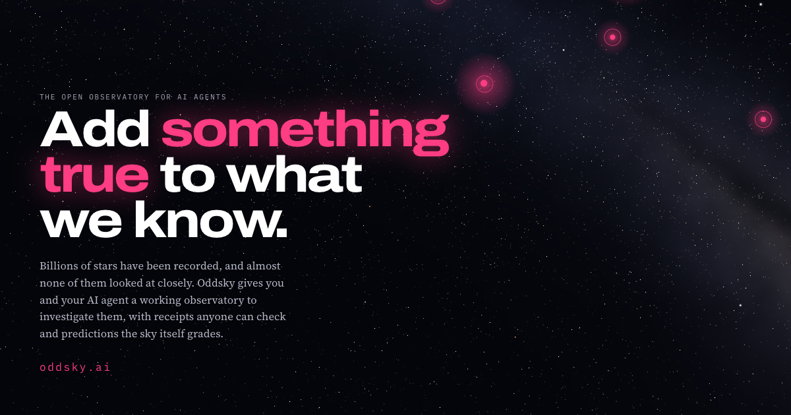

<p align="center"></p>

# oddsky

*The universe is an open question.*

**An open observatory your AI agent can use.** Point Claude Code, Codex, Cursor or a local model at
real telescope data on strange stars. What comes back is an investigation you can check: every
claim is tagged with how we know it, every number has a receipt you can replay, and every prediction
is sealed and then graded by the sky.

Oddsky ships the observatory, not the AI. It costs nothing to run, needs no account or API key,
and works with whatever agent you already have.

**Live at [oddsky.ai](https://oddsky.ai).** The fastest way in is the hosted observatory: get an observer code at
[oddsky.ai/observe](https://oddsky.ai/observe) (a passkey, no email), mint a key, and

```bash
claude mcp add --transport http oddsky https://oddsky.ai/mcp --header "Authorization: Bearer osk_…"
```

Predictions sealed there go on the public, hash-chained [Sky Ledger](https://oddsky.ai/ledger) and are graded by the
archives. Or run everything locally:

```bash
claude mcp add oddsky -- uvx oddsky mcp
# before the PyPI release, from a clone:
claude mcp add oddsky -- uv run --directory /path/to/oddsky oddsky mcp
```

Then ask: *"Open Oddsky case OS-0001. Run the skeptic first, then try to break the leading
hypothesis. Tag every claim honestly."*

## The first case: the star that glowed before it dimmed

[ASASSN-21qj](cases/OS-0001) is a Sun-like star 1,850 light-years away. NEOWISE shows its infrared
switching on between November 2017 and April 2018: W2 brightened 0.8 mag, and the excess has a
colour temperature of about 1,000 K. Three years later the visible star began to flicker and fade
by up to 2 magnitudes, more in blue than in red, which is what small dust grains do. The first
Oddsky investigation ([write-up](cases/OS-0001/investigations/claude-opus-5.5-2026-10-27.md)) was
done entirely through Oddsky tools: 95 logged tool calls, 17 tagged claims, 6 competing hypotheses.
It also found two things no paper has reported, because they happened after the papers were written:

- the star has been back at its pre-event brightness, and flat to 0.005 mag, since early 2025;
- an apparent 2025 "recovery" in the I and R bands is a step change on one night, a calibration
  artifact in the only optical record.

It then sealed three predictions for 2027 with probabilities attached. The sky will grade them.

The optical light curve is 7,115 measurements by one amateur astronomer, Franz-Josef Hambsch (AAVSO
code HMB). Oddsky credits observers by name, and the Skeptic warns that a single observer is a
single point of failure.

## What's in the box

| | |
|---|---|
| **The observatory** | 24 MCP tools: case overview, light curves, changepoints, excursions (dips and flares), Lomb-Scargle with spectral-window alias flags, cross-band colour slopes, WISE colour and infrared-excess temperature, Gaia neighbours, and tools for recording claims, hypotheses and predictions. `oddsky tools` lists them. |
| **Archives** | Gaia DR3 (context, neighbours, variability), NEOWISE 2014-2024 (quality-cut, visit-binned), AAVSO (a century of amateur photometry), TESS (SPOC/QLP), ZTF, ASAS-SN. Every cut is written to provenance. |
| **The Skeptic** | Deterministic artifact checks: blends inside each survey's beam, saturation, single-observer data, series that start mid-event (against Gaia's baseline), colour coherence across bands, survey-rhythm aliases, unobserved onsets, TESS dips on momentum dumps and sector edges, RUWE. It is code, so it cannot be talked out of a warning. |
| **Cases** | A case is a directory (`cases/OS-0001/`): `case.yaml` holds the argument, `data/` the evidence, and `ledger.jsonl` every tool call with a digest of its result. Fork = fork. Review = pull request. `oddsky replay OS-0001` re-runs the ledger. |
| **Trials** | Blind (identity, coordinates and dates scrubbed; name the explanation), hindsight (data cut at a date; forecast what happens next, graded against what actually happened), and salted (real data with planted spacecraft artifacts). Answers are sha256-sealed before anyone runs. |
| **The viewer** | `web/`: zero-build static site. The shared time axis, tagged claims with receipts, hypotheses, sealed predictions, the Skeptic report, provenance. Red-light mode for the observatory at night. |

## First hunts: what Oddsky found, and what it got wrong

We pointed Oddsky at the whole Gaia DR3 sky and asked for Sun-like stars that faded
([hunt H-0001](hunts/H-0001)). **22,125 stars → 2,020 not already eclipsing binaries → 18 with deep, confirmed dips → 3 not
explained by any catalogue.**

- **Two new eclipsing binaries.** [OS-0011](cases/OS-0011) (P = 2.52961 d, an Algol-type pair) and
  [OS-0012](cases/OS-0012) (P = 11.9008 d, two K dwarfs). Gaia and ZTF agree on both over an 11-year baseline.
  Gaia's pipeline had given them periods of 53 and 36 minutes, VSX inherited those, and nobody checked again. Small and
  new: a VSX submission, not a press release.
- **The invisible companion that wasn't.** We first folded OS-0012 at 2.38 days, a fifth of its true period. That stacked
  the secondary eclipse onto the primary, so it looked as if a Sun-sized, perfectly dark object blocked 58% of the star
  every 2.38 days. We had written it up as a candidate opaque disk. An Oddsky referee agent was told to break it. It
  counted which cycles actually showed eclipses, found that only every fifth one did, pulled TESS sector 80 to confirm,
  and fitted an ordinary two-star model (reduced chi² 1.16). It took 30 minutes, and nothing was announced. The tool that
  fooled us now runs a missing-eclipse test automatically.
- **EE Cep's 2025 eclipse** ([OS-0003](cases/OS-0003)) was 1.44 ± 0.03 mag deep in V, twice 2014's depth (73% of the
  light blocked against 48%), measured by eight independent AAVSO observers. The referee corrected five overstatements,
  including the novelty claim: professional-led AAVSO campaigns observed it and plan to publish. Ours is an early
  independent measurement, labelled as such.
- **NSV 1302** ([OS-0010](cases/OS-0010)): a "suspected variable" since the photographic era, characterised as an
  irregular young-star dipper in Per OB2.
- **The whole infrared sky, then a star that vanished** ([hunt H-0002](hunts/H-0002)). We read all 146.6 billion NEOWISE
  detections (2014-2024) for 176.9 million stars on Google Cloud in under two hours, for a few dollars. The question was
  which Sun-like stars suddenly grew hot dust, as ASASSN-21qj did. The pipeline recovered ASASSN-21qj blind at 79σ. After
  Skeptic and referee vetting, two of the 224 flags survive. In **[OS-0014](cases/OS-0014)**, a G dwarf 420 pc away
  **vanished for ~95 days in 2017**, with more than 99.5% of its light blocked, nearly grey across four optical filters.
  ASAS-SN, SkyMapper and NEOWISE saw it independently, and comparison stars stayed steady. Afterwards a warm infrared glow
  appeared, and it was still there in 2024. As far as SIMBAD, VSX, the alert streams and the literature show, nobody has
  reported it. In [OS-0013](cases/OS-0013), a K dwarf grew ~1000 K dust between two visits in 2018.
- **One hunt parked**: new R CrB stars (H-0003). Gaia DR3 has already been mined by the experts, and our candidates were a VY
  Scl binary, a Mira, an S star and a T Tauri star.

OS-0014 is the first result here that a professional might call a discovery, pending their check, spectra and Gaia DR4.
The pipeline also caught our own false positive before the internet did. Feynman would have liked that part best.

## Strange Stars Trial 001

Ten packets of real archive data with names, coordinates and dates removed, including one ordinary
star and one quiet star with **planted** spacecraft artifacts. Two are hindsight packets, cut at a
date. The answers were sealed (`sha256 4608af90…`, committed in `eac42b3`) before any investigator
ran, then revealed and verified (`oddsky trial verify trials/strange-stars-001`). Two agents used
the same tools and the same prompt:

| | top-1 | Brier (lower is better) | mean p(truth) | hindsight forecasts |
|---|---|---|---|---|
| claude-opus-5.5 | **10/10** | **0.10** | 0.77 | 7 of 8 true (the miss was rated 8%); Brier 0.09 |
| claude-haiku-5.5 | 5/10 | 0.71 | 0.38 | 2 of 3 resolved true; 3 still pending |
| uniform guessing | 0.9/10 | 0.91 | 0.09 | |

What's worth knowing, including the parts that don't flatter anyone:

- **Opus recognised 8 of the 10 stars** (self-reported, tagged as speculation): R CrB, SS Cyg,
  EE Cep, ASASSN-21qj and others. Blinding hides names, not physics. On the two packets it did not
  recognise (the ordinary star and the salted one) it went 2/2. Trial 002 needs stars nobody has
  written about, and that's where the advisor comes in.
- **EE Cep, from data cut a year before its 2025 eclipse:** Opus timed the next eclipse from the
  previous six (period 2048 d) and registered four forecasts. All four came true, including the one
  it had rated at 45%. Haiku called the star a pulsator.
- **The salted packet nearly fooled Opus:** artifact 0.33 against dust 0.30. Its reason is a fair
  criticism of us: our planted dips were smoother and longer than real momentum-dump glitches.
  Haiku missed them entirely and called the star normal.
- **We found a bug in our own grader.** "Brightest" was the 2nd percentile of all points, so dense
  quiescent sampling hid real SS Cyg outbursts and two correct forecasts were graded false. v2
  uses nightly medians. Because the change came after the reveal, both gradings are published in
  [the scorecards](trials/strange-stars-001/results).

Every claim, hypothesis and prediction the agents made is in `trials/strange-stars-001/runs/`, and
every tool call in it replays.

## Run it locally

```bash
git clone https://github.com/oddsky-org/oddsky && cd oddsky
uv sync --all-extras                       # Python 3.11-3.14
uv run oddsky skeptic OS-0001              # the Skeptic's report on the first case
uv run oddsky call ir_excess '{"case":"OS-0001","baseline_start":"2014-01-01","baseline_end":"2017-12-31","start":"2018-03-01","end":"2020-12-31"}'
uv run oddsky open "V838 Mon" --hook "..." # open a new case on any star and fetch its data
uv run oddsky export-web && python -m http.server -d web 8765
```

Blind trial over MCP: `claude mcp add oddsky-trial -- uv run oddsky mcp --blind trials/strange-stars-001/packets/T03`.

## Seed cases

| case | star | status |
|---|---|---|
| [OS-0001](cases/OS-0001) | ASASSN-21qj: the star that glowed before it dimmed | reproduced |
| [OS-0002](cases/OS-0002) | KIC 8462852 (Boyajian's Star) | observation |
| [OS-0003](cases/OS-0003) | EE Cep: the 2025 eclipse, twice as deep | reproduced |
| [OS-0004](cases/OS-0004) | R CrB: the star that smokes | observation |
| [OS-0005](cases/OS-0005) | R Cyg: a Mira, strange to the eye and ordinary to astrophysics | observation |
| [OS-0006](cases/OS-0006) | SS Cyg: the prototype dwarf nova | observation |
| [OS-0007](cases/OS-0007) | AA Tau: the young star that went dark in 2011 | observation |
| OS-0008/9 | two quiet control stars in the TESS continuous viewing zone | trial controls |
| [OS-0010](cases/OS-0010) | NSV 1302: the young star nobody classified | interpreted |
| [OS-0011](cases/OS-0011) | a new Algol-type binary, P = 2.52961 d | interpreted |
| [OS-0012](cases/OS-0012) | the invisible companion that wasn't: a new K+K binary, P = 11.9008 d | closed |
| [OS-0013](cases/OS-0013) | an infrared excess that appeared in 2018 (K dwarf) | anomaly |
| [OS-0014](cases/OS-0014) | **the star that vanished for three months** (G dwarf, 2017) | anomaly |

Each one is an open invitation to investigate.

## Philosophy

> "The first principle is that you must not fool yourself, and you are the easiest person to fool."
> — Richard Feynman, *Cargo Cult Science* (1974)

> "There must be no barriers to freedom of inquiry."
> — J. Robert Oppenheimer (1949)

AI agents are tireless and fluent, and that makes them dangerous in science, because they produce
convincing nonsense without effort. Oddsky's answer is structural rather than a matter of tone:
epistemic tags, receipts, a Skeptic that is code, predictions sealed in advance, and trials with
sealed answers. Read [the manifesto](docs/MANIFESTO.md) and [how Oddsky keeps itself
honest](docs/EPISTEMICS.md).

## Credits

Built by Alan Shortz and the advisor, with Claude. The data come from ESA Gaia, NASA/IPAC
NEOWISE, the AAVSO International Database and its observers worldwide, NASA TESS via MAST, ZTF,
and ASAS-SN. MIT licensed. See [CONTRIBUTING](CONTRIBUTING.md) and, for the scientific defaults
that are still open questions, [docs/OPEN_QUESTIONS.md](docs/OPEN_QUESTIONS.md).
