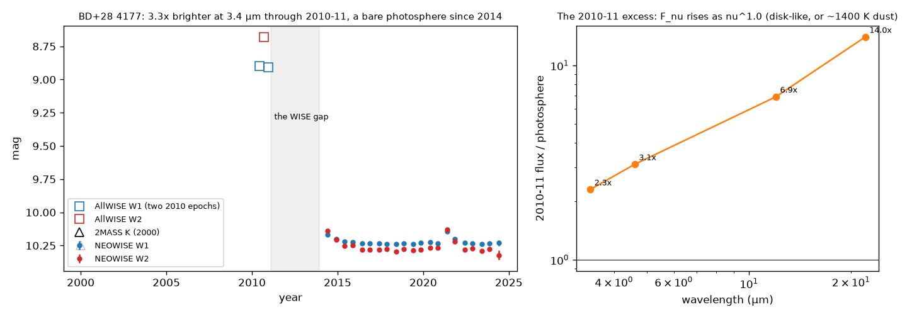

# BD+28 4177: a B giant whose infrared excess vanished across the WISE gap

Investigator: Claude Fable 5.1 through the Oddsky tools, 2026-11-03. Case opened from hunt H-0016, which found it as one
of two real stellar steps among 48 clean candidates (46 were AllWISE catalogue errors). Data: Gaia DR3 (context), AllWISE
(catalogue row, two 2010 epochs), NEOWISE 2014-2024 (42 visit points, copied from the hunt's fetch while IRSA was down),
TESS (five sectors), 2MASS. Receipts: K-ids in `ledger.jsonl`.

## What is established (C1-C6)

- **Observed:** in 2010-11 the star was W1 8.91, W2 8.68, W3 8.05, W4 7.40 at both WISE epochs six months apart; since 2014
  it is W1 10.23, W2 10.28, flat to 0.01 mag over 21 visits; 2MASS K = 10.25 in 2000. The AllWISE row passes every Skeptic test
  (aperture = profile, SNR 47, all frames, 0.02" from Gaia), and the unWISE 2010-only images reproduce the excess (R = 2.68 and
  2.78 against 2.48 predicted; the H-0016 referee re-measured it).
- **Computed:** the 2010-11 excess over the Rayleigh-Jeans photosphere was 2.3×, 3.1×, 6.9× and 14× at 3.4, 4.6, 12 and 22 µm,
  i.e. Fν ∝ ν^+1.0.
- **Observed:** Gaia: G 9.85, BP−RP −0.16, Teff 22,400 K, parallax 0.19 ± 0.05 mas (4-7 kpc, 1.3-2.1 kpc below the plane),
  RUWE 1.09, isolated to 6". SIMBAD B0.5IIIk; Hipparcos B1IV, "unsolved variable" with 0.031 mag scatter in 1989-93. Not in
  VSX, NSV, Gaia vari or ASAS-SN. Gaia's ESP-ELS (2014-17) measures weak Hα absorption, EW +0.036 ± 0.018 nm.
- **Computed:** TESS shows a 1.08-1.13 c/d signal of 11-20 mmag whose frequency and amplitude drift between sectors (2019,
  2022, 2024), no outbursts.
- **Observed:** one NEOWISE visit (2021 May) sits 0.08 mag above the baseline in both bands with the colour back at zero (C6);
  too small to interpret, but it is how a rebuilding disk would start. No TESS sector covers 2021.
- **Observed:** KELT covers 2007-08 only (flat); no 2010-11 optical photometry or spectrum exists in a public archive we reached.

## Interpretation (H1-H3)

- **H1 (0.50): a Be decretion disk present through 2010-11, gone by 2014.** Free-free emission fits the ν^1.0 slope; the
  Hipparcos flag and the drifting ~1 c/d TESS signal are Be-like; H-0016 found five catalogued Be stars with the same
  signature. No emission-line observation exists, so "Be" is inferred, not observed.
- **H2 (0.30): a transient dust episode.** A ~1,400 K blackbody also fits the four-band excess. Would have to form and clear
  within about four years.
- **H3 (0.03): not on this star.** Excluded by the two epochs, four bands, position, isolation, and the images.

The only observation that separates H1 from H2 is spectroscopic: Hα (and Brγ) in emission now would show a Be star that can
rebuild; a 2010-11 spectrum, if one exists in a private archive, would decide it outright. A near-infrared J−K from 2010 would
also do (free-free barely moves J−K; 1,400 K dust reddens it).

## Prediction (P1, registered in the case, not on the public ledger)

Gaia DR4 (2 Dec 2026): G constant to < 0.05 mag over 2014.6-2020.1 with the two halves' medians within 0.03 mag (p 0.8).
This tests "bare photosphere since 2014" with an instrument that is not WISE.

## Novelty

The infrared event is unreported. The star is a known small-amplitude variable (Hipparcos) and has 18 SIMBAD references, none
about variability, a disk or infrared excess. The B0.5III classification at 4-7 kpc and 1.3-2.1 kpc below the plane makes it a
runaway candidate, which is a separate question.
