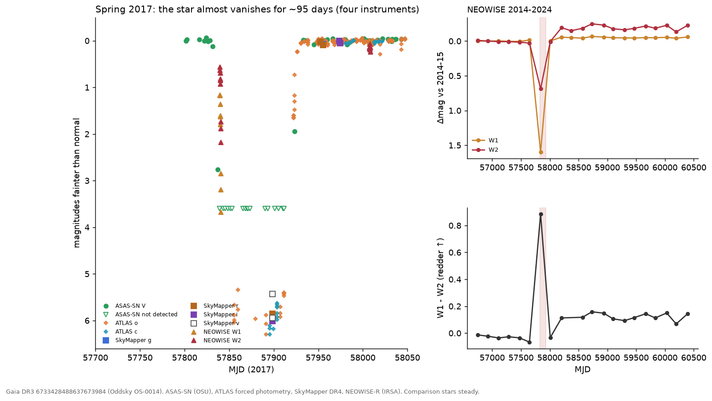

# For the advisor: a G dwarf that vanished for three months (Oddsky OS-0014)

**One line.** Gaia DR3 6733428488637673984 (2MASS J18330620−3607130, TIC 313603515; J2000 18:33:06.21
−36:07:13.05; G = 12.46, BP−RP = 0.80, ~420–426 pc, M_G ≈ 4.3, Teff ≈ 6000 K) was occulted in spring 2017.
It was fainter than normal for about 95–105 days, more than 3 mag fainter for at least 72 days, and ≥ 99.3% blocked
(5.4–6.0 mag, nearly grey in g/r/i/v) at mid-event. Afterwards its W1−W2 colour reddened by ~0.15 mag and
stayed so to 2024. As far as we can find, nobody has reported either.

## What is measured (all in `cases/OS-0014`; fact-checked against the data on 2026-10-27)

| | |
|---|---|
| Onset | ASAS-SN: normal on MJD 57828.4, −11% on 57831.35, V = 15.46 (−2.76 mag) on 57837.41 |
| Infrared ingress | NEOWISE single exposures, MJD 57839.9–57840.9 (9 exposures after cuts): W1 from 1.13 to 3.65 mag down, W2 from 0.41 to 2.03 mag down. The occulter is more transparent at 4.6 µm |
| Deep phase | ASAS-SN: undetected on 17 epochs, MJD 57839.3–57911.4 (each V > 15.7, i.e. ΔV > 3.0; stacked forced flux ΔV > 4.1 mag at 3σ) |
| Depth | SkyMapper DR4, 2017-05-25 (MJD 57898.6), at the star's position: g 18.58, r 18.30, i 18.31, v 19.13 and 19.65, i.e. 5.4–6.0 mag down. ATLAS: at most 0.3–0.7% residual flux through the deep phase |
| Recovery | V = 14.64 on MJD 57923.3; normal (12.68) by 57933.3 |
| Controls | 8 ASAS-SN comparison stars within 0.14 mag (median flux ratios 0.995–1.012); SkyMapper field zero points within 0.006 mag; no Gaia alert (nearest Gaia16bnn, 1.07° away). TNS: not yet checked |
| Afterwards | Optical: about 0.05 mag *brighter* than before (ASAS-SN 12.700 → 12.648; SkyMapper +0.04–0.07 mag in all filters). Infrared: W1−W2 redder by ~0.15 from late 2017 to 2024 (onset between MJD 58008 and 58204, i.e. 3–9 months after recovery). Excess fractions and the ~650 K colour temperature depend on whether the photosphere also brightened in the IR, so they are not robust |
| Before | Photospheric: AllWISE 2010 W1−W3 = −0.18 ± 0.16; NEOWISE 2014–2017 flat |
| Binary? | Gaia DR3 RV variable (robust amplitude 51 km/s, 7 transits), RUWE 1.15, duplicated_source = 1. TESS: a ~1.8-d signal on the star in Sector 13 (2019), weak in Sectors 66/93/104 |
| A century of plates | DASCH DR7: 2,348 plates, 1889–1989; no clear repeat except possibly 1924 (next row). A 95-d vanishing would have been caught 46% of the time; periods < 12.9 yr excluded; 97.6% of 1–30 yr excluded; ~93 yr and ~46.5 yr allowed |
| 1924? | Three ax plates (1924 Apr 30–May 14) miss the star in a 296-d gap. On ax 488 (Apr 30, limit 14.4) every comparison star from 12.9 to 13.9 mag is detected and only the target is missing; it falls 93.0 yr before 2017, inside the allowed ~93-yr window. Not plate quality as far as the data show (corrected 2026-10-28). **Worth an expert's eye on the plates** |
| ATLAS 2016–2026 | Independent confirmation (fourth instrument): at most 0.3–0.7% of normal flux in c and o, MJD 57856–57911 (≥ 99.3% occulted); egress resolved, 22% → 80% → 95% over MJD 57922–57930. No repeat in 2018–2026 (~940 nights, scatter 2–3%) |

## What we think (and don't)

- **Geometry:** blockage went from 11% to 92% in 6 days, about 0.7 stellar diameters for a sharp edge, so the occulter
  moved at ≳ 2 km/s and is ≳ 0.1 AU across. Requiring it to be smaller than its orbit gives a ≳ 1.4 AU; a circular
  orbit at that speed gives a ≲ 250 AU. A soft (dusty) edge, which the infrared ingress suggests, means a higher
  speed and a closer orbit.
- **Leading idea:** an extended, mostly opaque dusty body (a disk or dust structure around an unseen companion,
  cf. ε Aur, EE Cep) crossing a possibly binary G dwarf. A dust cloud from a collision remains possible. The later
  W1−W2 reddening may trace the same material; no causal link is claimed.
- **Ruled out by the referee:** instrumental causes (three independent surveys, steady comparisons), blends (the
  centroid is on the star; no neighbour bright enough), and an eclipse in a 1.8-day binary (it can't last 95 days).

## What only you can judge or arrange

1. Is the interpretation sound, and is it worth a spectrum? Lithium (age), Hα (activity/accretion), Na D (gas) and
   2–3 RV epochs (the binary).
2. Mid-IR or SPHEREx spectra of the infrared change; Gaia DR4 (Dec 2026) epoch photometry and RVs cover 2017 directly.
3. A look at the 1924 DASCH plates (ax 488, 528, 535) by someone who knows plate defects.
4. Co-authorship on the draft Research Note (`docs/papers/RNAAS_OS-0014_draft.md`), and whether STScI needs to clear it.

The second, weaker candidate is OS-0013, a K3 dwarf whose ~1000 K infrared excess appeared abruptly in 2018; see its case.
