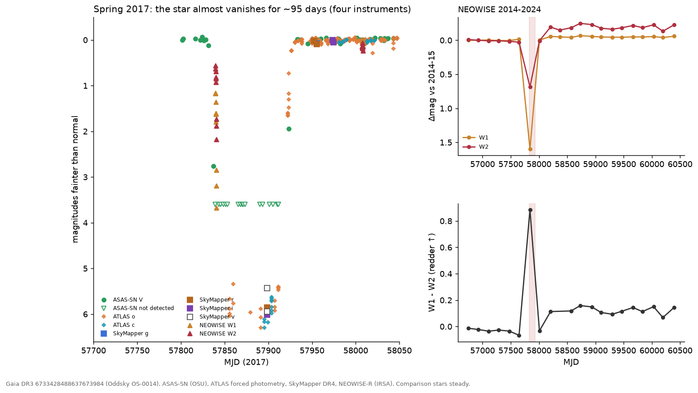
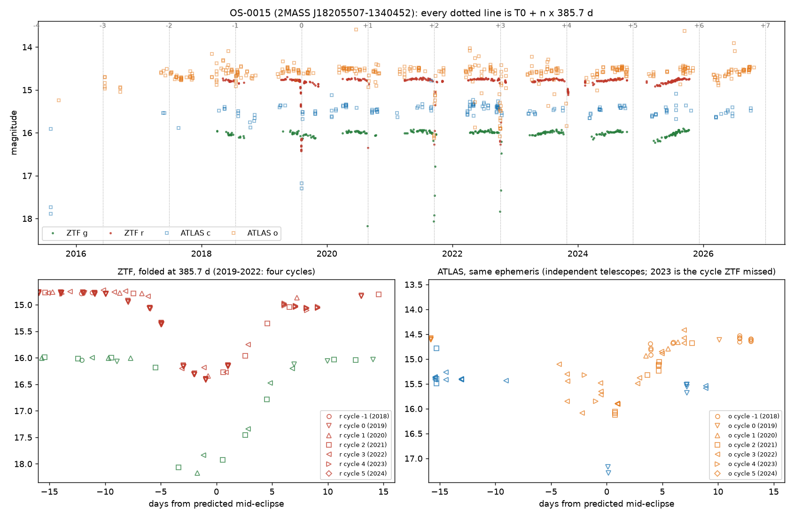
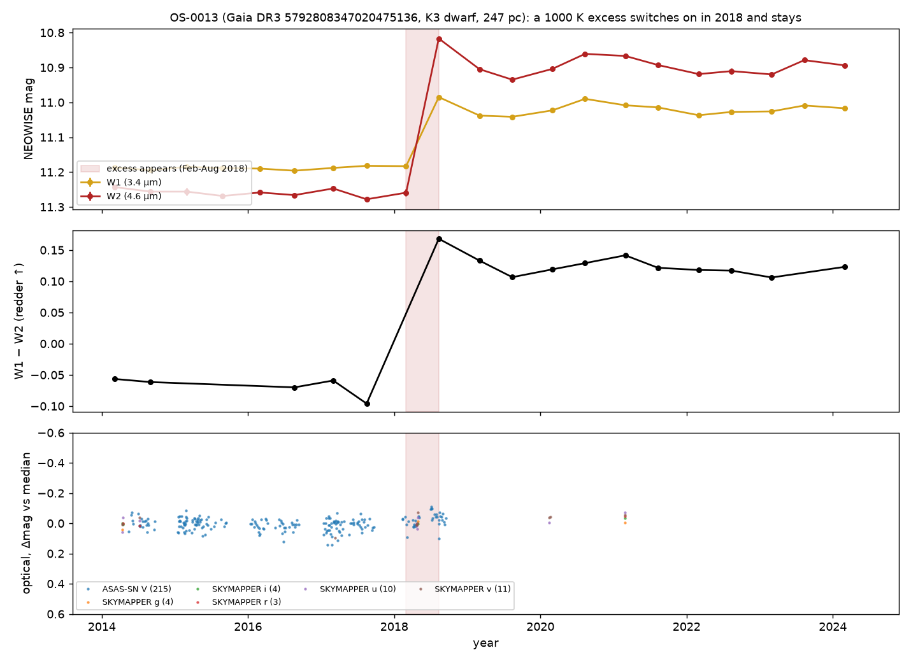

# Oddsky: Three candidate circumstellar dust events in public survey archives

*A 95-day near-total occultation of a G dwarf in 2017, two- to three-week dust eclipses on a 385.7-day orbit, and a 1000 K excess that appeared around a K dwarf in 2018. Oddsky cases OS-0014, OS-0015 and OS-0013.*

Alan Shortz, 27 October 2026; revised 28 October 2026 (corrections listed at the end).

## Introduction

For most of history astronomy was limited by light, how much a telescope could gather, and how often it could look. That limit has quietly fallen. Gaia has charted 1.8 billion stars, NEOWISE photographed the whole sky every six months for a decade, ZTF, ATLAS and TESS watch it night after night, and nearly all of it is public. What is scarce now is attention: most of that record has never been looked at closely by anyone, and whatever is in it stays unknown until someone does.

Oddsky is the open-source observatory I have been building to supply that attention. A curious person, using an AI agent as the instrument, can look closely at stars no one has examined and leave behind work that others can check. The tools make attention cheap, so what matters now is where and how that attention is directed.

Fundamentally, the three stars in this brief are the first stress test of the central idea. The question Oddsky exists to ask is whether an interested amateur (such as myself) armed with these increasingly capable AI tools can add something true to what is known. If at least one of these survives your scrutiny, then the premise holds, and that is very exciting. If none does, great. Back to the drawing board we go! Thanks in advance for taking the time. As Feynman said, "The prize is the pleasure of finding the thing out, the kick in the discovery, the observation that other people use it [my work], those are the real things."

The full light curves, provenance and referee reports are on the case pages at oddsky.ai and in the attached review kit; you will have repository access as well.

## OS-0014: a G dwarf that vanished for three months

Gaia DR3 6733428488637673984 (2MASS J18330620−3607130, TIC 313603515; 18:33:06.21 −36:07:13.05; G = 12.46, BP−RP = 0.80, 420 pc, M_G ≈ 4.3, T_eff ≈ 6000 K, an F9–G0 dwarf) was occulted in spring 2017. It was fainter than normal for about 95–105 days, more than 3 mag fainter for at least 72 days, and at least 99.3% blocked through the deep phase, nearly grey across four optical filters. Four instruments saw it independently. Three to nine months later its W1−W2 colour reddened by about 0.15 mag and has stayed so through 2024.

### Observations

| Measurement | Result |
|---|---|
| Onset | ASAS-SN V: normal (12.70, rms 0.015) through MJD 57828.4; −10% on 57831.3; V = 15.46 (−2.76 mag) on 57837.4 |
| Infrared ingress | NEOWISE single exposures, MJD 57839.9–57840.9, 14 exposures over one day: W1 from 1.13 to 3.65 mag below baseline, W2 from 0.41 to 2.03. The occulter is more transparent at 4.6 µm. Field stars in the same frames steady; the star lands on different detector positions in successive scans |
| Deep phase | ASAS-SN: 17 non-detections, MJD 57839.3–57911.4 (each V > 15.7; stacked forced flux ΔV > 4.1 mag at 3σ). ATLAS forced photometry: at most 0.3–0.7% of normal flux in c and o from MJD 57856 to 57911 (nightly medians on unsubtracted images; Gaia neighbours within 6″ carry 0.5% of the flux, so this is an upper limit on the star) |
| Depth | SkyMapper DR4, 2017-05-25 (MJD 57898.6), at the star's own Gaia position (within 0.3″): g 18.58, r 18.30, i 18.31, v 19.1–19.7, i.e. 5.4–6.0 mag down, nearly grey |
| Egress | ATLAS: 22% of normal flux on MJD 57922, 80% on 57926, ~95% by 57930. ASAS-SN: 14.64 on 57923.3, normal (12.68) by 57933.3 |
| Controls | 8 ASAS-SN comparison stars within 0.14 mag on the same nights; 18 NEOWISE field stars within 150″ steady to 0.01–0.02 mag; SkyMapper field zero points within 0.006 mag; WISE centroid shift 0.011 ± 0.011″ (any contaminant must be within 0.3″); no Gaia alert |
| Before | Photospheric: AllWISE 2010 W1−W3 = −0.18 ± 0.16, Ks−W1 = 0.02; NEOWISE 2014–2017 flat |
| After | Optical about 0.05 mag brighter than before (ASAS-SN and six SkyMapper filters). W1−W2 redder by ~0.15 from an onset between MJD 58008 and 58204, persisting to 2024. If the photosphere also brightened in the infrared, the W1 excess vanishes and W2's drops to 14–19%, so no excess fraction or temperature is quoted as a result (a naive blackbody gives ~650 K at ~0.24 AU) |
| Multiplicity | Gaia DR3: RV robust amplitude 51 km/s from 7 transits, RUWE 1.15, duplicated_source = 1. TESS: a ~1.8-d, 1.2–1.6% signal in all four sectors (13, 66, 93, 104), whose pixels centre on the star only in Sector 13; TIC contamination 0.41, so not securely on the target |
| A century of plates | DASCH DR7: 2,348 plates 1889–1989, star detected on 1,176 (median 13.30). A 95-day vanishing would have been caught 46% of the time; apart from 1924, none was. Phased on 2017, DASCH + ASAS-SN + NEOWISE exclude every period under 12.9 yr and 70% of 1–130 yr; ~93 and ~46.5 yr remain allowed. **1924 (corrected):** three plates (Apr 30–May 14) miss the star. On the deepest, ax 488 (1924 Apr 30, limit 14.4), every comparison star from 12.9 to 13.9 mag is detected and only the target is missing. It is the only deep plate in the century to miss the star with no detection within 50 days, and it falls 93.0 yr before 2017, inside the allowed ~93-yr window. Not explained by plate quality; not yet inspected by eye |
| 2018–2026 | ATLAS: no repeat over ~940 nights (scatter 2–3%), except in the yearly conjunction gaps |

### Interpretation

Blockage rose from 11% to 92% in six days, about 0.7 stellar diameters for a sharp edge, so the occulter moves at ≳ 2 km/s and is ≳ 0.1 AU across. Requiring it to be smaller than its orbit puts a ≳ 1.4 AU; a circular orbit at that speed puts a ≲ 180–270 AU. A soft, dusty edge, which the chromatic infrared ingress suggests, means a higher speed and a closer orbit. None of this is a measurement of the orbit; it is what the sharp-edge model allows.

The simplest reading is an extended, mostly opaque dusty structure, such as a disk around an unseen companion, crossing the star: the ε Aur / EE Cep / Gaia17bpp configuration on a field G dwarf. A debris cloud from a collision is not excluded. The later W1−W2 reddening may be the same material seen afterwards; no causal link is claimed.

The referee excluded instrument artifacts (three surveys, a fourth, ATLAS, added since; steady comparison stars, a smooth fade across detector positions), blends (the centroid stays on the star and nothing bright enough lies within 15″), an eclipse in a 1.8-day binary (it cannot last 95 days), a Be star, and a background AGN, and put the probability that both phenomena are astrophysical and belong to this system at 97% or more.

## OS-0015: a dust-shrouded star that goes dark for two to three weeks every 385.7 days

Gaia DR3 4152421080966024704 (2MASS J18205507−1340452; 18:20:55.07 −13:40:45.1; G = 14.76, BP−RP = 2.01, 2.4 kpc, RUWE 1.81; l = 17.3°, b = +0.4°, 4″ from IRAS 18180−1342) is steady to 0.1–0.2 mag and then goes dark by 1.5–2.2 mag for two to three weeks, four years running, on a clock good to a day. The eclipse is deeper in blue, has no secondary, and changes depth by a few tenths of a magnitude from orbit to orbit. ZTF found it; ATLAS, with different telescopes and a different pipeline, shows the same eclipses on the same ephemeris, including the 2023 one that fell in a ZTF gap.

### Observations

| Measurement | Result |
|---|---|
| Ephemeris | Four full-depth ZTF eclipses, mid-times MJD 58701.6, 59088.6, 59473.9, 59858.8 (Aug 2019, Aug 2020, Sep 2021, Oct 2022): P = 385.7 ± 0.5 d, T0 = MJD 58702.2, O−C within 0.7 d. The events advance 20 days a year through the observing season, which no seasonal systematic can do |
| Shape | FWHM 7.9 d; about 19–25 d wide at 0.05 mag, so first to last contact is at least ~18 d and probably longer. Ingress ~9 d, egress up to ~14 d. In 2019, in-eclipse nights carry 5–9 ZTF exposures agreeing to 0.01–0.02 mag |
| Depth | r: 1.64, 1.58, ≥ 1.5, 1.50 mag; g: 2.19, ≥ 2.08, 1.84 mag; i: ≥ 1.4 (2020, one flagged point; the unflagged 0.59 is in ingress). The 2022 eclipse is flat-bottomed and 0.35 mag shallower in g. d(g)/d(r) = 1.30 on 253 same-day pairs (ISM dust ≈ 1.4, grey = 1.0) |
| Independent check | ATLAS 2015–2026 (613 good exposures in a crowded field): cycle 0 at 1.8 mag in cyan at mid-eclipse; cycle 2 at 1.5 mag in orange one day after mid-eclipse, nearly recovered by +8 d; cycle 3 sampled on eight nights from −4 to +7 d; cycle 4 (2023, unseen by ZTF) caught in ingress at −2 and −1 d, 0.8 and 1.3 mag deep, on time to about ±2 d. Flagged ATLAS points also show dimming on the ephemeris in 2016–2018, which would extend the baseline to seven or eight cycles if the flags prove harmless; two 2015 cyan points 2.3 mag faint are off the ephemeris and unexplained. No ATLAS data within 25 d of the 2024 and 2025 eclipses (conjunction season) |
| Aliases | P/2, 365.25 d and 182.6 d leave the odd cycles flat; 2P and 3P put full-depth events at phases 0.51 and 0.67. Nothing but 385.7 d works |
| Secondary | None deeper than 0.09 (r) / 0.14 (g) mag within ±8 d of phase 0.5. Near phase 0.4 a slow, dust-coloured dimming recurs: 0.11 (r) / 0.14 (g) mag in 2024 and 0.14 / 0.20 in 2025. A secondary on an eccentric orbit, away from phase 0.5, is suggested, not excluded |
| Baseline | Not flat: out-of-eclipse nightly medians cover 0.17 (r) and 0.23 (g) mag (2–98%), season medians drift 0.04–0.07 mag, and g and r move together with slope 1.31, the same as in eclipse (1.30). Gaia DR2 saw a 0.22 mag range in 2014–2016 and flagged it as an LPV candidate (Mowlavi et al. 2018); ATLAS (Heinze et al. 2018) lists it as a "dubious" variable with a 407-d, 0.15-mag long-period fit. Neither reports eclipses |
| Artifacts and blends | 50 in-eclipse epochs with clean flags; airmass, limiting magnitude, chi, sharp and zero-point rms match the quiet nights; both ZTF programs record eclipses; the centroid moves 0.06″; neighbours at 8.2″, 17″ and 17.9″ constant to 0.01–0.02 mag on every eclipse night. The only Gaia source inside the ZTF PSF is a G = 18.5 star 3.0″ away with 3.3% of the flux (K = 16.1 against 9.5 for the target in 2MASS). UKIDSS shows two K = 13.3–13.6 sources at 4.0–4.4″ with no Gaia counterpart (embedded) |
| The star | 2MASS J−H 1.08, H−K 1.03; WISE W1–W4 = 7.95, 7.17, 4.21, 2.90 (K−W1 1.6, W2−W3 3.0): a Class II SED (SPICY candidate YSO, Kuhn et al. 2021; Robitaille et al. 2008 red source; Tisserand et al. 2020 WISE R CrB candidate). Dereddened at A_V = 3–4, M_G = +0.4 to −0.5; Gaia DR2 M_bol = 1.5 ± 0.7; so L ~ 20–100 L☉ and R of order 10 R☉ (≲ 10 R☉ if T_eff ≳ 5,800 K; ~20 R☉ at 4,000 K). RUWE 1.81 (astrometric excess noise 0.29 mas, 19.6σ) is what a 0.4 mas photocentre wobble on a 1 AU orbit at 2.4 kpc would do |
| NEOWISE | W1 and W2 are 0.09–0.12 mag brighter within ±60 d of eclipse phase than at phases 0.55–0.75, in both even and odd cycles; W1 also fades secularly (0.024 mag/yr). Two visits a year, no visit inside an eclipse: a lead, not a result |

### Interpretation

For M_tot = 1, 2, 3 M☉: a = 1.04, 1.31, 1.50 AU and v_rel = 29, 37, 42 km/s, so 18 d of contact is a chord of 65, 82, 94 R☉ (more if contact lasts longer, as the 0.05-mag width suggests), and that chord is R_star + R_occulter. The eclipse is translucent and chromatic (τ_r ~ 1.5), so the dust covers the whole stellar disk and R_occulter ≳ R_star. That requires a small primary, and the luminosity says it is one. The depth changing by 0.2–0.4 mag between orbits means a clumpy, evolving dust structure, not a rigid opaque disk.

Two readings remain, with equal weight. In the first, a companion on a 386-d orbit is wrapped in a translucent dust structure: EE Cep or ε Aur at a one-year period, on a star that may be a low-luminosity giant. In the second, a young binary (Class II SED, star-forming region) has a warped or clumpy inner disk that occults the primary once per orbit, a long-period relative of KH 15D. The first draft said "red giant eclipsed by something 80 solar radii wide"; the referee retracted both halves, and this brief follows the referee.

Excluded: a seasonal ZTF systematic (both programs, clean metadata, constant neighbours, a 20 d/yr drift against the calendar); R CrB-type dust puffs (strict periodicity, O−C under 0.7 d over four cycles); blends; P/2, 2P, 3P and the one-year aliases. The referee's estimate that a mundane explanation remains is about 5%.

Two predictions are sealed (hash-logged before the fact), both checked against ZTF r: the star stays within 0.5 mag of maximum through the 2027 season (p = 0.7), and it is ≥ 1 mag faint on at least one night between 2027-12-31 and 2028-02-05, the eclipse predicted for 2028 January 17 ± 18 d (p = 0.75). **Correction:** the December 2026 eclipse falls at solar conjunction, and so, I have since found, does the January 2028 one. The star is 10–41° from the Sun across that window (24° at mid-eclipse), and ZTF has never observed it closer than 39°. The second prediction is therefore very likely unresolvable as sealed, and both depend on ZTF releasing 2027–28 data. They stay sealed as written; I am saying so now rather than after the window. February 2029 (43° from the Sun) is marginal; February 2030 (64°) is the first comfortably observable eclipse.

## OS-0013: a K dwarf that grew hot dust in 2018 and still has it

Gaia DR3 5792808347020475136 (14:43:51.9 −76:11:46; G = 13.52, 247 pc, a K3 main-sequence dwarf with no pre-main-sequence overluminosity; lithium untested) was photospheric in the infrared from 2010 to early 2018. Between two NEOWISE visits (2018 Mar 1 to Aug 11) its W1 and W2 rose by 0.17 and 0.36 mag, a step of more than 30σ against 27 field stars, and the excess, with a colour temperature near 1000 K and a fractional luminosity of about 2%, was still there at the last NEOWISE visit, in early 2024. The optical light curve shows no dip across the onset; ASAS-SN has a 0.1-mag brightening on four nights inside the onset window that its comparison star does not share, unexplained. This is the ASASSN-21qj signature (infrared first) without, so far, the optical event.

### Observations

| Measurement | Result |
|---|---|
| The step | NEOWISE visit medians: W1 11.19 → 11.02, W2 11.26 → 10.90 (first post-step visit brightest, then a plateau at W2 10.86–10.94 into early 2024). Onset between MJD 58178.5 and 58341.7 |
| Controls | 27 field stars within 300″ (W2 9.5–12.5) change by +0.006 (W1) and +0.014 (W2) mag with robust scatter 0.005; per-visit zero points within ±0.02 mag; the WISE centroid moves 0.013 ± 0.008″ across the step (any contaminant within 0.2″); rchi2 changes little (W2 median ~1.3 → ~1.5); no saturation; nb = 1 throughout |
| Neighbours | unWISE W1-only source 7.4″ away at 5% of the flux; AllWISE sources at 13″, 16″ and 32″ are each flat across 2018 (dW2 ≤ 0.03); any of them supplying 39% of the W2 flux would drag the centroid by > 2″ |
| Before | AllWISE 2010 epochs equal the 2014–2017 baseline; W1−W3 = 0.17 ± 0.10 and Ks−W1 = 0.06, photospheric for K3V |
| The star | GSP-Phot A_G = 0.24: M_G0 = 6.31, (BP−RP)0 = 1.17, log g 4.58, on the K3V main sequence with no pre-main-sequence overluminosity. UVW = (−24, −18, −3) km/s, more than 12 km/s from Chamaeleon, ε Cha and LCC. RV −0.5 ± 1.9 km/s from 17 transits |
| Energetics | Excess colour W1−W2 ≈ 0.86 → T ≈ 1045 K for a blackbody; L_IR/L* ≈ 0.02; emitting area ≈ 8 stellar disks; equilibrium distance ≈ 0.035 AU for L ≈ 0.25 L☉. Sustained for six years, that fractional luminosity is extreme-debris-disk territory (ID8, BD+20 307, ASASSN-21qj) |
| Optical | ASAS-SN V 13.41 (blended; the star alone is V ≈ 13.9), robust scatter 0.036, no dip from MJD 58160 to 58378; a gap at 58243–58300 (35% of the onset window) and four points on 58300–58306 about 0.1 mag bright (~3σ each; the comparison star moves −0.02); SkyMapper on MJD 58232 (inside the onset window) matches 2014 in u, v, g, r to 0.03 mag. TESS (2019–2025): the star supplies only ~21% of the aperture flux (TIC contamination ratio 3.78), so only deep dips, tens of percent of the star's light, are excluded; the two 2026 sectors carry scattered-light ramps and are uninterpretable |
| Catalogues | VarWISE (Paz et al. 2026) lists the WISE variability with amplitudes 0.18/0.375 and classifies it "lpv", which a K3V dwarf cannot be. SIMBAD and VSX: a rotational variable, nothing more. The step-plus-reddening interpretation is new |

### Interpretation

The referee could not attribute the step to the instrument, the field, a neighbour, or a moving or new source: it is real, astrophysical, and within 0.2″ of the K dwarf, with about 93% confidence (an unresolved companion carrying the dust gets about 10% of that). The variability itself was in a catalogue under the wrong label; the interpretation is the new part.

What the dust is remains open. Two-band photometry cannot separate freshly made circumstellar dust (a collision or a large impact) from other dusty phenomena, for example ejecta after a planet engulfment. The flat optical record favours optically thin dust seen from outside its plane, so the ASASSN-21qj-style dimming may never come.

The weakness is that only NEOWISE has measured the excess, so there is no second-instrument confirmation of it yet, only of the photosphere's constancy. SPHEREx (public since 2025, 0.75–5 µm) can provide one, and it is the next thing to fetch. That is why it sits below the other two despite the cleaner physics.

## Open questions

Four questions, one per star and one overall. Everything else (spectra, plates, proposals, who to tell) follows from your answers, and I would rather not spend your time on logistics before you have said whether the physics holds.

One thing to know before you answer: this is the test of the whole idea, not just of three stars. The question Oddsky exists to ask is whether an interested amateur with these tools can add something true to what is known, in a form a professional can check. If at least one of these survives you, the premise holds and the implications are worth taking seriously. If none does, that is also an answer, and the right response is to go back to the drawing board rather than to polish the write-up. A polite verdict is the only one that tells me nothing.

1. **OS-0014.** A near-total, 95-day occultation of a field G dwarf, possibly repeating on a ~93-yr orbit (1924), by something dusty at AU scale, followed months later by a persistent warm excess: is that a physically coherent system to you, or does the combination point somewhere else (an engulfment, a transient disk, a line-of-sight cloud)?
2. **OS-0015.** A 20–100 L☉ star with a Class II SED in a star-forming region, eclipsed for two to three weeks once per 385.7-day orbit, with a possible shallow secondary near phase 0.4, by translucent, reddening dust whose depth changes from orbit to orbit: evolved binary with a circumsecondary disk, young binary with a warped circumbinary disk, or a third thing not considered here?
3. **OS-0013.** A 2% fractional luminosity at ~1000 K appearing around a K dwarf with no sign of youth within six months and holding for six years, with no optical dip: is this the giant-impact afterglow class (ID8, P1121, BD+20 307), and if not, what is it?
4. **Overall.** Would you put your name on any of these, and in which order? If yes to any, name the single observation you would want first and I will go and get it. If no, say which assumption you would attack, and I will attack it before anyone else sees this.

One statement rather than a question: OS-0015 came out of Tisserand and Karambelkar's published candidate list. I plan to tell them before anything is submitted. If that is the wrong protocol, stop me.

## Methods

OS-0014 and OS-0013 came from a pass over 146.6 billion NEOWISE detections of 164.7 million stars above Galactic latitude 10°, asking which Sun-like stars suddenly grew warm dust (the ASASSN-21qj signature; the pass recovered ASASSN-21qj blind at 46σ). A bug in the first run, found and fixed on 28 October, merged neighbouring stars' visits; the fixed re-run tests 35% more stars and finds the same two survivors. OS-0015 came from re-screening the WISE-selected R CrB candidates of Tisserand et al. (2020) for their first recorded declines: of 2,356, 1,954 remained after removing known and spectroscopically classified stars, and the 887 north of −30° were screened in ZTF (2018–2025; 473 had usable light curves); it is not an R CrB star, and no new R CrB star has been confirmed yet (the southern half is still queued on ATLAS).

Every claim carries a tag (observed, computed or inferred) and, where a tool produced it, the ids of the logged calls; `oddsky replay` re-runs the whole ledger and fails if any number changed (all three ledgers replay exactly as of 28 October). Some referee checks (field stars, centroids) ran outside the tools; for OS-0013 and OS-0014 their inputs are now archived with the case. The Skeptic runs first. Then a referee pass, run independently of the investigation with the mandate in `docs/REFEREE.md`, attacks aliases, artifacts, blends, "no X" claims, physical self-consistency, novelty and untapped data, and writes a report that must be answered claim by claim. All three reports are in the case directories, and each changed its case materially: OS-0015 lost its "red giant" and gained a fourth eclipse, OS-0014's referee found the event stronger than the first draft said, and OS-0013's referee found the variability already catalogued under the wrong class.

Not yet done: no images have been inspected by a human; no spectrum exists for any of the three stars; the OS-0014 DASCH detection-efficiency numbers assume repeats look like 2017; and the OS-0015 luminosity rests on Gaia DR2's bolometric estimate and an assumed extinction. All of the underlying data are public archives; the hosted observatory at oddsky.ai, or the repository, reproduces any number here from them in minutes. Gaia DR4 lands on 2 December 2026 and covers mid-2014 to early 2020 for all three stars (for OS-0014, Gaia's DR3 photometry shows it did not sample the dip before 28 May 2017, so DR4 can add at most the last week of the deep phase and the egress).

## Corrections since the 27 October version

An independent audit of every number in the first version against the case data found the following. Three change what you might conclude; the rest are numbers.

**Changes that matter**

- **OS-0014, 1924.** I wrote that the three 1924 plates miss the star because of plate quality. The data do not support that. One of the two "comparison" stars I relied on is missed on every plate, including the ones that show the target. On the deepest plate, ax 488 (1924 April 30), every comparison star is detected and only the target is missing. It is the only such plate in the century, and it falls 93.0 years before 2017, inside the period window the plates allow. That is not evidence of an earlier event until someone looks at the plate, but "one-off" is no longer safe.
- **OS-0015, the 2028 prediction.** The January 2028 eclipse is 24° from the Sun, so the sealed prediction for it is very likely unresolvable, as is the December 2026 one I already flagged. Both sealed predictions also depend on ZTF releasing 2027–28 data. Separately, the "one cycle only" coverage of phase 0.25–0.45 was wrong: 2024 covers it too, and the ~0.1-mag dimming near phase 0.4 appears in both 2024 and 2025, which hints at an eccentric-orbit secondary.
- **Methods.** A bug in the sky pass that found OS-0014 and OS-0013 merged neighbouring stars' visits. The fixed re-run has 164.7 million stars (not 176.9 million, ~12 million of which were artifacts of the bug), recovers ASASSN-21qj at 46σ (not 79σ), tests 35% more stars, and finds the same two survivors. Neither case's numbers came from the buggy table; both were measured from archive data directly.

**Numbers**

- OS-0014: about 95–105 days fainter than normal (not 92–105); at most 0.3–0.7% of normal flux in the deep phase, i.e. ≥ 99.3% blocked (not 0.2–0.4% and 99.6%); orbit ≲ 180–270 AU (not 110–250); the referee had three surveys, ATLAS came after; the TESS 1.8-d signal is present in all four sectors, only its localisation is weak; W2 excess 14–19% after the brightening correction.
- OS-0015: eclipses are two to three weeks long at 0.05 mag (19–25 d), so contact is at least ~18 d and the chords (65/82/94 R☉) are lower limits; depths 2022 r 1.50, ATLAS 1.8 / 1.5 / 0.8–1.3 mag; the 2020 i point is in ingress, not a depth; out-of-eclipse g vs r slope 1.31 over all seasons; 2MASS J−H 1.08, H−K 1.03; the R CrB screen covered 887 northern stars in ZTF, not all 2,356 in ZTF and ATLAS.
- OS-0013: G = 13.52 (not 13.1); onset window 2018 March 1 to August 11; post-step medians W1 11.02, W2 10.90; TESS rules out only deep dips, because the star is ~21% of the aperture flux, and the scattered-light sectors are 2026; four ASAS-SN points 0.1 mag bright inside the onset window are unexplained, so "no flash" is not established; "not young" means no pre-main-sequence overluminosity, since lithium is untested; the 93% means within 0.2″ of the star; SPHEREx can now give the second-instrument check.

Each correction is also recorded in the case as a new, dated claim; earlier claims were left as written. All three case ledgers replay exactly.
