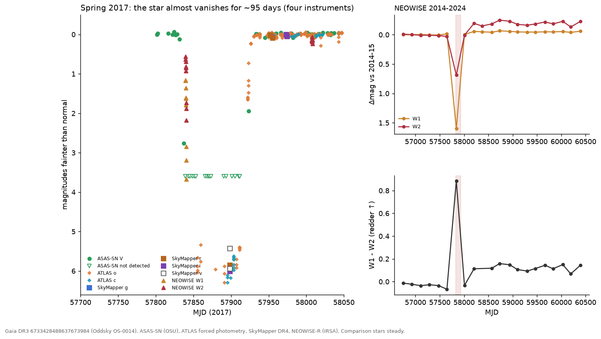
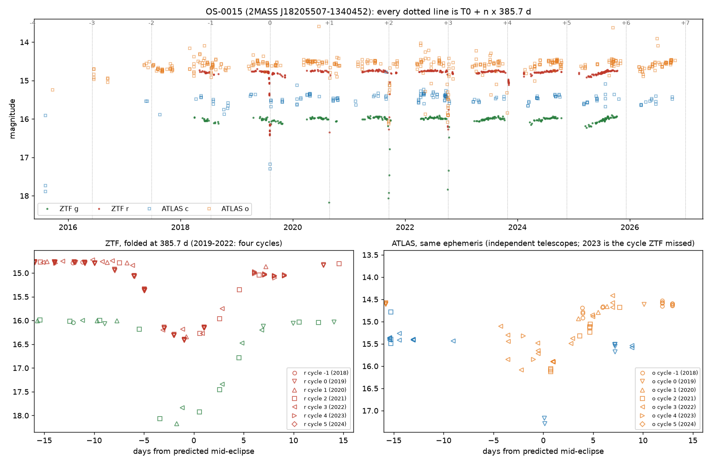
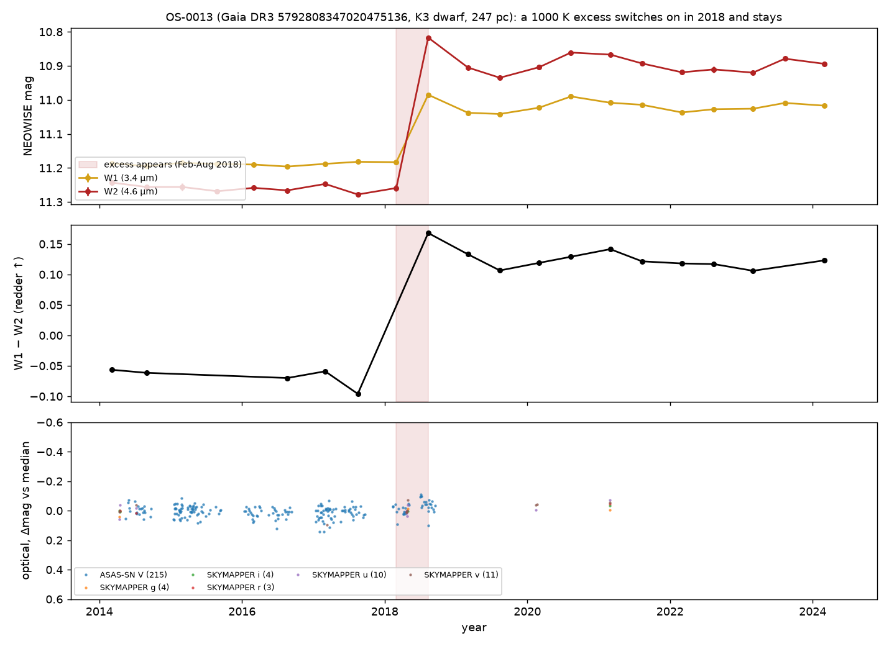

# Three stars for the advisor

*Oddsky cases OS-0014, OS-0015 and OS-0013. Alan Shortz, 27 October 2026. Private, for scientific review.*

## Introduction

For most of history astronomy was limited by light: how much a telescope could gather, and how often it could look. That limit has quietly fallen. Gaia has charted 1.8 billion stars, NEOWISE photographed the whole sky every six months for a decade, ZTF, ATLAS and TESS watch it night after night, and nearly all of it is public. What is scarce now is attention. In 2017 a star like the Sun went dark for 95 days; three public surveys recorded it, and nobody noticed for nine years. It is the first object below.

Oddsky is the open-source observatory I have been building to supply that attention, carefully. A curious person, using an AI agent as the instrument, can look closely at stars no one has examined and leave behind work that others can check: every claim says how it is known, every number has a receipt that replays from the archives, every prediction is sealed before the sky answers, and nothing is called a finding until a deterministic set of checks (the Skeptic) and an independent adversarial pass (the referee) have tried to break it. The tools make attention cheap. The discipline is what makes it worth anything.

Two systematic searches this week left three objects standing: one from a re-screen of the published R CrB candidate list, two from a full-sky pass over the NEOWISE archive. None of the three phenomena is reported anywhere I can find.

I am not an astronomer. Each object below is given in the same order: the claim, the figure, the observations, the interpretation. Section 5 contains four questions, which is all I am asking of you. Everything cited here is in the public repository, case directories `cases/OS-0014`, `cases/OS-0015` and `cases/OS-0013`, including the three referee reports, which are blunter than this brief.

## OS-0014: a G dwarf that vanished for three months

Gaia DR3 6733428488637673984 (2MASS J18330620−3607130, TIC 313603515; 18:33:06.21 −36:07:13.05; G = 12.46, BP−RP = 0.80, 420 pc, M_G ≈ 4.3, T_eff ≈ 6000 K, an F9–G0 dwarf) was occulted in spring 2017. It was fainter than normal for 92–105 days, more than 3 mag fainter for at least 72 days, and at least 99.6% blocked at mid-event, nearly grey across four optical filters. Four instruments saw it independently. Three to nine months later its W1−W2 colour reddened by about 0.15 mag and has stayed so through 2024.

### Observations

| | |
|---|---|
| Onset | ASAS-SN V: normal (12.70, rms 0.015) through MJD 57828.4; −11% on 57831.4; V = 15.46 (−2.76 mag) on 57837.4 |
| Infrared ingress | NEOWISE single exposures, MJD 57839.9–57840.9, 14 exposures over one day: W1 from 1.15 to 3.65 mag below baseline, W2 from 0.41 to 2.03. The occulter is more transparent at 4.6 µm. Field stars in the same frames steady; the star lands on different detector positions in successive scans |
| Deep phase | ASAS-SN: 17 non-detections, MJD 57839.3–57911.4 (each V > 15.7; stacked forced flux ΔV > 4.1 mag at 3σ). ATLAS forced photometry: 0.2–0.4% of normal flux in c and o from MJD 57856 to 57911 |
| Depth | SkyMapper DR4, 2017-05-25 (MJD 57898.6), at the star's own Gaia position (0.17″): g 18.58, r 18.30, i 18.31, v 19.1–19.7, i.e. 5.4–6.0 mag down, nearly grey |
| Egress | ATLAS: 22% of normal flux on MJD 57922, 80% on 57926, ~95% by 57930. ASAS-SN: 14.64 on 57923.3, normal (12.68) by 57933.3 |
| Controls | 8 ASAS-SN comparison stars within 0.14 mag on the same nights; 18 NEOWISE field stars within 150″ steady to 0.01–0.02 mag; SkyMapper field zero points within 0.006 mag; WISE centroid shift 0.011 ± 0.011″ (any contaminant must be within 0.3″); no Gaia alert |
| Before | Photospheric: AllWISE 2010 W1−W3 = −0.18 ± 0.16, Ks−W1 = 0.02; NEOWISE 2014–2017 flat |
| After | Optical about 0.05 mag brighter than before (ASAS-SN and six SkyMapper filters). W1−W2 redder by ~0.15 from an onset between MJD 58008 and 58204, persisting to 2024. If the photosphere also brightened in the infrared, the W1 excess vanishes and W2's drops to 14–16%, so no excess fraction or temperature is quoted as a result (a naive blackbody gives ~650 K at ~0.24 AU) |
| Multiplicity | Gaia DR3: RV robust amplitude 51 km/s from 7 transits, RUWE 1.15, duplicated_source = 1. TESS: a ~1.8-d, 1.2–1.6% signal centred on the star in Sector 13 (2019), weak in Sectors 66/93/104; TIC contamination 0.41, so not securely on the target |
| A century of plates | DASCH DR7: 2,348 plates 1889–1989, star detected on 1,176 (median 13.30). A 95-day vanishing would have been caught 46% of the time; none was. Phased on 2017, DASCH + ASAS-SN + NEOWISE exclude every period under 12.9 yr and 70% of 1–130 yr; ~93 and ~46.5 yr remain allowed. Three 1924 plates miss the star, but two brighter comparison stars 4–5′ away are missing on the same plates: plate quality, not an event |
| 2018–2026 | ATLAS: no repeat over ~940 nights (scatter 2–3%), except in the yearly conjunction gaps |

### Interpretation

Blockage rose from 11% to 92% in six days, about 0.7 stellar diameters for a sharp edge, so the occulter moves at ≳ 2 km/s and is ≳ 0.1 AU across. Requiring it to be smaller than its orbit puts a ≳ 1.4 AU; a circular orbit at that speed puts a ≲ 110–250 AU. A soft, dusty edge, which the chromatic infrared ingress suggests, means a higher speed and a closer orbit. None of this is a measurement of the orbit; it is what the sharp-edge model allows.

The simplest reading is an extended, mostly opaque dusty structure, such as a disk around an unseen companion, crossing the star: the ε Aur / EE Cep / Gaia17bpp configuration on a field G dwarf. A debris cloud from a collision is not excluded. The later W1−W2 reddening may be the same material seen afterwards; no causal link is claimed.

The referee excluded instrument artifacts (four surveys, steady comparison stars, a smooth fade across detector positions), blends (the centroid stays on the star and nothing bright enough lies within 15″), an eclipse in a 1.8-day binary (it cannot last 95 days), a Be star, and a background AGN, and put the probability that both phenomena are astrophysical and belong to this system at 97% or more.

## OS-0015: a dust-shrouded star that goes dark for a week every 385.7 days

Gaia DR3 4152421080966024704 (2MASS J18205507−1340452; 18:20:55.07 −13:40:45.1; G = 14.76, BP−RP = 2.01, 2.4 kpc, RUWE 1.81; l = 17.3°, b = +0.4°, 4″ from IRAS 18180−1342) is steady to 0.1–0.2 mag and then goes dark by 1.5–2.2 mag for about two weeks, four years running, on a clock good to a day. The eclipse is deeper in blue, has no secondary, and changes depth by a few tenths of a magnitude from orbit to orbit. ZTF found it; ATLAS, with different telescopes and a different pipeline, shows the same eclipses on the same ephemeris, including the 2023 one that fell in a ZTF gap.

### Observations

| | |
|---|---|
| Ephemeris | Four full-depth ZTF eclipses, mid-times MJD 58701.6, 59088.6, 59473.9, 59858.8 (Aug 2019, Aug 2020, Sep 2021, Oct 2022): P = 385.7 ± 0.5 d, T0 = MJD 58702.2, O−C under 0.7 d. The events advance 20 days a year through the observing season, which no seasonal systematic can do |
| Shape | FWHM 7.9 d, 14 d wide at 0.05 mag, about 18 d first to last contact. Ingress 9 d, egress complete within 14 d. In-eclipse nights carry 5–7 ZTF exposures agreeing to 0.01–0.02 mag |
| Depth | r: 1.64, 1.57, 1.5–1.8, 1.54 mag; g: 2.19, ≥ 2.08, 1.84 mag; i: 0.59 (2020). The 2022 eclipse is flat-bottomed and 0.35 mag shallower in g. d(g)/d(r) = 1.30 on 253 same-day pairs (ISM dust ≈ 1.4, grey = 1.0) |
| Independent check | ATLAS 2015–2026 (613 good exposures in a crowded field): cycle 0 at 1.9 mag in cyan at mid-eclipse; cycle 2 at 1.6 mag in orange one day after mid-eclipse, recovered by +8 d; cycle 3 sampled on eight nights from −4 to +7 d; cycle 4 (2023, unseen by ZTF) caught in ingress at −2 and −1 d, ≥ 1.4 mag deep, on time. No ATLAS data within 25 d of the 2024 and 2025 eclipses (conjunction season) |
| Aliases | P/2, 365.25 d and 182.6 d leave the odd cycles flat; 2P and 3P put full-depth events at phases 0.51 and 0.67. Nothing but 385.7 d works |
| Secondary | None deeper than 0.09 (r) / 0.14 (g) mag within ±8 d of phase 0.5. Phases 0.25–0.45 are covered in one cycle only, where a slow 0.13 (r) / 0.20 (g) mag, dust-coloured dimming occurs over MJD 60750–60790: an eccentric-orbit secondary away from phase 0.5 is untested |
| Baseline | Not flat: out-of-eclipse nightly medians span 0.17 (r) and 0.22 (g) mag, season medians drift 0.04–0.09 mag, g and r move together with slope 1.23. Gaia DR2 saw a 0.22 mag range in 2014–2016 and flagged it as an LPV candidate (Mowlavi et al. 2018); ATLAS (Heinze et al. 2018) lists it as a "dubious" variable with a 407-d, 0.15-mag long-period fit. Neither reports eclipses |
| Artifacts and blends | 50 in-eclipse epochs with clean flags; airmass, limiting magnitude, chi, sharp and zero-point rms match the quiet nights; both ZTF programs record eclipses; the centroid moves 0.06″; neighbours at 8.2″, 17″ and 17.9″ constant to 0.01–0.02 mag on every eclipse night. The only Gaia source inside the ZTF PSF is a G = 18.5 star 3.0″ away with 3.3% of the flux (K = 16.1 against 9.9 for the target). UKIDSS shows two K = 13.3–13.6 sources at 4.0–4.4″ with no Gaia counterpart (embedded) |
| The star | 2MASS J−H 1.09, H−K 1.02; WISE W1–W4 = 7.95, 7.17, 4.21, 2.90 (K−W1 1.6, W2−W3 3.0): a Class II SED (SPICY candidate YSO, Kuhn et al. 2021; Robitaille et al. 2008 red source; Tisserand et al. 2020 WISE R CrB candidate). Dereddened at A_V = 3–4, M_G = +0.4 to −0.5; Gaia DR2 M_bol = 1.5 ± 0.7; so L ~ 20–100 L☉ and R ≲ 10 R☉. RUWE 1.81 (astrometric excess noise 0.29 mas, 19.6σ) is what a 0.4 mas photocentre wobble on a 1 AU orbit at 2.4 kpc would do |
| NEOWISE | W1 and W2 are 0.09–0.12 mag brighter within ±60 d of eclipse phase than at phases 0.55–0.75, in both even and odd cycles; W1 also fades secularly (0.024 mag/yr). Two visits a year, no visit inside an eclipse: a lead, not a result |

### Interpretation

For M_tot = 1, 2, 3 M☉: a = 1.04, 1.31, 1.50 AU and v_rel = 29, 37, 42 km/s, so 18 d of contact is a chord of 67, 85, 97 R☉, and that chord is R_star + R_occulter. The eclipse is translucent and chromatic (τ_r ~ 1.5), so the dust covers the whole stellar disk and R_occulter ≳ R_star. That requires a small primary, and the luminosity says it is one. The depth changing by 0.2–0.4 mag between orbits means a clumpy, evolving dust structure, not a rigid opaque disk.

Two readings remain, with equal weight. In the first, a companion on a 386-d orbit is wrapped in a translucent dust structure: EE Cep or ε Aur at a one-year period, on a star that may be a low-luminosity giant. In the second, a young binary (Class II SED, star-forming region) has a warped or clumpy inner disk that occults the primary once per orbit, a long-period relative of KH 15D. The first draft said "red giant eclipsed by something 80 solar radii wide"; the referee retracted both halves, and this brief follows the referee.

Excluded: a seasonal ZTF systematic (both programs, clean metadata, constant neighbours, a 20 d/yr drift against the calendar); R CrB-type dust puffs (strict periodicity, O−C under 0.7 d over four cycles); blends; P/2, 2P, 3P and the one-year aliases. The referee's estimate that a mundane explanation remains is about 5%.

Two predictions are sealed (hash-logged before the fact): the star stays within 0.5 mag of maximum through the 2027 season (p = 0.7), and it is ≥ 1 mag faint on at least one night between 2027-12-30 and 2028-02-04, the eclipse predicted for 2028 January 17 ± 18 d (p = 0.75). The December 2026 eclipse falls at solar conjunction.

## OS-0013: a K dwarf that grew hot dust in 2018 and still has it

Gaia DR3 5792808347020475136 (14:43:51.9 −76:11:46; G = 13.1, 247 pc, a K3 main-sequence dwarf, not young) was photospheric in the infrared from 2010 to early 2018. Between two NEOWISE visits (2018 Feb 26 to Aug 8) its W1 and W2 rose by 0.17 and 0.36 mag, a step of more than 30σ against 27 field stars, and the excess, with a colour temperature near 1000 K and a fractional luminosity of about 2%, has stayed through 2024. The optical light curve is flat across the onset: no dip, no flash. This is the ASASSN-21qj signature (infrared first) without, so far, the optical event.

### Observations

| | |
|---|---|
| The step | NEOWISE visit medians: W1 11.19 → 11.00, W2 11.26 → 10.88 (first post-step visit brightest, then a plateau at W2 10.86–10.94 through 2024). Onset between MJD 58178.5 and 58341.7 |
| Controls | 27 field stars within 300″ (W2 9.5–12.5) change by +0.006 (W1) and +0.014 (W2) mag with robust scatter 0.005; per-visit zero points within ±0.02 mag; the WISE centroid moves 0.013 ± 0.008″ across the step (any contaminant within 0.2″); rchi2 unchanged; no saturation; nb = 1 throughout |
| Neighbours | unWISE W1-only source 7.4″ away at 5% of the flux; AllWISE sources at 13″, 16″ and 32″ are each flat across 2018 (dW2 ≤ 0.03); any of them supplying 39% of the W2 flux would drag the centroid by > 2″ |
| Before | AllWISE 2010 epochs equal the 2014–2017 baseline; W1−W3 = 0.17 ± 0.10 and Ks−W1 = 0.06, photospheric for K3V |
| The star | GSP-Phot A_G = 0.24: M_G0 = 6.31, (BP−RP)0 = 1.17, log g 4.58, on the K3V main sequence with no pre-main-sequence overluminosity. UVW = (−24, −18, −3) km/s, more than 12 km/s from Chamaeleon, ε Cha and LCC. RV −0.5 ± 1.9 km/s from 17 transits |
| Energetics | Excess colour W1−W2 ≈ 0.87 → T ≈ 1040 K for a blackbody; L_IR/L* ≈ 0.02; emitting area ≈ 8 stellar disks; equilibrium distance ≈ 0.04 AU for L ≈ 0.3 L☉. Sustained for six years, that fractional luminosity is extreme-debris-disk territory (ID8, BD+20 307, ASASSN-21qj) |
| Optical | ASAS-SN V 13.41, robust scatter 0.036, flat from MJD 58160 to 58378 except a gap at 58243–58300; SkyMapper on MJD 58232 (inside the onset window) matches 2014 in u, v, g, r to 0.03 mag. TESS (2019–2025): no dips beyond ~5%; the two 2025 sectors carry scattered-light ramps and are uninterpretable |
| Catalogues | VarWISE (Paz et al. 2026) lists the WISE variability with amplitudes 0.18/0.375 and classifies it "lpv", which a K3V dwarf cannot be. SIMBAD and VSX: a rotational variable, nothing more. The step-plus-reddening interpretation is new |

### Interpretation

The referee could not attribute the step to the instrument, the field, a neighbour, or a moving or new source: it is real, astrophysical, and on the K dwarf, with about 93% confidence. The variability itself was in a catalogue under the wrong label; the interpretation is the new part.

What the dust is remains open. Two-band photometry cannot separate freshly made circumstellar dust (a collision or a large impact) from other dusty phenomena, for example ejecta after a planet engulfment. The flat optical record favours optically thin dust seen from outside its plane, so the ASASSN-21qj-style dimming may never come.

The weakness is that only one instrument can see 3–5 µm at these epochs, so there is no second-instrument confirmation of the excess itself, only of the photosphere's constancy. That is why it sits below the other two despite the cleaner physics.

## Open questions

Four questions, one per star and one overall. Everything else (spectra, plates, proposals, who to tell) follows from your answers, and I would rather not spend your time on logistics before you have said whether the physics holds.

One thing to know before you answer: this is the test of the whole idea, not just of three stars. The question Oddsky exists to ask is whether an interested amateur with these tools can add something true to what is known, in a form a professional can check. If at least one of these survives you, the premise holds and the implications are worth taking seriously. If none does, that is also an answer, and the right response is to go back to the drawing board rather than to polish the write-up. A polite verdict is the only one that tells me nothing.

1. **OS-0014.** A one-off, near-total, 95-day occultation of a field G dwarf by something dusty at AU scale, followed months later by a persistent warm excess: is that a physically coherent system to you, or does the combination point somewhere else (an engulfment, a transient disk, a line-of-sight cloud)?
2. **OS-0015.** A 20–100 L☉ star with a Class II SED in a star-forming region, eclipsed for two weeks once per 385.7-day orbit by translucent, reddening dust whose depth changes from orbit to orbit: evolved binary with a circumsecondary disk, young binary with a warped circumbinary disk, or a third thing not considered here?
3. **OS-0013.** A 2% fractional luminosity at ~1000 K appearing around a mature K dwarf within six months and holding for six years, with no optical event: is this the giant-impact afterglow class (ID8, P1121, BD+20 307), and if not, what is it?
4. **Overall.** Would you put your name on any of these, and in which order? If yes to any, name the single observation you would want first and I will go and get it. If no, say which assumption you would attack, and I will attack it before anyone else sees this.

One statement rather than a question: OS-0015 came out of Tisserand and Karambelkar's published candidate list. I plan to tell them before anything is submitted. If that is the wrong protocol, stop me.

## Methods

OS-0014 and OS-0013 came from a full-sky pass over 146.6 billion NEOWISE detections of 176.9 million stars, asking which Sun-like stars suddenly grew warm dust (the ASASSN-21qj signature; the pass recovered ASASSN-21qj blind at 79σ). OS-0015 came from re-screening the 2,356 WISE-selected R CrB candidates of Tisserand et al. (2020) in 2018–2026 ZTF and ATLAS data for their first recorded declines; it is not an R CrB star, and no new R CrB star has been confirmed yet (the southern half is still queued on ATLAS).

Every claim carries a tag (observed, computed or inferred) and the ids of the logged tool calls that produced it; `oddsky replay` re-runs the whole ledger and fails if any number changed. The Skeptic runs first. Then a referee pass, run independently of the investigation with the mandate in `docs/REFEREE.md`, attacks aliases, artifacts, blends, "no X" claims, physical self-consistency, novelty and untapped data, and writes a report that must be answered claim by claim. All three reports are in the case directories, and each changed its case materially: OS-0015 lost its "red giant" and gained a fourth eclipse, OS-0014's referee found the event stronger than the first draft said, and OS-0013's referee found the variability already catalogued under the wrong class.

Not yet done: no images have been inspected by a human; no spectrum exists for any of the three stars; the OS-0014 DASCH detection-efficiency numbers assume repeats look like 2017; and the OS-0015 luminosity rests on Gaia DR2's bolometric estimate and an assumed extinction. Everything is public; the hosted observatory at oddsky.ai, or a local install from the repository, reproduces any number here from the archives in minutes. Gaia DR4 lands on 2 December 2026 and covers all three stars' 2014–2020 epochs.
