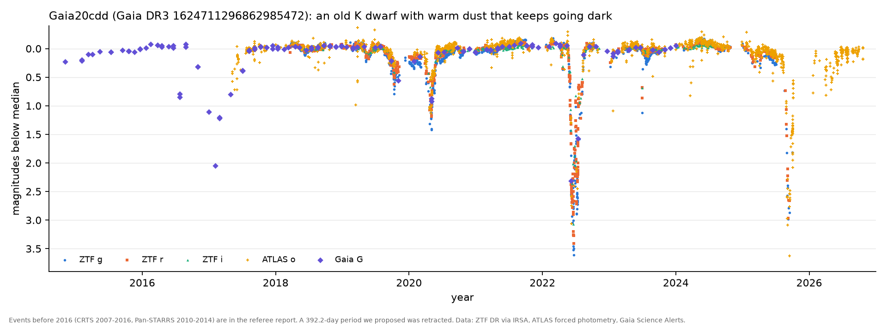

# Gaia20cdd: an old K dwarf with warm dust that has dimmed by up to 3.5 mag at least ten times since 2007

**Status: reproduced dimming; catalogued variable, mis-typed; candidate re-classification as a field main-sequence
dipper.** Referee (2026-10-28, [`reviews/Gaia20cdd-referee-2026-10-28.md`](reviews/Gaia20cdd-referee-2026-10-28.md)):
the dimming is real and on the star (artefact < 1%); our 392.2-day clock is retracted (≲ 10% real); the star is in VSX
already. What survives is the nature of the object.

## Identification

| | |
|---|---|
| Gaia DR3 | 1624711296862985472; Gaia20cdd = AT2020jem = CSS_J162053.8+592622 = GALEX J162053.9+592622 = ATO J245.2240+59.4395 |
| position | 16:20:53.76 +59:26:22.4 (J2000); l 90.13, b +41.99 (Draco) |
| catalogues | **VSX: NL/VY: (range 16.0-17.7 from CRTS; S. Otero, 2020-05-08).** ATLAS-VAR (Heinze+2018): "dubious", P(LPV) 0.85 |
| Gaia DR3 | parallax 0.624 ± 0.035 mas (1.6 kpc, z ≈ 1.07 kpc), pm (-7.50, -7.51) mas/yr, RUWE 0.95; DR3 mean G 16.32 and BP-RP 1.18 are biased by the 2016-17 dip (out-of-dip G ≈ 16.13, M_G ≈ 5.1); Gaia MSC logg 4.6-4.8, Teff 5100-5380 K; Hα pseudo-EW +0.09 ± 0.11 nm (no emission) |
| other | SDSS 2004 u-g 1.71, g-r 0.71, r-i 0.26; 2MASS J 14.82 (1999, normal), J-K 0.47; GALEX NUV 22.79 ± 0.31, no FUV (photospheric for a K1 V) |
| infrared | AllWISE W1-W2 = 0.23 ± 0.04 (≈ 6σ redder than a K dwarf), W3 12.61 at 4.8σ (≈ 1.6 mag above the photosphere): **warm dust, T ≈ 500 K, L_IR/L* ~ 10^-2** (referee, computed) |

## Finding

At least ten dimming events in 2007-2025, seen by **CRTS, Pan-STARRS, Gaia, ZTF (two independent fields/CCDs),
NEOWISE and TESS** (observed): e.g. 2007-04-24 (1.62 mag, CRTS), 2011-03 (1.33, CRTS + PS1), 2014-06 (≥ 1.2, part of a
~280-d complex), 2016-10 → 2017-07 (to 2.05 in G), 2019-08 → 2020-06 (one complex, to 1.41 in g), 2022 May-Aug (3.55 in
g), 2023-07-02 (1.1 mag, recovered within ~6 h), 2025-02 → 2025-10+ (to 2.98 in g; still 1.8 mag deep on the last
public ZTF night). Events last from under a day to ~300 days. Shallow phases redden like interstellar dust (A_g/A_i ≈
1.7); only the deepest points look grey (partial covering or a scattered-light floor). W1 dimmed 0.42 mag when i dimmed
3.07. A 6-hour, 0.8-mag egress needs a transverse speed ≳ 26 km/s, placing the occulting material within ~1 AU (inferred).

(ZTF, ATLAS and Gaia, 2014-2026. The 2007-2015 events are in the referee report.)

## What we got wrong, and the referee caught

- **The 392.2-day clock.** Fitted to four hand-picked minima, with a 0.25% false-alarm rate from a 300-500 d search.
  Over 150-1300 d it is 2.5% before the post-hoc choices; CRTS and PS1 minima we had not fetched fall at phases -0.12,
  0.56 and 0.50 (deep "secondaries"), the half-period fits as well, and several events outlast either period. If any
  regularity exists it is a weak ~196-d tendency (8 of 11 minima within ±8 d; a few percent after trials; most cycles
  empty). **Retracted**, with its prediction of a minimum at MJD 61317 (2026 October 4; we first mis-converted this as
  November 14). ATLAS shows no dip then (o +0.06 on Sep 27, +0.12 on Oct 17): the retraction was right.
- "Nearly grey": retracted (see above). "Five episodes": at least ten. "Nothing found": it is in VSX and ATLAS-VAR.

## Why it is still interesting (inferred)

The VSX type (nova-like, VY Scl) does not fit: no Hα emission, photospheric UV, K-dwarf colours, an 18σ parallax at
1.6 kpc. The data describe an **old, thick-disk K dwarf with warm circumstellar dust, occulted by clumps within ~1 AU on
timescales of hours to most of a year**. Main-sequence dippers in the field are rare (Tzanidakis+2025 found 81 in ZTF;
this star is not among the IDs in their paper's text, and their full table was not checked). Old ones are rarer still:
dust this warm and this variable around a thick-disk dwarf needs a recent supply (collisions, a disrupted body), as for
ASASSN-21qj or OS-0014.

## ATLAS (2015 to 2026-10-27; computed, `data/Gaia20cdd_atlas.csv`)

Independent confirmation of the 2025 event: o is 2.7 mag deep around 2025-09-12 and still +1.1 to +1.8 in early October.
A shallow, reddened low state follows from 2026 January to May (o +0.2 to +0.66, c +0.5 to +0.8; MJD 61121, the ~196-d grid
point on 2026 March 22, sits inside it at o +0.57), then near-baseline from June 2026 to the last night (o +0.06 to +0.12).
No dip at the retracted clock's 2026 October 4.

## Next steps

1. Done (ATLAS to 2026-10-27, see "ATLAS" below). Keep monitoring; any >= 0.5-mag dip starting more than ~20 d off the
   ~196-d grid (next grid points MJD 61317 + 196.1 n) argues against even that weak regularity.
2. A moderate-resolution spectrum (Hα, Li 6708, [Fe/H], RV) to confirm an old, non-accreting dwarf; repeated through a
   dip, it gives the reddening law and any gas absorption.
3. Propose a VSX type correction (NL/VY: → dipper / dust-occultation variable) once the spectrum is in, crediting
   S. Otero's original entry.
4. TESS sectors 75-86 (2024, near-continuous) for short dips.

## Reproduce

`scripts/hunt_h0005_cdd_plot.py`; `scripts/hunt_h0005_tess_pixels.py`; the referee's CRTS/PS1/NEOWISE downloads and
period tests are in `~/oddsky-runs/research-2026-10-28/cdd/referee/`.
