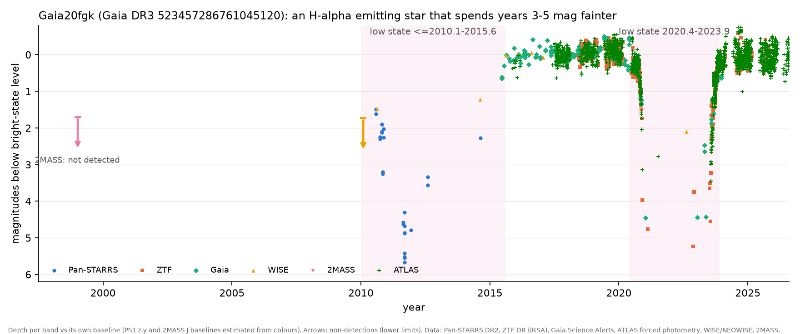
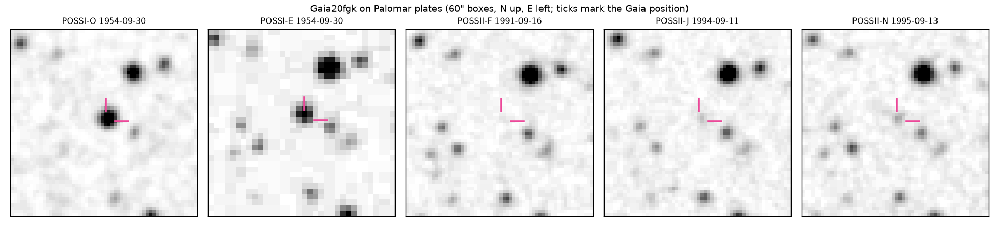

# Gaia20fgk: an Hα-emitting star at 1 kpc that has spent most of the last 35 years 3-5 magnitudes fainter

**Status: candidate. Confirmed real variable; nature unclassified.** Referee (2026-10-28,
[`reviews/Gaia20fgk-referee-2026-10-28.md`](reviews/Gaia20fgk-referee-2026-10-28.md)): the fades are real and on this star
(artefact or mis-identification < 2%); the investigators' "Sun-like dwarf hidden by an external, grey, optically thick
occulter" framing does not survive; a young-star "fader" or a nova-like in low states is the likely mundane explanation (~0.7).

## Identification

| | |
|---|---|
| Gaia DR3 | 523457286761045120; alert Gaia20fgk = TNS AT2020zvx = ZTF18abiiped |
| position | 01:08:33.49 +64:08:24.2 (J2000); l 124.80, b +1.33 (Cassiopeia) |
| Gaia DR3 | G 16.25, BP-RP 1.23, parallax 0.970 ± 0.048 mas (~1.0 kpc), RUWE 1.04, phot_variable_flag VARIABLE (range 15.81-19.61), classifier "CV" (score 0.31) |
| spectrum hints | Gaia ESP-ELS Hα pseudo-EW -0.72 nm (emission; the most extreme 0.1% of 3,738 field stars of similar G); GSP-Phot 5967 K, logg 4.67 but [M/H] -4.09, i.e. a failed fit, not a usable dwarf classification |
| luminosity | M_G ≈ 5.3 with AG 0.86 (0.6-0.9 mag below the main sequence for its colour) |

## Finding (observed unless tagged)

The star is bright only at **1954.7** (POSS-I), **2015.6-2020.4** and **2024.0-2026** (latest ZTF, Oct 2025: g ≈ 17.0,
0.2 mag fainter than 2018-19). At every other epoch we can find it is 2-5+ mag fainter:

| epoch | instrument | measurement |
|---|---|---|
| 1991.7 | POSS-II F (red) | not detected (computed: relative plate photometry vs 32 Gaia stars) |
| 1994.7 / 1995.7 | POSS-II J / N | +2.85 / +1.75 mag faint (computed) |
| 1999.0 | 2MASS | not in PSC or reject table; field complete to J 16.8-17.0; forced photometry J ≈ 18.5 (referee): ≥ 2.7 mag deep |
| 2010.1 | WISE | 0/16 frames detect it while the 8.8" neighbour (W1 15.0) is detected 16/16: W1 ≳ 15.5 vs baseline ≈ 13.9 |
| 2010.6 | WISE | 7/14 frames, W1 15.32 (an upper envelope) |
| 2010.57-2014.63 | Pan-STARRS DR2 | z 17.2 → g 20.0 (2010.85) → g 21.7, i 20.1-21.4 (2011.68) → y 17.8 (2014.63); 26 good detections, all within 0.81" of Gaia |
| 2014.75-2015.63 | Gaia DR3 epochs | G 19.61 → 16.23: egress ends 2015.6 |
| 2020.4-2023.9 | ZTF, Gaia alerts, NEOWISE | g 16.8 → 21.6 (2021.1), undetected in g until mid-2023, G 20.7 (2023.0), NEOWISE 0 detections in 2021.0-2023.0 visits; egress Jul-Nov 2023 |

The low states are not smooth: ZTF r changes 21.32 → 19.84 in 12 days inside the 2022 low, g swings 0.7-1 mag in a day
during egress, PS1 i changes by 1 mag within 0.003 yr. The bright state is not flat either: ZTF g rms 0.155 mag against
0.02 errors, hour-scale changes of up to 0.24 mag in Gaia transit pairs, and a ~20-day quasi-period of ~0.3 mag in ZTF g and r
(2018-2019; referee, computed). The fades are nearly grey in the optical (A_BP/A_RP ≈ 1.18, A_i/A_g ≈ 0.75) and about a
third as deep in W1.

## Why it is interesting (inferred)

Few stars are seen to spend most of three decades hidden this deeply, with only two multi-year windows when the
star shows itself. Whatever the class, the record is new: the alert said "~1 mag dimming", and nobody connected it to
Pan-STARRS, WISE, 2MASS or the Palomar plates. If it is a young star, it is a long-timescale fader near b = +1.3 deg at
1 kpc with a dense, clumpy occulting structure. If it is a cataclysmic variable, its low states are unusually long.

## Hypotheses

- **H1, young-star fader (inferred; favoured by the referee):** an Hα-emitting T Tauri/UXor-type star seen nearly
  edge-on, hidden by its own disk material for years at a time (AA Tau after 2011, V1184 Tau, RW Aur, KH 15D as the
  periodic special case). For: Hα emission, flickering, the 20-day modulation, grey-ish fades, Galactic plane,
  underluminous in the bright state (scattered light). Against: no known star-forming region named yet (not checked; CDS down).
- **H2, VY Scl nova-like in long low states (inferred):** for: Hα, hour-scale flickering, M_G ≈ 5, DR3 classifier "CV".
  Against: bright-state colours fit a G0 star reddened by E(B-V) ≈ 0.35, and the deep-state colour (BP-RP 1.82) is not
  as red as an M-dwarf donor.
- **H3, a main-sequence star occulted by a disk around a long-period companion (speculated; demoted):** a ≥ 50%
  low-state duty cycle is very hard for a disk around a companion; no period is established.

## Skeptical review (done)

Mis-identification (proper motion 0.15" over 62 yr; PS1 detections within 0.81"), plate flaws (three POSS-II plates,
three years), the 14.87-mag giant 16.5" N (compact on all plates), WISE blending (the 8.8" neighbour inflates the W1
baseline by up to 0.3 mag; in-eclipse W1 values are bright-biased upper envelopes), and "not detected" limits (2MASS,
WISE 2010 and NEOWISE 2021-2023 all checked against detected neighbours) are all handled. Corrections we accepted: two PS1
points below our own quality cut (2012.86 g, 2013.64 z) are dropped from the text; the 2010-2015 low began before 2010.1
and ended at 2015.6; "Sun-like", "flat out of eclipse", "optically thick" and the shrinking-duration and ~10-year-period
claims are withdrawn.

## Novelty

Searched 2026-10-28: web (Gaia20fgk, AT2020zvx, ZTF18abiiped, source_id, J0108+6408), TNS/BHTOM (registered, "class
unknown", importance 0; one follow-up night with pt5m on 2020-11-25), arXiv 2601.16828 (ZTF circumbinary occultations; not
there), Tzanidakis+2025 dipper list (not among visible IDs; machine-readable table unchecked), **VSX (vsx.aavso.org): listed
as Gaia20fgk, type NL/VY:, range 15.8 G - 21.8 r, discoverer Gaia** (AUID 000-BNS-159). **Not checked: SIMBAD, IPHAS.**
Status: a catalogued variable (typed as a nova-like, which is our H2); its 1991-2015 low state and the plate history are
not described anywhere we could reach. Not established as novel.

## Reproduce

`scripts/hunt_h0005_fgk_compile.py` (assembles `data/Gaia20fgk_photometry.csv` and the figure from ZTF, Gaia alerts,
NEOWISE, Pan-STARRS DR2 and WISE 2010 single exposures), `scripts/hunt_h0005_dss_phot.py` (plate photometry on `dss/`).
Referee scripts: `~/oddsky-runs/research-2026-10-28/fgk/referee/`.

## Predictions and next steps

1. **Spectrum now, while it is bright** (g ≈ 17; R ≳ 2000, 4000-7000 Å, a 2-4 m telescope): Li I 6708 + G-type lines +
   Hα/[O I] emission → H1; broad Balmer + He I/He II, weak photosphere → H2. Radial velocities every ~20 days test binarity.
2. Once CDS is back: IPHAS r-Hα, SIMBAD, Gaia/WISE YSO catalogues, Tzanidakis+2025 full table.
3. Done: ATLAS forced photometry (2015-10 to 2026-10-27, `data/Gaia20fgk_atlas.csv`) independently shows the 2020-2023 low
   (70 of 132 points in 2021.0 are 5-sigma upper limits; c +2.85 in 2021.5; o +1.25 in 2023.5) and the star bright since 2024,
   sitting 0.1-0.2 mag below its 2019 level in both o and c, as ZTF g does. It is in its bright state now.
4. Not a sealed prediction yet: with no period, the only forecast with teeth is H1's "it will fade again"; we decline to
   put a date on it.
