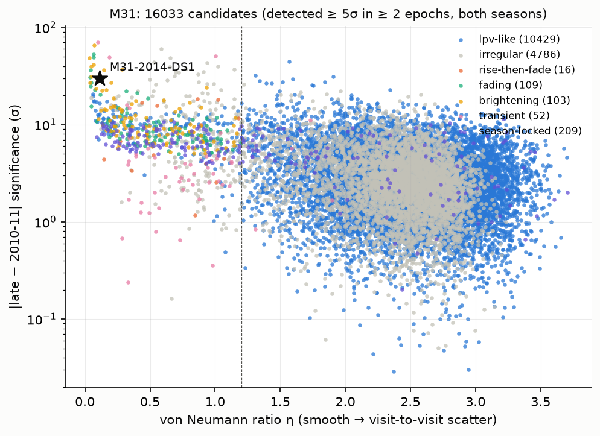
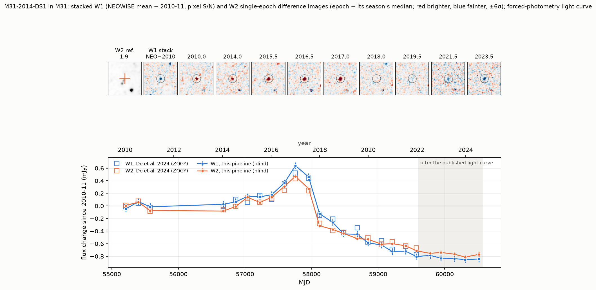
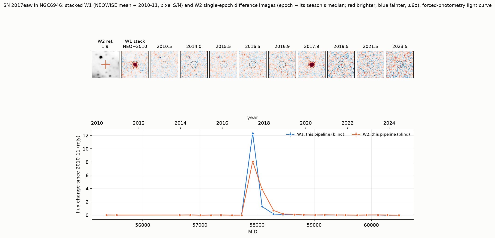
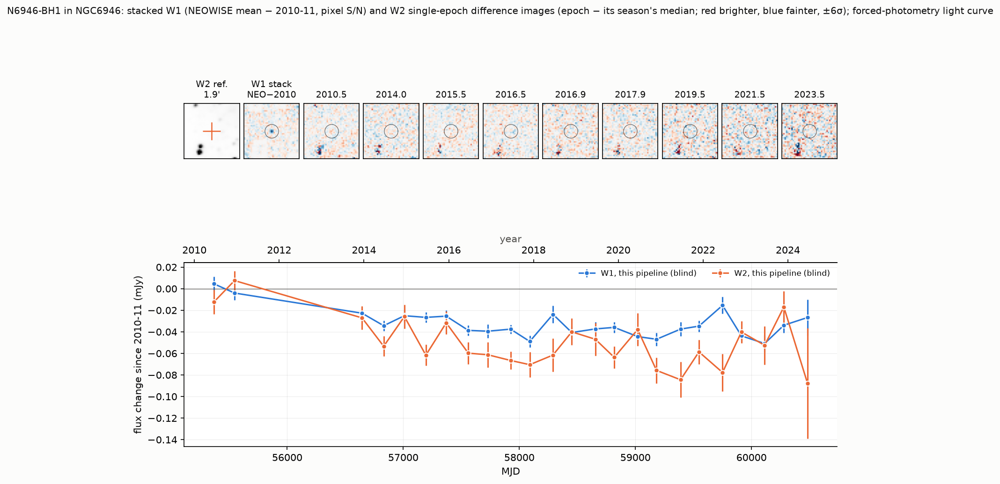
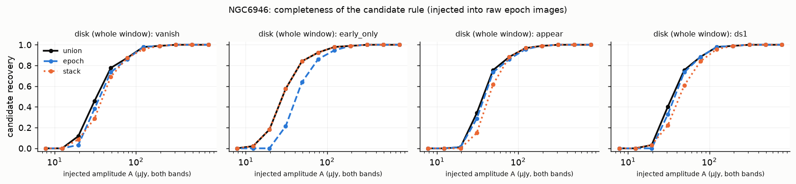
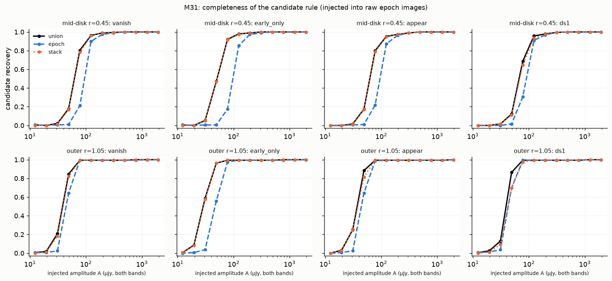

# Hunt H-0012: stars that vanish or appear in the mid-infrared

**Question.** M31-2014-DS1 (De et al. 2024; arXiv 2410.14778) is a supergiant in Andromeda that brightened by about 50% in
the mid-infrared in 2014-2016, then faded by about 10⁴ in the optical and about 10× in total light. It is the best
failed-supernova candidate known. It was found by difference imaging the six-monthly WISE/NEOWISE coadds of M31. Can
Oddsky build that tool, prove it on DS1 and other known objects without being told where they are, and then point it at
every star-forming galaxy within about 10 Mpc?

**Status (2026-11-01): tooling and acceptance tests done; refereed once (`reviews/claude-referee-2026-11-01.md`) and
revised. Nothing is committed.** The scale-up is designed but not run, and is gated on A. Meisner's permission (see
*Data provenance*).

**Acceptance results (after the referee round):**

- **M31-2014-DS1, recovered blind.** The pipeline is given only "M31".
  - The candidate is 0.16" from DS1's Gaia position, found by both detection channels (42 single-epoch detections;
    stacked S/N −30). It is classified rise-then-fade in W1 and W2 independently.
  - It is #1 of 16 in its class, #14 of 16,033 candidates by DS1-likeness, and #8 once flagged moving foreground stars
    are removed.
  - The light curve tracks De et al.'s: r = 0.995 (W1) and 0.998 (W2). Our flux changes are 8.7% (W1) and 4.8% (W2)
    larger than theirs, a calibration offset we have not explained. The ranking was not fully blind to DS1 during
    development; see *How blind was it?*.
- **NGC 6946, three known objects recovered blind:**
  - SN 2017eaw is the #1 variable.
  - SN 2008S (the 2008 dust-enshrouded transient) is the #1 one-way fader: stacked S/N −17.6.
  - **N6946-BH1** is found by the new stacked channel only (0.36"; class step-down in both bands; #4 of 27). The
    pre-defined statistic gives W1 −5.9σ (about −5.0σ against 1,660 real-source controls); the 2010-vs-NEOWISE
    statistic gives W1 −7.5σ and W2 −7.2σ.
  - BH1's mid-IR fade is already published from Spitzer. What is new is the first WISE light curve: a 2010 anchor, and
    a flat level from about 2016 to 2024.
  - BH1 was blind only after a mask change that BH1 itself prompted; see below.

## The tool: `oddsky.imaging`

The package is `src/oddsky/imaging/` (numpy, scipy and astropy only). Tests are in `tests/test_imaging.py`: 25
tests on synthetic images, 2.4 s.

| module | what it does |
|---|---|
| `tiles` | the unWISE tile scheme (18,240 tiles of 2048² px at 2.75"/px) and which tiles cover a galaxy |
| `fetch` | caches the epochal coadds (img-m, invvar-m, n-m) and the full-depth bitmask under `~/oddsky-runs/imaging/`; per-process atomic writes |
| `stack` | all epochs of a tile and band over a window; **absolute** visit-season labels; unWISE build per epoch |
| `psf` | empirical PSF per tile, band and season |
| `diff` | per-season median references, **leave-one-out** medians, delta-basis kernel plus background, residual floor, mesh background |
| `detect` | matched-filter S/N calibrated by its own local scatter (floor 0.8); peaks; masks; grouping |
| `photometry` | forced PSF photometry with a local background on every difference image; reference flux |
| `metrics` | variability metrics; per-band classes; DS1-likeness score; step classes |
| `crossmatch` | Gaia DR3 (string source_id, DSC quasar probability) and the W1−W2 AGN flag |
| `pipeline` | end to end: `python -m oddsky.imaging.pipeline M31` → detections, candidates, light curves |

### How it works, and why

- **Data:** unWISE time-resolved ("epochal") coadds, neo11 build (*Data provenance*). There are 25 epochs per M31 tile,
  2010 Jan to 2024 Jul, which is the whole mission. Every epoch shares its tile's WCS, so no resampling is needed.
- **References:**
  - Built per visit season. WISE sees a field from one side of the Sun in one season and the other side six months
    later, so the scan direction and the PSF's three-fold pattern flip.
  - **Season labels are absolute.** They come from the sign of the Sun-minus-field ecliptic longitude at each epoch,
    not from the tile's first epoch. In NGC 6946 the old tile-relative labels were globally inverted relative to
    M31's, which is harmless within a tile but wrong for cross-tile "both seasons" counts.
- **Two images per epoch:**
  - *Detection* uses a **leave-one-out** median reference, so an epoch never subtracts itself (a few-percent bias for
    single-epoch excursions).
  - *Photometry* uses the full-season median, with the same kernel. Every epoch of a season then shares one zero
    point, which long-term light curves need.
- **Kernel:** a 5×5 delta-function basis plus a constant, fitted in 512-px blocks (a minimal Bramich 2008 scheme).
- **Noise:**
  - A residual floor of 3% of the reference's compact structure.
  - The matched-filter S/N map is divided by its local robust scatter in 64-px boxes. This factor may not fall below
    0.8; it used to be allowed down to 0.5.
  - A 66" mesh background is subtracted from every difference image. unWISE's per-frame sky subtraction eats a varying
    amount of a big galaxy's light.
- **Masks:**
  - unWISE bitmask artefact bits (Meisner et al. 2019, Table 2): bright-star cores per scan direction, saturation,
    scan-dependent ghosts, latents, diffraction spikes.
  - Bright reference peaks; the nucleus and companions (M32, NGC 205); pixels outside 1.2-1.5× D25.
  - **Not masked:** bits 6, 9 and 10 (tile overlap, resolved galaxy, "big object: M31"), and, since this revision,
    **23-24 (AllWISE-like halos)**. Halos flag static, smooth light that biases catalogue fluxes but subtracts out in a
    difference image. They had blanked 11.4% of NGC 6946's search area (0.8% of M31's), **including BH1**. This change
    was prompted by finding BH1 masked. It is generic, but it was not blind.
- **Two detection channels; the candidate rule is "either":**
  1. **Single-epoch channel:** a ≥5σ peak in ≥2 epoch-band images *from both seasons* (two independent references).
  2. **Stacked channel (new):** reference-free stacks per season of (NEOWISE-era mean − 2010-11 mean) and (last
     ~1.5 yr − 2010-11). A peak must reach ≥5σ in the season-combined stack *and* agree in sign at ≥2σ in each season.
     This finds slow, faint, one-way changes that never reach 5σ in one epoch: BH1 at about 4σ per epoch is the case.
- **Classification:**
  - Each band is classed on its own. The verdict is the band that made the source variable (larger χ²); the other
    band's class and an agreement flag are reported. Bands agree for 87% of M31 candidates.
  - Classes: `lpv-like`, `rise-then-fade`, `fading`, `brightening`, `transient`, `season-locked`, `irregular`, and
    new **`step-down` / `step-up`** (quiet epoch to epoch, but ≥5σ different between 2010-11 and NEOWISE).
  - `dipole` flags moving foreground stars. Gaia DR3 parallax/proper motion, DSC quasar probability and W1−W2
    (`agn_colour` = W1−W2 ≥ 0.8 outside D25) are part of triage, not optional extras.

**Separating a DS1 from AGB stars.** At a 182.6-day cadence a Mira looks uncorrelated from visit to visit (von
Neumann η ≈ 2, many direction reversals over 14 years). DS1 is one smooth excursion: η = 0.11 (W1) and 0.14 (W2), one
turn, and −19.5σ / −30σ between 2010-11 and 2023-24. The class thresholds and score were written right after reading
De et al.'s description of DS1, so "DS1-likeness" is DS1-shaped by construction. The test shows the pipeline recovers a
known morphology; it does not measure discovery efficiency for other kinds of event.



## Acceptance test 1: M31 and M31-2014-DS1

`python -m oddsky.imaging.pipeline M31` (5 tiles; 15.4 min on this laptop, 2.5 GB peak), then `scripts/acceptance.py
M31`. DS1's Gaia position (00:45:13.47 +41:32:33.14, from the paper) is used only in the acceptance script. Two errors
in the original brief: it gave arXiv ID 2401.07913 (a quantum-oscillator paper) and Dec +41:45:57.

| | |
|---|---|
| ≥ 5σ detections (both channels) | 200,569 |
| candidates | **16,033**: 12,906 single-epoch only, 794 stacked only, 2,333 both |
| significant variables (var_sig = √χ²ᵣ > 5) | **4,557** (> 10: 386; > 20: 16) |
| of the 4,557, by class | lpv-like 3,208, irregular 1,249, season-locked 32, brightening 27, fading 15, transient 13, rise-then-fade 12, step-down 1 |
| flagged dipoles | 326 candidates |

χ²ᵣ and var_sig treat epochs as independent, but the epochs of a season share one reference. That makes var_sig
optimistic at the low end. The Δ statistics are not affected, because the reference cancels within a season.

### DS1

| | this pipeline (blind) | De et al. 2024 |
|---|---|---|
| position | 0.16" from Gaia | Gaia DR3 369287369785313152 |
| detections | 42 epoch-band images (20 W1, 22 W2), peak S/N +27.2 / −19.8; stacked channel −30.4 | > 10σ in 2016 Jul (WTP 16aathhy) |
| class / rank | rise-then-fade in both bands; **#1 of 16 in class**; #14 of 16,033 by ds1_score (#8 without dipoles); #97 by var_sig | |
| peak change since 2010-11 (2017-01-05, MJD 57758) | W1 +0.64, W2 +0.47 mJy (our scale) | W1 +0.52, W2 +0.44 mJy |
| vs the published NEOWISE fluxes (20 epochs) | r = 0.995 / 0.998; **slope 1.087 / 1.048**; rms 0.056 / 0.027 mJy vs median error 0.052 / 0.029 | |

**Flux scale.** Our flux changes are 8.7% (W1) and 4.8% (W2) larger than De et al.'s ZOGY fluxes. The W1 slope is
about 3.5σ from unity. That is a real, unexplained calibration offset, not agreement within errors. χ²ᵣ against their
points (1.2 / 0.9) is a weak test, because our errors are about 5× theirs. Fluxes and luminosities in this README are
on our scale unless marked. On De et al.'s scale DS1's peak change is 8.6×10³ L☉ (W1), not 1.1×10⁴. The fix is to
calibrate forced PSF fluxes of isolated stars against unWISE/unTimely catalogue fluxes; this is not yet done.

**After 2021.** De et al.'s last NEOWISE epoch is 2021 Dec; ours run to 2024 Jul.
- The change from 2021 Dec to the 2022-24 mean is −0.020 ± 0.042 mJy (W1, −0.5σ) and −0.055 ± 0.045 mJy (W2,
  −1.2σ). The error comes from 150 non-variable control stars of similar flux, photometered identically
  (`scripts/rerun_referee/ds1_checks.py`).
- **There is no significant change after 2021.** On De et al.'s scale 22% of the 2010 W1 flux (the same as their 2021
  Dec value) and 27% of W2 (their 34%) remain in 2024 Jul. The WISE data neither require nor exclude a slow continued
  decline.
- The only later infrared epoch is JWST in 2024 Nov, and its two analyses disagree. De et al. 2026 (arXiv
  2601.05774) report continued bolometric fading. Beasor et al. 2026 (arXiv 2601.05317) find the flux at ≥10 µm
  constant since 2012.
- Synthetic W1/W2 photometry from the NIRSpec spectrum would directly check the 2024 NEOWISE values (not done).



### How blind was it?

Event order, reconstructed by the referee from the session transcript (UTC):

| UTC | event |
|---|---|
| 05:15 | read De et al. |
| 05:29 | class thresholds and score written |
| **05:34** | **development run on tile 0118p408, DS1's own tile**: DS1 #3 in that tile |
| 05:40 | burst/transient class added |
| **06:03** | **first full M31 run: DS1 #26 overall, #2 of 48 rise-then-fade** |
| 06:05 | unWISE bitmask masking added (saturated-star artefacts had topped the list) |
| 06:16 | DS1 #14 overall, #1 of 33 |

The referee-round changes (leave-one-out references, absolute seasons, stacked channel, per-band classes, halos
unmasked, floor 0.8) leave DS1 at #14 overall and #8 without dipoles, now #1 of 16 rise-then-fade.

**Robustness** (all 16,033 candidates re-classified under perturbed thresholds; `scripts/rerun_referee/ds1_checks.py`):

| variant | rank (all) | rank (no dipoles) | rank in class / size |
|---|---|---|---|
| baseline | 14 | 8 | 1 / 36 |
| η cut 1.0 / 1.5 | 14 / 14 | 8 / 8 | 1/28, 1/65 |
| rise > 3 & fade > 3 | 14 | 8 | 3 / 79 |
| rise > 5 & fade > 5 | 14 | 8 | 1 / 25 |
| penalise every turn | 36 | 13 | 1 / 36 |
| no burst class | 14 | 8 | 2 / 39 |
| no smoothness factor | 15 | 9 | 1 / 36 |
| turn threshold 3σ only | 14 | 8 | 1 / 35 |
| plain "most negative W2 late − 2010" (no morphology) | 10 | 8 | — |

(That script uses the referee's copy of the classifier, which mixes bands, so its class sizes differ from the
pipeline's 16.)

### What outranks DS1, and the false-positive classes (`figures/M31_top_ds1score.png`, `work/gaia_M31.csv`)

1. **Moving foreground stars.** These are 6 of the 13 above DS1: linear, opposite-sign flux ramps about 8" apart,
   flagged `dipole`. Every pair checked has a nearby M dwarf at its midpoint (Gaia: 50-100 pc, 175-335 mas/yr, moving
   along the pair axis; `work/gaia_M31_dipoles.csv`).
2. **AGB and long-period variables.** About 97% of the significant variables, pushed down the DS1 ranking by η and
   turns. By raw variability DS1 is only #97.
3. **Bright-star artefacts.** Removed by the bitmask; `season-locked` catches the rest.
4. **Galaxy-light residuals.** Removed by the mesh background.
5. **Background AGN and known stellar variables.** These are the "leads" of the first version, now identified:

| | what it is | how triage now flags it |
|---|---|---|
| 9.3360 +40.2771 (#1) | **known luminous blue variable** in M31 (LGGS J003720.65+401637.7; Huang et al. 2019, ApJ 884, L7). Its mid-IR fade parallels about 1 mag of optical fading: S Dor variability, not a vanishing star | Gaia 380754490083950080, G = 16.6, BP−RP 0.15, VARIABLE |
| 10.5671 +40.3267 (#2) | **background Seyfert 1 IV Zw 29** (z = 0.10) | Gaia P(quasar) = 1.00; `agn_colour` (W1−W2 = 0.80, outside D25) |
| 11.0014 +42.3396 (#3) | **probable background AGN**: beyond D25, W1−W2 = 0.90, red extended Pan-STARRS counterpart | `agn_colour` |
| 10.8769 +41.7422 (#6) | **unidentified; the only open M31 lead.** Inner disk; bright in 2010-11 and down by 2014; W1−W2 = 1.32; no Gaia/SIMBAD. Needs the PHAT/HST and Spitzer check and a search for a 2009-10 M31 transient | — |

## Acceptance test 2: NGC 6946 (7.72 Mpc)

One tile (3090p605), 24 epochs. 193 detections → 27 candidates: 4 single-epoch only, 17 stacked only, 6 both.

| object | blind? | how |
|---|---|---|
| **SN 2017eaw** (Type IIP, 2017 May) | **yes, #1 by var_sig** | 0.29"; transient in both bands; var_sig 497 |
| **SN 2008S** (intermediate-luminosity red transient / dust-enshrouded progenitor, 2008) | **yes, #1 by ds1_score** | 0.48"; transient in both bands; stacked −17.6σ; 2010→NEOWISE −18.7σ (W1), −22.4σ (W2) |
| **N6946-BH1** (failed-SN candidate, 2009) | **yes, stacked channel only** | 0.36"; step-down in both bands; #4 of 27 by ds1_score; stacked W1 S/N −6.2 |



### N6946-BH1 (20:35:27.56 +60:08:08.29)

**Blind detection.** BH1 changes by about 35 µJy, about 4σ per epoch, so the single-epoch channel cannot find it. The
stacked channel finds it at −6.2σ in W1 with both seasons agreeing, and it becomes a candidate. In the first version
of this revision it was missed because the AllWISE-halo bit (23) of a bright star covered it. Halos are no longer
masked (above), but that decision was made after seeing BH1, so treat "blind" as "blind after one BH1-prompted mask
change".

**Statistics.** Forced photometry at the exact position (`work/acceptance_NGC6946.json`):

| | W1 | W2 |
|---|---|---|
| **pre-defined:** 2010-11 vs last three epochs (`delta_late`) | **−40 µJy, −5.9σ** | −34 µJy, −2.6σ |
| added after seeing BH1: 2010-11 vs all NEOWISE (`delta_neo`) | −35 µJy, −7.5σ | −53 µJy, −7.2σ |

The look-elsewhere factor is about 4 (2 statistics × 2 bands); the position was fixed in advance.

**Controls** (referee's script rerun on the revised pipeline, `scripts/rerun_referee/bh1_step_test.py`):

- **1,660 (W1) and 1,598 (W2) real reference-image sources** across the whole window, at every flux:
  - `delta_neo` robust σ is 1.05 / 0.99, minimum −4.4 / −4.0, none below −5.
  - `delta_late` (W1) robust σ is 1.17, none below −5. BH1's −5.9σ is therefore about −5.0σ against real sources.
  - No flux-proportional step: median (NEOWISE − 2010) / flux is between −0.3% and +0.9% for sources above 30 nmgy.
- **1,297 grid positions within 2.5'** of BH1, including the brightest compact structure: W1 minimum −4.0, none below
  −5.
- **The 13 reference sources of BH1's own faint flux** (`null_on_sources`; 17 in the first run): `delta_neo` (W1)
  between −2.8 and +2.8, `delta_late` no lower than −1.1. Few, but nothing like BH1.
- **300 empty positions** at BH1's elliptical radius: σ 1.03-1.09, minimum −3.4. These test the noise model only,
  not calibration; the source controls do that.
- **Variants** (BH1 W1 / W2 `delta_neo`): pipeline −35 / −53 µJy; NEOWISE-only reference −35 / −53; 2010-only
  reference −32 / −45; PSF from the 2010 epoch −34 / −51; 7×7 kernel −35 / −53; no mesh −36 / −53. The fitted kernel
  sums show the first WISE pass reading 1.4% (W1) and 3.5% (W2) bright (unTimely reports 1.8% and 2.5%). The free
  kernel normalization absorbs this, and the source controls show nothing flux-dependent survives.
- **Build boundaries:** the step falls between e001 and e002-e004, all built with the same 2017 unWISE code, so it is
  not a build boundary.
- **Position:** the fading source localizes 0.39" ± 0.43" (W1) from BH1 in the stacked image. DS1 gives an astrometric
  floor of about 0.5". WISE's 6" PSF (220 pc here) cannot separate BH1 from a neighbour within about 1" on its own.

**Literature: the fade is not new.**
- Spitzer saw BH1's mid-IR remnant decline from 2011 to 2018 (Adams et al. 2017, arXiv 1609.01283; Basinger et al.
  2021): 3.6 µm 46 → 10 µJy and 4.5 µm 52 → 11 µJy in 2.4" apertures.
- JWST measures BH1 itself at 1.3-1.8 µJy at 3.6 µm in 2023 (Beasor et al. 2024; Kochanek et al. 2024; Forés-Toribio
  & Kochanek 2026, arXiv 2604.05019). JWST/MIRI identifies the mid-IR source with BH1.
- Our W1 drop of 35-40 µJy and W2 drop of 34-53 µJy match that decline in amplitude and timing.

**What is new** is the first WISE light curve of BH1. No published WISE/NEOWISE/unWISE measurement exists (checked to
2026-11). It does two things: it anchors the flux in 2010, before Spitzer's 2011 epoch, and it shows the mid-IR
**flat from about 2016 to 2024**. WISE independently confirms the Spitzer-era decline and shows it had levelled off by
about 2016. Not a discovery claim.



## Sensitivity and completeness

### Per-epoch depth (`scripts/sensitivity.py`; every epoch)

This is the 5σ point-source limit on a flux change: 5 × the calibrated PSF-flux error, median over unmasked search
pixels. Vega magnitudes.

| | W1 median (range over epochs) | W2 median (range) |
|---|---|---|
| M31, tile 0118p408, all radii | 17.06 (16.66-17.30, 25 epochs) | 15.82 (14.88-15.95) |
| M31 by radius: < 0.3 / 0.3-0.6 / 0.6-1.0 / > 1.0 R25 | 16.05 / 16.46 / 17.16 / 17.36 | 15.23 / 15.49 / 15.87 / 15.93 |
| NGC 6946 | 17.55 (16.58-17.92, 24 epochs) | 16.20 (14.82-16.49) |

The epoch-to-epoch range reaches 1.3 mag (W1) and 1.7 mag (W2) in NGC 6946. The shallow ends are the 2010 epochs and
the short final 2024 visit.

**Post-subtraction injection** (4 epochs, sources added to the difference image) checks the noise calibration only.
50% recovery falls 0.04-0.13 mag brighter than the computed limit. **The plateau is not 100%**:

| | 1.0 / 1.25 / 1.5 mag above the limit |
|---|---|
| M31 W1 | 87% / 92% / 97% |
| M31 W2 | 97-99% |
| NGC 6946 W1 | 90% / 94% / 93% |
| NGC 6946 W2 | 95-99% |

The losses are blending, masks and the 1.5-px match. This test bypasses the kernel fit and the candidate rule.

### Candidate-level completeness (`scripts/completeness.py`, new)

Fake variable sources are injected into the **raw epoch images** before references, kernels, masks and noise
calibration. Then both channels, both bands and the candidate rule run, and a source counts as recovered if a
candidate lies within 4". The same flux A is injected in both bands. The light-curve shapes are:

- `vanish`: A until 2016.6, then 0.
- `early_only`: A in 2010-11 only (BH1-like).
- `appear`: 0 until 2017.0, then A.
- `ds1`: De et al.'s shape scaled to quiescent flux A.

| galaxy, region | shape | 50% (µJy) union / epoch-only / stack-only | 90% (µJy) union | plateau |
|---|---|---|---|---|
| M31, mid-disk r=0.45 (189 positions) | vanish | 62 / 94 / 63 | 103 | 1.00 |
| M31, mid-disk r=0.45 (189 positions) | early_only | 51 / 97 / 51 | 76 | 1.00 |
| M31, mid-disk r=0.45 (189 positions) | appear | 62 / 95 / 63 | 105 | 1.00 |
| M31, mid-disk r=0.45 (189 positions) | ds1 | 67 / 90 / 69 | 112 | 1.00 |
| M31, outer r=1.05 (163 positions) | vanish | 38 / 44 / 39 | 58 | 1.00 |
| M31, outer r=1.05 (163 positions) | early_only | 29 / 47 / 29 | 45 | 1.00 |
| M31, outer r=1.05 (163 positions) | appear | 37 / 44 / 38 | 53 | 1.00 |
| M31, outer r=1.05 (163 positions) | ds1 | 39 / 43 / 42 | 56 | 1.00 |
| NGC6946, disk (whole window) (94 positions) | vanish | 33 / 36 / 39 | 88 | 1.00 |
| NGC6946, disk (whole window) (94 positions) | early_only | 28 / 42 / 28 | 68 | 1.00 |
| NGC6946, disk (whole window) (94 positions) | appear | 37 / 39 / 44 | 85 | 1.00 |
| NGC6946, disk (whole window) (94 positions) | ds1 | 35 / 38 / 43 | 84 | 1.00 |

Positions avoid masked pixels and existing candidates, so this is completeness over the unmasked, unconfused search
area. The unWISE artefact masks remove about 3.1% of M31's search area and about 6% of NGC 6946's, now that halos are kept.

- The stacked channel is the more sensitive one for every shape in the crowded M31 disk. Its 50% points are
  1.4-1.9× fainter there than the single-epoch rule's.
- For the BH1-like `early_only` shape it is the only route below about 50 µJy.
- BH1 (35 µJy, early-only-like) sits near NGC 6946's 60% point. Recovering it was not a fluke at the threshold, but
  it was not a sure thing either.

**What this means for a DS1-like disappearance.** DS1's 2010 W1 flux (0.99 mJy at 0.77 Mpc) scaled to distance d
falls to the 50% amplitude (about 35-60 µJy, depending on crowding) at **d ≈ 3-4 Mpc**. That is the measured blind
reach for a DS1 twin. It replaces the earlier "6-7 Mpc by averaging" claim, which was a guess about a statistic the
search did not then use. Sources more luminous in the mid-IR than DS1 reach proportionally further: BH1's remnant was
about 4× DS1's W1 output.




### Luminosity limits

Single-epoch 5σ change, νLν in L☉ (W1 / W2):

| distance | 0.77 Mpc (M31) | 1 Mpc | 4 Mpc | 10 Mpc |
|---|---|---|---|---|
| uncrowded (17.36 / 15.93) | 5.8×10² / 8.8×10² | 9.8×10² / 1.5×10³ | 1.6×10⁴ / 2.4×10⁴ | 9.8×10⁴ / 1.5×10⁵ |
| crowded inner disk (16.05 / 15.23) | 1.9×10³ / 1.7×10³ | 3.3×10³ / 2.8×10³ | 5.2×10⁴ / 4.5×10⁴ | 3.3×10⁵ / 2.8×10⁵ |

For scale, on De et al.'s flux scale: DS1's peak change was 8.6×10³ L☉ (W1) and 5.2×10³ L☉ (W2), and its 2010 W1 output
1.6×10⁴ L☉. In one epoch, DS1's brightening is detectable to about 3 Mpc. The candidate-level completeness above gives
the blind reach for its disappearance: about 3-4 Mpc at 50%.

## Data provenance

- **Source and status.** The epochal coadds come from A. Meisner's personal NERSC web space,
  `https://portal.nersc.gov/project/cosmo/temp/ameisner/neo11/`. It has **no official release, no licence and no
  README**. The official unWISE, IRSA, AWS and Legacy Survey trees hold only full-depth coadds and the unTimely
  *catalogue*, which ends 2020 Dec. WiseView shows the epochs as PNGs from a private bucket.
- **Mixed builds.** The 25 "neo11" epochs concatenate **at least eight unWISE code builds, 2017-2025**:

  | epochs (0118p408 / 3090p605) | build |
  |---|---|
  | e000-e004 | v3.5-15 (2017-01) |
  | e005-e006 | v3.5-20 (2017-11) |
  | e007-e010 / e007-e009 | v3.5-22 (2018-05) |
  | e011-e012 / e010-e011 | v3.5-28 (2019-08/09) |
  | — / e012 | neo6 (2020-04) |
  | e013-e014 | neo7 (2021-06) |
  | e015-e016 | neo8 (2022-05) |
  | e017-e018 | neo9 (2023-05) |
  | e019-e024 / e019-e023 | neo9-5 (2024-12 / 2025-01) |

  The table is from the `builds` recorded per epoch.

  `meta.json` now records `UNW_VER|UNW_DATE` per epoch (`builds`). The free per-epoch kernel normalization absorbs
  global zero-point jumps, and control stars show residual epoch zero points of ≤ 0.02 mJy. Neither the BH1 step nor
  DS1's 2021-24 comparison crosses a build boundary.
- **Hard gate.** **Asking Meisner is a hard gate before any scale-up pull** (about 330 GB).
  `infra/gcp/imaging_tile.py` refuses to download unless the job sets `ODDSKY_UNWISE_PERMISSION=granted`, and the
  generated spec ships with `NOT-YET`.
- **Official fallback.** Rebuild epochs from IRSA L1b frames (`s3://nasa-irsa-wise/`) with `unwise-coadds --epoch`
  (GPL-2.0). That gives a uniform build, but needs about 100× the input, astrometry.net and the frame indexes: days of
  engineering, not hours.
- **Citations:**
  - unWISE: Lang 2014 (AJ 147, 108); Meisner, Lang & Schlegel 2017 (AJ 153, 38).
  - Time-resolved coadds: Meisner, Lang & Schlegel 2018 (arXiv 1710.02526).
  - Bitmasks: Meisner et al. 2019 (PASP 131, 124504).
  - unTimely: Meisner, Caselden, Schlafly & Kiwy 2023 (arXiv 2209.14327).
  - Any publication must say where the epoch coadds came from.

## Scale-up: targets and Cloud Batch design (not run)

**Targets** (`scripts/targets.py` → `work/targets_10mpc.csv`, `work/targets_10mpc_summary.json`, `work/tiles_h0012.txt`):

- **Source:** the Updated Nearby Galaxy Catalog (Karachentsev, Makarov & Kaisina 2013, AJ 145, 101; VizieR
  J/AJ/145/101/catalog). Fetched 2026-11-01 from the vizier.idia.ac.za mirror (CDS was timing out); the URL and date
  are recorded.
- **SFR** (Karachentsev & Kaisina 2013): log SFR(FUV) = 2.78 − 0.4 m_FUV + 2 log D, and log SFR(Hα) = 3.54 − 0.4 m_Hα
  + 2 log D. Both are corrected for Galactic extinction only, so they are lower limits.
- **Cuts:** D ≤ 10 Mpc, log SFR ≥ −2.5, a26 ≥ 1'. Where UNGC has no SFR, late types (T = 1-10) with M_B ≤ −14 are
  kept (9 galaxies).
- **Result:** **318 galaxies**, 316 to search plus the LMC and SMC as separate projects (74 and 30 tiles). By distance:
  8 within 1 Mpc, 67 within 4, 229 within 8.
- **Tiles:** **332 unique primary tiles, about 330 GB of input.** UNGC has no position angle, so each region is a
  circle of 1.2 × a26; M31 then needs 11 tiles instead of 5.
- **Distance caveat:** UNGC's NGC 6946 distance is 5.89 Mpc, against the 7.72 Mpc (TRGB) used here.

**Runner design** (`infra/gcp/imaging_tile.py`, `infra/gcp/make_imaging_job.py`, spec `infra/gcp/h0012a.json`;
documented in `infra/gcp/README.md`):

- **Unit:** one task is 2 tiles. Each tile: fetch 1 GB to the boot disk (≤ 2 connections per task); run every target
  galaxy on it; write candidates, light curves, detections and 41×41 cutouts to `runs/h0012/<tile>/<galaxy>/`; delete
  the stacks. Idempotent per tile.
- **Job:** 166 tasks on `n2d-standard-4` spot VMs, 2 tasks per VM, 7 GB per task, parallelism 25.
- **Estimate:** about 28 task-hours, about **$1-2**, about 1-2 h of wall time. NERSC sees at most 50 concurrent
  downloads; that gets lowered if Meisner asks.
- **After the run:** a merge step joins galaxies that span tiles. Triage per galaxy: dipole, Gaia foreground and
  quasar flags, the AGN colour, a SIMBAD/Milliquas/VSX match, then a referee pass, *before* anything is called a lead.

## Reproduce

```bash
uv run pytest tests/test_imaging.py                       # 25 synthetic-image tests
uv run python -m oddsky.imaging.fetch 0096p393 0098p408 0101p424 0118p408 0121p424 3090p605   # ~7 GB (cached; gated for new pulls)
heavy uv run python -m oddsky.imaging.pipeline M31        # ~15 min, 2.5 GB
heavy uv run python -m oddsky.imaging.pipeline NGC6946
uv run python hunts/H-0012/scripts/acceptance.py M31      # DS1 rank + light curve vs De et al.
uv run python hunts/H-0012/scripts/acceptance.py NGC6946  # SN 2017eaw, SN 2008S, BH1 (+ nulls)
uv run python hunts/H-0012/scripts/sensitivity.py M31 0118p408
heavy uv run python hunts/H-0012/scripts/completeness.py NGC6946   # and M31 (~30 min)
uv run python hunts/H-0012/scripts/rerun_referee/bh1_step_test.py && uv run python hunts/H-0012/scripts/rerun_referee/bh1_controls_summary.py
uv run python hunts/H-0012/scripts/rerun_referee/ds1_checks.py
uv run python hunts/H-0012/scripts/gaia_flags.py M31 20
uv run python hunts/H-0012/scripts/targets.py
```

## Files

- `scripts/`:
  - `acceptance.py`: ranks, the light-curve comparison, nulls, figures.
  - `sensitivity.py`: per-epoch depth and the post-subtraction plateau.
  - `completeness.py`: raw-image injection and the candidate rule.
  - `localize.py`: position of a stacked change.
  - `gaia_flags.py`: Gaia and AGN triage.
  - `targets.py`: the UNGC target list.
  - `rerun_referee/`: the referee's controls, rerun on the revised pipeline.
- `work/`: acceptance, sensitivity, completeness, localize, Gaia and target outputs.
- `figures/`: DS1, SN 2017eaw, SN 2008S, BH1, metric planes, top-15 galleries, completeness curves.
- `reviews/claude-referee-2026-11-01.md`: the referee report this revision answers.
- Difference stacks (about 6 GB) and the cache (7.4 GB) live in `~/oddsky-runs/imaging/`.

## Open items

- Calibrate the forced-photometry flux scale against unWISE/unTimely catalogue fluxes (the 8.7% / 4.8% offset).
- 10.8769 +41.7422: check PHAT/HST and Spitzer (Khan et al. 2017), and search for a 2009-10 M31 transient.
- DS1: synthetic W1/W2 photometry from the 2024 NIRSpec spectrum.
- M33 as a third acceptance galaxy. A per-build zero-point check on control stars as a standard pipeline output.
- Permission from A. Meisner (or a mirror) before the scale-up; in parallel, prototype the L1b `unwise-coadds --epoch`
  route on one tile.

## Provenance

**Permission (2026-11-01).** Aaron Meisner agreed by phone with Alan Shortz on 2026-11-01 to Oddsky using the time-resolved
unWISE (neo11) epochal coadds for this search, including the scale-up pull. The drafted email (`drafts/email_meisner.md`) was not
sent. Downloads are throttled (at most 2 connections per task, parallelism lowered to 12, so at most 24 concurrent connections to
NERSC). Credit: Meisner, Lang & Schlegel 2018 (arXiv:1710.02526) and Meisner, Caselden, Schlafly & Kiwy 2023 (unTimely).


## The full run (2026-11-01; `work/triage_h0012a*.csv`, `scripts/merge_triage.py`)

All 332 tiles of the 318 star-forming galaxies within 10 Mpc ran on Google Cloud Batch (166 tasks, ≤ 24 concurrent downloads), plus
16 tiles rerun after two runner fixes (one galaxy no longer takes down a task; a galaxy with no candidates inside a tile's photometry
window is kept as `no-photometry`). 178 galaxies have candidates: 25,696 variable sources after merging across tiles, 20,410 of them
in M31.

| | failed-SN-like | obscured transient | step-up | total |
|---|---|---|---|---|
| moving foreground star | 211 | 156 | 36 | 403 |
| AGN / quasar | 107 | 125 | 33 | 265 |
| Gaia foreground star | 21 | 11 | 9 | 41 |
| known AGB/LPV | 14 | 29 | 4 | 47 |
| known transient | 10 | 39 | 1 | 50 |
| known failed-SN candidate | 2 | 0 | 0 | 2 |
| unknown | 376 | 318 | 250 | 944 |

23,003 sources (long-period, irregular and season-locked variables) are demoted before cross-matching.

**Benchmarks, found blind.** M31-2014-DS1 is #2 of 738 by the failed-SN score; N6946-BH1 #65 (behind unidentified M31 and M33
faders). Of 33 non-nova supernovae, LRNe, ILRTs and LBVs from 2009.5 to 2024.5 in these galaxies, 13 are recovered, and 12 of them
rank in the obscured-transient top 31: SN 2023ixf #1, SN 2017eaw #2, AT 2023nzt (LRN) #5, SN 2023axu #6, SN 2024ggi #8, SN 2023dbc
#11, AT 2018bwo #12, AT 2019abn #13, AT 2015dl #15, AT 2021biy #18, SN 2011ja #20, SN 2013ej #31. Most misses are background SNe Ia,
events in the 2011-13 gap with no NEOWISE coverage, or events near masked nuclei; SN 2011dh (M51) and SN 2014J (M82) have no detection
within 6" and are under investigation (masking).

**Referee of the leads ([report](reviews/claude-referee-triage-2026-11-01.md)).** No briefed lead is a credible failed supernova.
The strongest result is an object outside the brief: **an apparently unreported obscured transient in NGC 3239** (156.2910 +17.1639):
a W1/W2 transient on 2020 Nov 21 (≈1.6 × 10⁵ L☉) fading over ~1.5 yr, with nothing optical (no TNS or ZTF alert; the galaxy was in
solar conjunction in August 2020), and an HST point source 0.87" away in an image taken 85 days after the WISE peak (F606W ≈ 25.8 AB),
absent in 2022 and 2025. **An independent check confirms it as a real, unreported transient and adds JWST**
([check](reviews/ngc3239-check-2026-11-01.md)): peak 2020 Nov 23, ~5.6 × 10⁵ L☉ from ~960 K dust; the HST source lies 0.37" from the
WISE centroid (chance coincidence ~0.2%) and vanished by 2022; JWST found cooling ~580 K dust 0.01" from it in 2024; Spitzer saw
nothing in 2008; no radio or X-ray. It is probably not a simply buried normal supernova (the HST colour allows little extinction,
and the infrared is 30-100× fainter than an enshrouded SN II): an obscured stellar merger or eruption fits better. Now case
**[OS-0030](../../cases/OS-0030)**.
Real infrared-only outbursts worth cases: NGC 4945 (a 2018-24 rise of a dusty star, possibly an obscured red nova), M81 (a 2023-24
outburst in a compact HII region), NGC 55 (a decade-long brightening, accelerating in 2023-24) and IC 342 rank #26 (a luminous star
brightening in the optical, then the infrared). IC 342's top fader is most likely cooling dust from an unrecorded pre-2004 event;
NGC 2976's is probably a background AGN. The masks hide real events in galaxy cores (SN 2014J in M82; 44-92% of W1 light masked in
the nuclear starbursts); SN 2011dh fell in the 2011-13 gap. A revised score puts DS1 #1 and BH1 #9; tool v2 is in progress.

**Leads before the referee (superseded above).** Obscured transients: an unidentified 2019-2023 rise in NGC 4945 (196.4697 −49.4162; peak
3.3 × 10⁵ L☉, no Gaia source), and rising sources in M81, NGC 55 and M101. Failed-SN-like: unidentified faders in IC 342 (possibly
a background AGN) and NGC 2976, and many red faders in M31 and M33 (dusty AGB stars or background AGN are the likely explanations).
