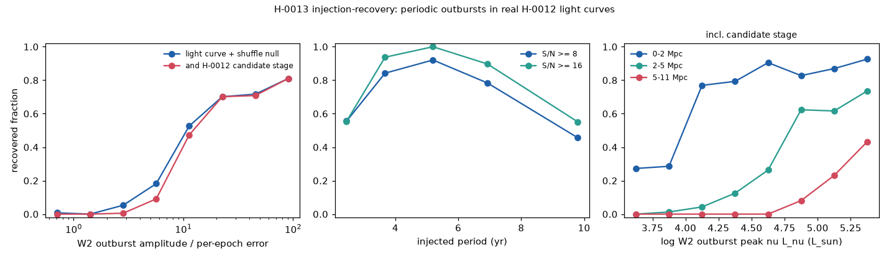
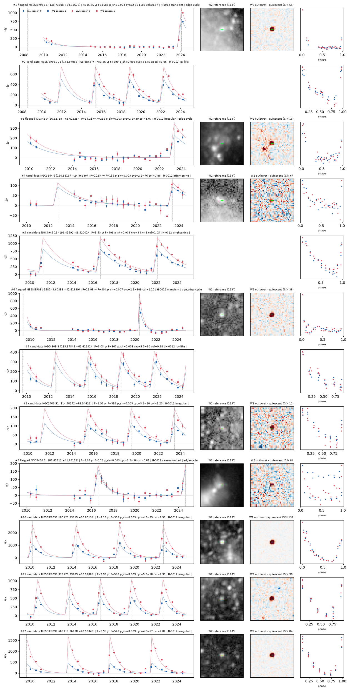

# Hunt H-0013: periodic dust-forming massive stars in nearby galaxies

**Question.** H-0012 found OS-0031: a source in NGC 2403 that makes a mid-infrared dust outburst every ~5.3 yr (Spitzer
2007, 2012, 2018; WISE 2017-18, 2023), with no optical counterpart. Fewer than about a dozen extragalactic periodic or
episodic dust makers are known (colliding-wind WC binaries such as WR 140, and LBV binaries). Can Oddsky build a tool
that finds sources with **repeated** outbursts in the H-0012 forced light curves? It has to recover OS-0031 blind,
explain how the known dust makers fare, and then search all 318 galaxies within 10 Mpc.

**Status (2026-11-02): tool built, acceptance-tested, run on everything, and the top candidates checked against
Spitzer 2004-2019 and the archives. Refereed in-line below. Nothing is posted, sealed or filed, and no cases are
opened.**

**Results in brief**

- **OS-0031 is recovered blind.**
  - It passes every gate with no flag. P_WISE = 5.45 yr, with cycles detected at 2017.5 and 2022.9.
  - The joint WISE + Spitzer fit gives P = 5.16 yr with all four cycles detected (2007.0, 2012.1, 2017.3, 2022.4).
  - It is **not** near the top of the list: #55 of 310 by priority and #111 by F. WISE alone does not make it special.
- **The dominant false-positive class is luminous long-period dusty pulsators** (OH/IR, super-AGB or dusty supergiant
  stars with P = 3-5 yr). They match OS-0031-like objects in period, colour and luminosity.
  - Four of the five such SPIRITS stars that H-0012 measured (Karambelkar et al. 2019) are found as "recurrent", with the right
    periods: 14dd, 14bbc, 15mr and 15ty (15afp fails the shuffle null).
  - Only a light-curve *shape* test separates them, and it does so imperfectly. 15mr reaches **#7** of the list.
- **Two new candidates survive the 20-year Spitzer + WISE test and look like dust makers:**
  - **NGC 3344 #6.** WR 140-like: sharp ~1-yr outbursts in 2004.3, 2013.9 and 2023.3 (P ≈ 9.6-10 yr) over a flat
    minimum, on a knot whose SDSS spectrum shows Wolf-Rayet features.
  - **NGC 4945 #13.** Three cycles at P = 5.37 yr, a rise of ≤ 0.45 yr, and a peak-to-trough W2 amplitude of
    ~3×10⁵ L☉. That is more than any AGB star emits in total.
- **Two more are real repeating sources whose nature is undecided:**
  - **M81 #6:** two large obscured outbursts at least 14 yr apart (≤ 2005-2009.9, and 2024).
  - **M81 #21:** P = 3.56 yr over 2004-2024. It is the self-obscured luminous star [KSK2013] M 81 10 of Khan et al.
- Completeness reaches ~70-80% only for strong signals (W2 outburst amplitude ≥ 16× the per-epoch error). For a fixed
  luminosity it falls steeply with distance.
- **The WISE-only list is not pure.**
  - Shuffled-surrogate false-positive rate: 0.33% per source.
  - PSD-matched red-noise surrogates: 7.1% per source.
  - Periodicity needs a third and later cycles, which means Spitzer.

## The tool: `oddsky.imaging.recurrence` (and `oddsky.imaging.spitzer`)

Tests: `tests/test_recurrence.py` (13 tests on synthetic WISE-cadence light curves and synthetic IRAC images, 2 s).

**Model.** Per band b and visit season s:

    y = c[b,s] + A[b] · h(t; P, t0, τr, τd)

- h is a closed-form infinite train of outbursts: a linear rise of length τr to a peak at t0 + kP, then an
  exponential decline with e-folding time τd.
- A[b] ≥ 0.
- The four season offsets absorb the per-season reference zero points and any season-locked systematic.

**Grid.**
- P from 1.5 to 16 yr, log-spaced so that the last cycle moves by < 0.2 yr between grid steps.
- t0 in 0.1-yr steps.
- 7 (τr, τd) shapes with τd ≤ P/2.5 and τr ≤ P/3.

That is about 65,000 templates. The amplitudes and offsets are linear, so each template is a weighted projection
(about 30 ms per light curve).

**Statistic.** F = Δχ² / max(1, χ²_fit/dof). It is scale-free: it does not trust the absolute scale of the forced-photometry
errors, and it punishes sources whose residuals stay large (Miras, AGN).

**Light-curve decision (`light_verdict`).** All of the following must hold:
- F ≥ 25.
- At least 2 detected cycles. Each cycle gets its own amplitude with the colour fixed, and needs α/σ ≥ 3.
- The outburst is present in **both** visit seasons, each against its own reference (S/N ≥ 2 each).
- It is not a short-period sinusoid: a sinusoid with P < 1000 d must not fit as well.
- **The Mira-alias guard: P ≥ 2.3 yr.** At the 182.6-d cadence an apparent period P is fitted equally well by a
  pulsator at 365.25/(2 ± 1/P) d. Below P = 2.3 yr that alias is an ordinary Mira period (≥ 230 d). Without this
  guard, aliased M31 Miras at P ≈ 2.0 yr filled the top of the list.

**Significance and comparisons.**
- **Shuffle null** (`shuffle_null`, 300 per source). Epochs are permuted within each visit season, with the same
  permutation in W1 and W2, over the same template grid, so the look-elsewhere effect is included. Gate: p ≤ 0.01.
- **Red-noise null** (`phase_null`, 150 per source). Fourier phase randomisation of the evenly sampled NEOWISE
  segment. It keeps the power spectrum, so quasi-periodic stochastic variability survives. Reported, not a gate:
  OS-0031 itself has p_phase = 0.046 from WISE alone.
- **Shape test** (`shape_test`). At the best period, sharp outburst trains (FWHM/P ≤ 0.25) are compared with a
  sinusoid, with **one phase shared by all bands**. Z = (Δχ²_sharp − Δχ²_sine)/scale.
  - Z > 0 means flat-minimum outbursts are preferred; Z < 0 means continuous pulsation.
  - Soft flag `agb-compatible`: P < 7 yr and Z < 4.
- **Also reported:**
  - R: what the second and later outbursts add over the best single outburst.
  - S: outburst against a free sinusoid, with an independent phase per band.
  - A: the long period against the best Mira-like (P = 100-1000 d) asymmetric train.
  - Asymmetry against time-reversed templates, the duty cycle, and the colour of the outburst light.
- **Context vetoes** (hunt script; from the H-0012 merged table):
  - Hard (reject):
    - moving star (dipole or cutout dipole);
    - Gaia foreground star;
    - core: r < 0.03 R, or a nucleus/saturation mask code;
    - empty sky: reference flux ≤ 0 in both bands;
    - neighbour: a source within 12" with a stronger fit at the same period;
    - tile-systematic: ≥ 3 other recurrent sources in the same tile share the period within 5% and the phase within 0.1 P.
  - Soft (flag):
    - AGN (Gaia quasar, AGN colour, SIMBAD AGN);
    - known SIMBAD LPV;
    - a missing cycle;
    - `edge-cycle`: fewer than 2 detected peaks inside the data span.
- **Priority** (for ordering only; light curve and luminosity, no catalogue identities): log₁₀F + 0.5 for each of
  - P ≥ 7 yr (beyond AGB pulsation periods);
  - Z ≥ 10;
  - L_W2 ≥ 3×10⁴ L☉;
  - p_phase ≤ 0.01.

**Spitzer extension** (`oddsky.imaging.spitzer`, `scripts/spitzer_ext.py`).
- **Input:** every IRAC [3.6]/[4.5] post-BCD mosaic over the position, from IRSA's SIA service (`spitzer_sha`).
- **Light curve:** each mosaic is resampled onto a 0.6" grid, differenced against the median epoch, and measured in a
  2.4" aperture with an annulus sky. The error is empirical (12 offset apertures). This is the H-0012 referee's
  method, made reusable; it reproduces their OS-0031 light curve to a few µJy.
- **Politeness:** IRSA serves neither byte ranges nor cutouts for SHA files. So each mosaic is downloaded once,
  sequentially with 2-s pauses, sampled at every target in it, and deleted; only small grids are cached
  (`~/oddsky-runs/h0013/spitzer/`). Failures go to `work/spitzer/errors.json`. Three SIA failures were recorded: a
  connection reset (M81 #6; the retry succeeded), then a malformed CSV and a TLS timeout (NGC 4605 #3; still missing).
- **Joint fit (`fit_series`):** W1/W2 with season offsets plus IRAC [3.6]/[4.5] with cryogenic/warm offsets, each with
  its own amplitude, one outburst train. Outputs:
  - per-cycle amplitudes 2004-2024 and which instruments see each cycle;
  - missing cycles;
  - a joint shuffle null;
  - the joint shape statistic Z_joint.

## Acceptance test

**OS-0031 (114.22807 +65.59806), blind.** It is recovered: verdict `candidate`, no flag.

| | WISE only (blind) | WISE + Spitzer (joint) | H-0012 referee |
|---|---|---|---|
| period | 5.45 yr | 5.16 yr (grid step 0.05) | 5.3 ± 0.1 yr |
| cycles detected | 2017.5, 2022.9 | 2007.0, 2012.1, 2017.3, 2022.4 (3 in Spitzer); none missing | 2007.25, 2012.45, 2017.75, 2023.2 |
| F, p_shuffle | 141, 0.0033 (the floor for 300 shuffles) | 1057, 0.005 (floor for 200) | |
| red-noise p | 0.046 | | |
| shape | Z = +20 | Z_joint = +25 | fast rise, flat minimum |
| rank | #55 of 310 by priority, #111 by F | | |

The template's peak marks the end of the linear rise, so the fitted peak dates run 0.3-0.8 yr earlier than the
observed maxima. The WISE-only and joint periods differ by 5%, which is a template-mismatch systematic.

**Known dust makers and periodic IR sources** (positions from SIMBAD and the literature, compiled in
`work/known_dust_makers.json`; script `scripts/known.py` → `work/acceptance_known.csv`):

| object | host | H-0012 source? | H-0013 result | why |
|---|---|---|---|---|
| SPIRITS 16ln = N604-WRXc (WC dust maker) | M33 | yes, 0.2" (`transient`) | rejected: single outburst (2014.2, F = 715) | One dust episode in 2010-2024. Lau et al. 2021 also saw only one; the period (2.2-8.8 yr bounds) is not shown by WISE |
| SPIRITS 19q (WC dust maker) | NGC 2403 | yes, 0.2" | rejected: single outburst (2018.2) | Published P ≥ 12 yr, longer than the usable baseline. A correct miss |
| SPIRITS 16df | NGC 2403 | no (nearest 22.6"; no detections within 6") | – | ~0.1-mag irregular variation, far below the WISE limit |
| SPIRITS 14apu | M101 | yes, 0.5" (`irregular`) | weak (F = 21) and single outburst | Low S/N at 6.9 Mpc. Lau et al. 2021 call it irregular; Karambelkar et al. 2019 give 1752 d |
| SPIRITS 18hb | NGC 6946 | no (nearest 59") | forced photometry on the local stacks: F = 19, p_shuffle = 0.30 | W2 amplitude 66 µJy against an 18 µJy per-epoch error, with one episode. Too faint |
| SPIRITS 14bqe (P ≈ 8.5 yr) | IC 1613 | no (nearest 56"; no ≥ 5σ detections within 6") | – | Below the single-epoch candidate threshold. Forced photometry would need IC 1613's stacks again (not on disk; no NERSC pulls) |
| HD 36402, HD 38030 | LMC | – | – | The LMC was a separate H-0012 project; no light curves exist |
| **dusty LPVs** (Karambelkar 2019; Bond 2022), P = 1100-1650 d: 14dd, 14bbc, 15ty, 15mr, 15afp | NGC 2403, 7793, 6946, 4605 | yes | **recurrent, with the right periods:** 14dd 3.97 yr (lit. 3.88); 14bbc 4.02 (4.10); 15ty 4.44 (4.35); 15mr 3.03 (3.05); 15afp 5.5 (4.5, 2 cycles) | The false-positive class. Final: **15mr candidate #7, 15ty candidate #66**, 14dd and 14bbc flagged `agb-compatible`, 15afp rejected (shuffle null, empty sky) |
| other SPIRITS LPVs (15nz, 15qo, 15aag, 15ahg, 14al, 15wt, 15mt, 16ea, 15pk, 18ec, 15js, 14apz, 16do, 15jt, 16po; 14aue P = 344 d) | various | 15 of them: no candidate within 6" (0-1 single detections) | – | Below the candidate threshold. 14aue (a candidate, 0.5") is rejected as a short-period sinusoid / single outburst |

What the acceptance test shows:

- The detector measures long periods correctly. It recovers the Karambelkar periods to 1-3%.
- It recovers OS-0031 without being told where it is.
- It does **not** recover the known WC dust makers as *periodic*. In 2010-2024 each shows one episode (16ln, 19q),
  is too faint (18hb, 14bqe), or is irregular (16df, 14apu).
- Its purity against luminous dusty pulsators is poor. That is a property of the sky, not only of the code: at WISE
  cadence these stars have the same period, colour and luminosity as OS-0031.

**A correction to the H-0012 referee.** The H-0012 referee wrote that the SPIRITS LPV catalogue (Karambelkar et al.
2019) "only fits periods below about 1,000 d". Our compilation lists Karambelkar LPVs with P = 1113-2538 d, and the
detector recovers four of them. OS-0031's P = 1940 d is inside that range. This should be checked against the
paper's table; if it holds, it weakens the purely photometric case that OS-0031 is a dust maker (see the referee
section below).

## Completeness and false positives (`scripts/inject.py`)

**Setup.**
- **Hosts:** 1,433 injections into real light curves, up to 25 per galaxy over 171 galaxies, drawn from every H-0012
  class except sources the scan itself calls recurrent.
- **Injected signal:**
  - P log-uniform in 2-12 yr, random phase;
  - τr from 0.1 to 0.5 yr and τd from 0.3 to min(1.5, P/2.5) yr;
  - W2 peak νLν log-uniform in 10^3.5-10^5.5 L☉ at the host's distance;
  - W1−W2 of the outburst light from 0.6 to 1.6.
- **Recovery:** the full decision, including 100 shuffles. The H-0012 candidate stage is emulated from the injected
  signal (≥ 2 epoch-band images at ≥ 5σ above the season median, from both seasons).

| W2 amplitude / per-epoch error | < 2 | 2-4 | 4-8 | 8-16 | 16-32 | > 32 |
|---|---|---|---|---|---|---|
| recovered | 0.2% | 5% | 18% | 53% | 70% | 80% |

Period by period, for S/N ≥ 8:

| P (yr) | 2-3 | 3-4.5 | 4.5-6 | 6-8 | 8-12 |
|---|---|---|---|---|---|
| recovered | 56% (the alias guard removes P < 2.3) | 84% | 92% | 78% | 46% |

- The loss at long P is the requirement for two peaks inside 2010-2024. With one peak in the data, 43% are recovered;
  with two, 81%; with four, 94%.
- **Periods:** 97% of recovered injections have the period within 10%.
- **By distance:** at W2 outburst luminosity ≥ 10^4.5 L☉ (OS-0031 is ~9×10⁴), recovery is 90% within 1 Mpc, 82% at
  1-2, 64% at 2-4, 44% at 4-7 and 17% at 7-11 Mpc.
- **By luminosity** (with the candidate stage): 4% at 10^3.5-4, 16% at 10^4-4.5, 32% at 10^4.5-5 and 57% at
  10^5-5.5 L☉.
- **WR 140 analogues** (~3×10³ L☉ amplitude) are reachable only within ~1 Mpc: M31, M33, NGC 6822, IC 1613 and the like.

**False positives.** For 1,527 real light curves of every class, one surrogate each was passed through the full decision:

- within-season shuffle: **0.33%** pass (5);
- Fourier phase randomisation (PSD kept): **7.1%** pass (109). Most come from irregular (29), season-locked (23),
  LPV (18) and fading (16) hosts.

The red-noise null is harsh: it turns monotonic trends into wandering oscillations. Even so, it says what WISE alone
cannot do. With 2-3 cycles in 14 years, quasi-periodic stochastic variability can pass. **Three or more cycles across
2004-2024 (Spitzer + WISE) and the shape test are what make a periodic claim.**



## The discovery run

- `scripts/h0013.py scan` covers every merged H-0012 v2 source with a light curve: **25,365 sources in 177 galaxies**
  (16.5 min, one process, under 0.5 GB).
- **Funnel:**
  - light-curve decision `recurrent`: 525;
  - p_shuffle ≤ 0.01: 347;
  - after context vetoes: **92 `candidate` + 218 `flagged`**, in 51 galaxies.
- **Rejection reasons** (215 rejected): shuffle null 178, tile-systematic 22, empty sky 21, AGN 16, moving star 8,
  Gaia foreground 6, core 1, neighbour 1.
- **Flags among the 310:** `agb-compatible` 186, `edge-cycle` 20, missing cycle 13, AGN 9, known LPV 3.
- **By galaxy:** M31 has 100 of the 310 and M33 45. Most are long-period AGB stars.

The top 12 by priority (`work/candidates_h0013.csv`, `figures/top_candidates.png`):



Spitzer was run on 7 of the top 9 (the AGN M31 #1587 was skipped; NGC 4605 is listed below), plus OS-0031 and two
controls (`work/spitzer_summary.csv`, `figures/spitzer_*.png`):

- SPIRITS 14dd, a known LPV: **Z_joint = −27**;
- the AGB-like NGC 2403 #3: Z_joint = −17;
- OS-0031: Z_joint = +25.

M33 was not run: its mosaics are ~100 MB each, ~6 GB per position. M31 #669 has a single Spitzer epoch.

### Referee verdicts (skeptical; Claude, 2026-11-02)

Archive checks are in `work/archives_h0013.json`: Gaia DR3 3", SIMBAD 10", AllWISE 6", SEIP 4", HST/JWST coverage
from MAST, TNS (H-0012 galaxy cones) and ADS full-text searches of the coordinates. Every ADS coordinate hit was an
unrelated paper; no top candidate's position appears in the ADS full text.

| # | source (RA, Dec) | d (Mpc) | WISE / joint P | verdict | reasoning |
|---|---|---|---|---|---|
| 1 | **M81 #6** (148.73908 +69.14676) | 3.6 | 15.8 / 15.8 yr (two events) | **Real; recurrent eruptions; nature undecided** | Spitzer is flat in 2003.8-2005.0, then +196 µJy at 2009.9 declining to +98 by 2010.4 (WISE 2010 agrees). Flat 2014-2023, then a sharp rise in 2023.9-2024.4 to W1 0.75 / W2 1.0 mJy (~3×10⁵ L☉). Two events ≥ 14 yr apart; a period cannot be tested. It sits on a GMC/HII region next to a blue Gaia source (G 20.25, BP−RP 0.37, M_G ≈ −7.5). TNS: nothing within 22" (AT 2026dvq at 22.6"). Probably the H-0012 "2023-24 outburst in a compact HII region" lead, now with an earlier event. Options: a recurrent LBV-like eruption, a long-period (~16 yr) dust maker, or two unrelated transients. Post-2024 IR is needed |
| 2 | **M81 #21** = [KSK2013] M 81 10 (148.97066 +68.98447) | 3.6 | 3.45 / 3.56 yr | **Real, periodic (4 cycles, 2004.8-2022.5); class undecided, leaning dusty pulsator** | A known self-obscured luminous star (Khan et al. 2013, 2015). Continuous sawtooth with short minima, χ²_r 47, Z_joint 607. A peak-to-trough W2 amplitude of ~1.6×10⁵ L☉ needs L_bol ≳ 3×10⁵ L☉: a hypergiant or massive star, not AGB. Whether its periodicity is already reported needs a read of Khan et al. 2015 (not done) |
| 3 | IC 342 #0 (56.62799 +68.01925) | 3.3 | 14.2 / 14.3 yr | **Real variable; recurrence undecided** | Bright in 2010 and fading; Spitzer quiescent in 2005.8 and 2014-2020; a slow (~2-yr) rise in 2022-24. Two states with edge cycles and an unfast second rise: not a demonstrated recurrence. Low latitude, heavy extinction. Three faint red Gaia sources within 3" |
| 4 | **NGC 3344 #6** (160.88167 +24.96630) | 6.85 | 10.5 / 10.0 yr | **Real. The best new periodic dust-maker candidate** | Spitzer [3.6]/[4.5]: +80 µJy above quiescence at **2004.32** (both bands); quiescent in 2012.5-2013.1; a rise caught at 2013.18 and a peak at **2014.1** (+85); back to quiescence by 2016. WISE: flat 2016-2022, a new outburst peaking ~**2023.3**. The outbursts are spaced 9.8 and ~9.2 yr, last ~1.5 yr each (duty ~0.15), and rise fast: the WR 140 morphology. Peak νLν(W2) ~1×10⁵ L☉, about 30× WR 140. The variable is a point source 0.45" from the WISE position in the Spitzer bright − faint image. It sits 0.4" from **[BKD2008] WR 541**, an SDSS fibre spectrum with Wolf-Rayet features (Brinchmann, Kunth & Durret 2008), and on a blue knot (Gaia G = 21.1, BP−RP ≈ 0, M_G ≈ −8: a young cluster). No TNS, no ADS. **Caveats:** the 2004 cycle rests on one Spitzer epoch; the WR signature belongs to a 3" (100 pc) fibre, not to the star. Next peak ≈ 2033. **Case: recommended** |
| 5 | **NGC 4945 #13** (196.41592 −49.42001) | 3.8 | 5.43 / 5.37 yr | **Real, periodic (3 cycles); leaning dust maker / massive star** | Cycles in 2011.3, 2016.7 and 2022.05. Spitzer warm 2012-2019 tracks two of them (2016.34 → 2016.78: from +22 to +505/+748 µJy in 0.45 yr), and a single 2007.6 [4.5] epoch fits the decline of the 2005.9 cycle. Sawtooth: fast rise (~8% of P), slow decline, short minimum; Z_joint +83. The peak-to-trough W2 amplitude of ~3×10⁵ L☉ exceeds the total luminosity of any AGB star, so this is not an OH/IR pulsator at NGC 4945's distance. A Galactic foreground star (b = +13°) is implausible: no Gaia source, and halo Miras do not reach P = 5 yr. Nothing in Gaia, SIMBAD, AllWISE, SEIP, HST, TNS or ADS. An edge-on starburst with heavy extinction: an optical counterpart is not expected. **Case: recommended** |
| 6 | M31 #1587 (9.60353 +41.61839) | – | 11 yr | **AGN (flagged)** | Blazar 6C 003542+412035 behind M31: one 2020 flare plus the 2010 level. Correctly flagged |
| 7 | NGC 4605 #3 = **SPIRITS 15mr** (189.97844 +61.61292) | 5.5 | 3.03 yr | **Known dusty LPV (P = 1113 d)** | Recovered with the right period, but a false positive for the dust-maker search. It passed every veto (Z = 98: a large-amplitude pulsator looks peaky in flux). Spitzer was not run: two SIA attempts failed (a malformed CSV, then a TLS handshake timeout), see `work/spitzer/errors.json` |
| 8 | NGC 2403 #51 (114.48272 +65.54622) | 3.2 | 3.97 yr | **Undecided, leaning luminous AGB** | Three clean WISE cycles; colour 1.23; SEIP [4.5] = 196 µJy (M[4.5] ≈ −12.6), the luminosity of SPIRITS 14dd in the same galaxy. Spitzer gives only 7 cryogenic [3.6] epochs here (the warm mosaics do not cover it), so it cannot be tested |
| 9 | NGC 4490 #9 (187.61512 +41.66151) | 5.8 | 8.0 yr | **Known transient; recurrence not established** | Its 2016.5 outburst is SPIRITS 16az (SIMBAD, 1.7"). The "second cycle" is one rising last epoch (2024.6). A Chandra HMXB lies 0.5" away. Edge cycle |
| 10 | M33 #180 (23.53515 +30.80134) | 0.86 | 4.16 yr | **Real; probably an OH/IR (dusty AGB) star** | Sharp peaks over ~2-yr flat minima; bright (SEIP [4.5] 1.08 mJy, M[4.5] ≈ −11.6, W1−W2 = 1.56). Period, luminosity and colour are typical of luminous OH/IR stars. A large magnitude amplitude makes the flux minima flat. Spitzer was not run (mosaic size). JWST NIRCam/MIRI imaging exists |
| 11 | M33 #378 (23.33189 +30.51805) | 0.86 | 2.99 yr | **Known variable (AGB)** | [MSC2015] VC 20, a catalogued M33 variable candidate. Sawtooth |
| 12 | M31 #669 (11.76179 +42.56349) | 0.77 | 3.99 yr | **Dusty AGB / OH/IR** | AllWISE W1−W2 = 2.37; SEIP SED rising to 8 µm (2.3 mJy); M[4.5] ≈ −11.1 |
| – | **OS-0031** (114.22807 +65.59806) | 3.2 | 5.45 / 5.16 yr | **Real, strictly periodic over 4 cycles; a dust maker is favoured but not proven** | See below |

**On OS-0031, independently.**
- **For a dust maker:** the periodicity is secure (four cycles, 2007-2022, no missing cycle). The shape prefers flat
  minima. Z_joint = +25, against **−27 for the known LPV SPIRITS 14dd measured the same way in the same galaxy**.
- **Not decisive:** period (1,900-2,000 d), colour (W1−W2 ≈ 1.5) and W2 amplitude (~9×10⁴ L☉) all lie inside the
  range of the luminous SPIRITS dusty LPVs. A star whose magnitudes vary sinusoidally with 2-3 mag amplitude produces
  peaky flux curves with flat minima (cf. SPIRITS 15mr, Z = 98).
- **Archive notes:** SIMBAD lists an X-ray source (CXOU J073654.5+653547) 5.1" away and the Khan et al. candidate
  [KSK2013] N 2403 5 5.4" away. At WISE/Spitzer astrometry (≲ 0.5") neither is the same object, but the X-ray source
  deserves a look at the Chandra positions, because colliding-wind binaries are X-ray sources.
- **What would decide it:** an infrared spectrum (JWST NIRSpec/MIRI) showing featureless carbon dust (WC) or
  H₂O/CO/silicate (AGB), or a measured absolute amplitude. The case should say "periodic dust-obscured outbursts",
  not "colliding-wind binary".

**Bottom line.**
- **Two new periodic candidates merit cases:** NGC 3344 #6 (WR 140-like, P ≈ 10 yr, on a WR-bearing knot) and
  NGC 4945 #13 (P = 5.4 yr, ~3×10⁵ L☉ swings).
- M81 #6 (two big obscured eruptions 2005-09 and 2024) is worth a case as a recurrent transient once post-2024 data exist.
- M81 #21 is a known luminous dusty star whose 3.6-yr periodicity may be new (literature check owed).
- The rest of the top 12 are AGB stars, a blazar, or a known transient.
- The large `candidate` population (92) is dominated by long-period AGB stars in M31 and M33 and should not be read as
  92 dust makers.

## Files

- `src/oddsky/imaging/recurrence.py`: templates (closed-form outburst trains, Mira-like short-period trains), the
  matched-filter scan and F, per-cycle fits, season check, single-outburst / sinusoid / alias / shape comparisons,
  shuffle and phase-randomised nulls, injection, multi-instrument series fits, verdicts.
- `src/oddsky/imaging/spitzer.py`: SIA query, polite download-sample-delete, the difference-aperture light curve.
- `tests/test_recurrence.py`: 13 tests.
- `scripts/h0013.py`: `scan`, `nulls`, `rank`, `figures`.
- `scripts/inject.py`: injection-recovery and surrogate false-positive rates.
- `scripts/known.py`: the acceptance table, including forced photometry where stacks are on disk.
- `scripts/spitzer_ext.py`: the Spitzer extension and joint fits.
- `scripts/archives.py`: Gaia, SIMBAD, AllWISE, SEIP, MAST, TNS (cached cones) and ADS.
- `work/`:
  - `candidates_h0013.csv`: the 525 shortlisted sources with every statistic, flag, verdict and rank;
  - `acceptance_known.{csv,json}`;
  - `known_dust_makers.json`: 29 literature objects with positions, periods and references;
  - `injection_summary.json`;
  - `spitzer_summary.csv` and `spitzer/<source>.json` (light curves, joint fits, SIA results, errors);
  - `archives_h0013.json`.
- `figures/`: `top_candidates.png`, `spitzer_<source>.png`, `completeness.png`.
- Big data in `~/oddsky-runs/h0013/`: `scan.parquet` (all 25,365), `nulls.parquet`, `inject.parquet`,
  `false_positives.parquet`, Spitzer sample caches, logs.

## Reproduce

```bash
uv run --extra dev pytest tests/test_recurrence.py               # 13 tests, ~2 s
uv run python hunts/H-0013/scripts/h0013.py scan                 # ~17 min, all 25,365 H-0012 light curves
uv run python hunts/H-0013/scripts/h0013.py nulls                # ~35 min: 300 shuffles + 150 phase surrogates x 525
uv run python hunts/H-0013/scripts/h0013.py rank
uv run python hunts/H-0013/scripts/h0013.py figures --top 12
uv run python hunts/H-0013/scripts/known.py
uv run python hunts/H-0013/scripts/inject.py --per-galaxy 25 --n-shuffle 100   # ~30 min
uv run python hunts/H-0013/scripts/spitzer_ext.py --top 0 --uids "NGC2403|1153p651|69" "NGC3344|1601p242|6" ...  # downloads; paced
uv run python hunts/H-0013/scripts/archives.py --top 0 --uids ...
```

The inputs are the H-0012 v2 run (`~/oddsky-runs/h0012b`) and its merged table
(`~/oddsky-runs/h0012-xmatch/merged_h0012b.parquet`). No new unWISE (NERSC) data were downloaded. The neo11 epochal
coadds behind those light curves are used with A. Meisner's permission (see H-0012 *Provenance*).

## Limits and next steps

- Light curves exist only for H-0012 candidates (≥ 5σ in ≥ 2 epochs from both seasons, or the stacked channel), so
  faint dust makers never enter the scan. A forced-photometry grid over each disk would remove this stage; it needs
  the difference stacks again.
- **Spitzer not done:** M33 (mosaic size) and NGC 4605 #3 (SIA failed twice). Warm-mission coverage of NGC 2403 #51 and #3 is missing.
- **ADS:** the topical ADS queries used concatenated galaxy names (e.g. "NGC3344") and are weak; the
  coordinate-string searches are complete. A proper full-text novelty check is owed for NGC 3344 #6, NGC 4945 #13 and
  M81 #6, and Khan et al. 2015 should be read for M81 #21.
- **OS-0031's centre distance:** r = 0.040 R, just above the 0.03 R `core` veto. A small change to that veto would lose it.
- **Follow-up for NGC 3344 #6:** HST imaging (ACS exists) to isolate the counterpart; an optical spectrum of the knot
  (WC features); LBT/ZTF optical light curves.
- **Follow-up for NGC 4945 #13:** near-IR imaging around the predicted next peak (~2027.4). JWST would settle the dust
  type for both.
