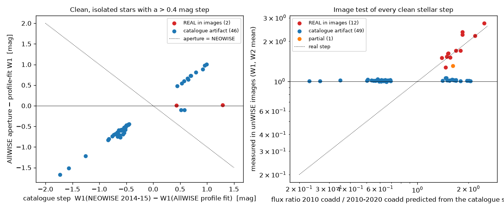

# Hunt H-0016: the WISE gap

**Question.** Nothing observed the mid-infrared sky between February 2011 (end of the WISE post-cryo survey) and December
2013 (NEOWISE reactivation). Which stars and galaxies changed permanently across that gap, and were quiet afterwards? The
H-0002 sky table already holds both epochs for 164.7 million AllWISE sources at |b| ≥ 10°: the AllWISE 2010-11 catalogue
magnitude next to the NEOWISE 2014-15 baseline. Asking costs one query.

**Status (2026-11-03, one session): pilot done and refereed** ([referee report](reviews/claude-referee-2026-11-03.md),
whose required changes are applied below; its probabilities: catalogue-artifact diagnosis 0.97, BD+28 4177 as a disk-loss
event 0.45, LEDA 1815030 as a nuclear flare 0.25). **Nothing committed, sealed or posted.** The companion track, the
one-visit *fades* that H-0008 recorded and never examined, is in section 6.

**Answer in one paragraph.** A > 0.4 mag step in both W1 and W2 between AllWISE and a quiet NEOWISE decade is rare
(19,818 of ~49 million quiet stars) and almost always a blend: 99.4% of the step stars carry an AllWISE artifact or blend
flag. Of the 110 that carry none, 62 are galaxies and quasars (58 of 62 confirmed in the images: nuclei that were 0.4-1.5 mag
brighter or fainter in 2010 and have sat still for ten years), and 48 are stars with a Gaia parallax. **Forty-six of those 48
stellar steps do not exist in the images.** The AllWISE profile-fit magnitude of a clean, isolated, unsaturated W1 = 11-14
star is wrong by 0.4-1.7 mag in both bands; the per-frame fits in the AllWISE multi-epoch table are individually bad (errors 5-10×
too large, some negative fluxes, bad χ²), the AllWISE position is off Gaia by 0.35-2.6" with spurious apparent motions of ~1"/yr,
and the AllWISE *aperture* magnitude is right (median |aperture − NEOWISE| = 0.02 mag). Every one of the 53 artifacts found has
an anomalously low profile-fit SNR (w1snr < 15 at W1 < 14.5); every real step has w1snr ≥ 31. That is a catalogue-column test
anyone can run. The two real stellar steps are both early B stars whose 2010-11 mid-infrared excess vanished by 2014:
**BD+28 4177** (HIP 107387, B0.5III-B1IV, 1.3 mag at 3.4 µm and 1.5 mag at 4.6 µm, rising to 14× at 22 µm) and JL 62 (NSV 25308,
B4e, 0.4-0.5 mag). Both carry small-amplitude optical variability flags (Hipparcos "unsolved variable"; NSV); neither has a
published infrared event. Whether the excess was a Be decretion disk or a ~1400 K dust episode is not decided by the WISE colours.
The wider pull (NEOWISE variability allowed) adds nine image-confirmed stellar changes, and with identities the class is clear: five more emission-line B stars (SK 142, HV 2312, BD+79 499, a B3III[e] star in the LMC, and an uncatalogued 15,000 K B giant), so seven B stars lost circumstellar emission across the gap; TESS shows BD+28 4177 pulsating with the drifting ~1.1 c/d signal Be stars show.
Among the galaxies, eight nuclei (LEDA 1815030 the strongest, 1.0 and 1.5 mag, already declining at 0.5 mag/yr inside 2010) were
far redder and brighter in 2010 than at any time since; the null hypothesis is a turn-off AGN, and nothing in hand excludes it.

## 1. Data and selection

| | |
|---|---|
| parent | BigQuery `oddsky-sky-br3c3.sky.sky2_features` (H-0002 re-run, |b| ≥ 10°, 176.9 M AllWISE sources with NEOWISE 2014-2024 visit medians) |
| quiet NEOWISE | n_visits ≥ 12, W1 and W2 peak-to-peak < 0.3 mag over 2014-2024, baseline W2 scatter < 0.1 |
| magnitude window | 8 ≤ W1(AllWISE) ≤ 14.5, W2(AllWISE) ≤ 13.5 (saturation above, NEOWISE W2 bias below; section 2) |
| step | \|W1_base − W1_AllWISE\| > 0.4 **and** \|W2_base − W2_AllWISE\| > 0.4, same sign |
| wide pull | the same with 0.3 ≤ W1 ptp < 1.0, W2 ptp < 1.0, fainter-now only (> 0.5 in W1, > 0.4 in W2): 722 stars. Motivated by the positive control KT Eri (below), whose quiescent flicker fails the strict quiet cut |
| kept for cross-matching (`work/steps_master.csv`, 261 rows) | every candidate with no AllWISE flag (110) plus every fainter-now candidate with ≤ 2 flags (151 more); the flagged brighter-now majority was not followed |

`w1_base`/`w2_base` are the medians of the first three NEOWISE visits (2014-15, code `infra/gcp/neowise_pixel_v2.py`, on
GCS under `code/`); the AllWISE magnitudes are `w1mpro`/`w2mpro` carried in the NEOWISE single-exposure table.

## 2. Controls

**Systematics (18-49 M quiet stars, BigQuery, `work/q1_offsets.csv`).** Median W1_base − W1_AllWISE is within ±0.02 mag for
8 ≤ W1 ≤ 14.5 and the 16-84% range is ±0.01-0.05 mag. W2 is within ±0.03 to W2 ≈ 14, then NEOWISE W2 runs bright (−0.14 at
15.0, −0.34 at 15.5: faint-end bias), hence the W2 ≤ 13.5 cut. Brighter than W1 = 8 the NEOWISE baseline is 0.8-4 mag *fainter*
(saturated frames dropped), hence the W1 ≥ 8 cut.

**Positive control: KT Eri** (nova, outburst 2009 Nov 25, AllWISE cntr 723010701351038500). AllWISE W1 = 10.11 (2010, in
decline) against NEOWISE 13.58: d1 = +3.47, d2 = +3.11. Found by the step query, but it fails the quiet cut (NEOWISE ptp 0.52),
which is why the wide pull exists. The image test below gives flux ratios 4.3 (W1) and 3.6 (W2) against 5.6-6.2 predicted: it
under-predicts by 25-30% because the nova was still fading through 2010-11 and the catalogue ratio is not a flux-weighted mean,
and it is nowhere near the R = 1 of an artifact.

**Third epoch: 2MASS K (1998-2001).** A bare photosphere has K − W1 ≈ 0.0-0.2. For each step star, K says which WISE epoch is the
star's normal state (`epoch3` column: `allwise`, `neowise`, `both`, `neither`, `no2mass`).

**AllWISE flags** (`scripts/steps_triage.py`): cc_flags in W1/W2, nb > 1, ext_flg > 0, saturated pixels, w1rchi2 > 3,
detected in < 70% of frames. **Gaia DR3** (IRSA copy; the ESA archive hung all night): brightest source within 3", every
source within 6", parallax, proper motion. **AllWISE multi-epoch photometry** (`allwise_p3as_mep`, every 2010-11 frame):
per-epoch medians (`scripts/mep_epochs.py`).

**Independent image test** (`scripts/unwise_check.py`). unwise.me serves coadds labelled `allwise` and `neo7`, on one
calibration. Their semantics were established empirically, not from documentation (the site does not state them): for BD+28 4177
the `allwise` cutout gives W1 = 8.97 (AllWISE catalogue 8.91), the `neo7` cutout 10.03, between 2010 and the NEOWISE level, with
an implied 2010-11 weight of 1:5 to 1:9; KT Eri gives R = 4.3. So `allwise` is the 2010-11 coadd and `neo7` mixes 2010-2020.
Aperture flux of the star in both gives R = F_2010 / F_2010-2020. With a = the catalogue flux ratio 2010/NEOWISE and frames
weighted 1:6 (nominal 1:7; the two differ by < 4% here), a real step predicts R = 7a / (a + 6); a catalogue error predicts R = 1.
The two are far apart for every candidate (R_pred 0.23-2.5). The referee re-measured R with independent aperture code (three
apertures and the peak pixel) and reproduced every value to 0.01-0.04.

## 3. Funnel

| step | n | what fell out |
|---|---|---|
| quiet stars in the magnitude window | ~49 M | |
| > 0.4 mag step, both bands, same sign | 19,818 | 19,546 brighter now, 272 fainter now |
| no AllWISE artifact/blend flag | **110** | 19,708 flagged (97% of them "brighter now": NEOWISE single frames blend what the AllWISE coadd resolves; step rate per star is 3× higher in the dense pixels) |
| a Gaia parallax (parallax/error > 3) | 48 stars | 62 galaxies and quasars (SIMBAD: 5 QSO, 5 Sy1, 3 Sy2, 3 AGN, 6 G, ...) |
| 2010 epochs: both AllWISE epochs agree with the catalogue | 48 of 48 | the per-epoch medians follow the catalogue, but the frames behind them are individually bad for the artifacts (section 4) |
| **real in the unWISE images** | **2 stars** | **46 catalogue artifacts** (33 "brighter now", 13 "fainter now") |
| galaxies and quasars real in the images | 58 of 62 | 4 artifacts, all with the same signature as the stellar ones |
| wide pull: 722 → no flag 398 → stellar with 2MASS 14 → real in images | 10 (+1 partial) | 3 artifacts |

Tables: `work/steps_master.csv`, `work/steps_unwise_verdict.csv`, `work/steps_nonstellar_unwise_verdict.csv`,
`work/steps_wide_unwise_verdict.csv`. Raw pulls (8 MB) in `~/oddsky-runs/h0016/`.

## 4. The AllWISE profile-fit failure (a result about the catalogue)

Left: for the 48 clean stellar steps, AllWISE aperture minus profile-fit W1 against the catalogue step. The 46 artifacts lie on
the line "aperture = NEOWISE": the aperture magnitude (`w1mag`, curve-of-growth corrected) is right to 0.02 mag and the
profile-fit magnitude (`w1mpro`) is the one that is wrong, in either direction, by up to 1.7 mag, in W1 and W2 together. The two
real stars sit at zero. Right: the image test for every clean stellar step (main and wide pulls): artifacts at R = 1, real steps
on the diagonal.

What the 53 artifacts (46 + 4 non-stellar + 3 wide) have in common, from the catalogue columns alone (the referee's frame-level
and astrometric columns added):

| column | artifacts | real steps |
|---|---|---|
| w1snr at W1 = 11-14.5 | **5.4-13.7** (a W1 = 12.5 star normally has SNR ≈ 40-47) | 31-50 |
| \|w1mag − w1mpro\| | 0.44-1.67 | ≤ 0.13 |
| AllWISE − Gaia position offset | 0.35-2.6" (median 0.86") | 0.05" |
| AllWISE sigra | 0.10-0.40" | 0.03-0.04" |
| AllWISE apparent motion \|pm\| | up to 2,380 mas/yr (median 847) | 0, 55 mas/yr |
| multi-epoch frames: w1sigmpro_ep; null uncertainties; negative fluxes; frame MAD; w1rchi2_ep | 0.09-0.27 mag; 0-29%; 0-22%; 0.07-0.35; 0.8-8.7 | 0.024; 0; 0; 0.021; 1.3-1.6 |
| cc_flags, nb, ext_flg, w1rchi2 (catalogue), w1nm/w1m | clean | clean |

So the failure is silent in every flag but visible in several columns: it is a profile fit that converged badly (wrong centroid
and/or PSF) on an isolated star, in every frame, not a clean photometric offset. 32 of 46 artifacts have no Gaia source within
6", and the strongest neighbour case (an unresolved 1.5" pair) is measured identically by the aperture, the 2010 image and
NEOWISE; neighbours do not explain the sample (referee, finding 6). **Computed (IRSA async job 27091585, 2026-11-03):** of
20,560,072 AllWISE sources with |b| > 10°, 8 ≤ W1 ≤ 14.5, cc_flags = 0000, nb = 1, ext_flg = 0, **106,933 (0.52%) have
|w1mag − w1mpro| > 0.4, and 10,995 (0.053%) also have w1snr < 15.** In a 1.5° test cone the referee found the same rates
(0.10% and 0.065%), that `w1snr < 15` alone selects the discrepant sources, and a new instance (J131558.26+294324.9, w1mpro 14.41
vs w1mag 11.37, |pm| 1,023 mas/yr) outside our sample. Which of the 10,995 are failures of this kind is not tested beyond our
53. The mechanism is not identified; the unWISE catalogue paper (Schlafly et al. 2019) notes magnitude-dependent AllWISE-side
systematics, and the NEOWISE explanatory supplement documents a "suppressed nearby brighter source subtraction" error in AllWISE
profile fitting, but neither describes isolated stars off by a magnitude. **Inferred:** any AllWISE-versus-later comparison
(CatWISE, NEOWISE, VarWISE, Gaia-WISE SED fits) should require |w1mag − w1mpro| < 0.3, w1snr consistent with the magnitude, and
an AllWISE − Gaia offset < 0.3" for isolated stars, or test the images.

## 4b. The failure over the whole catalogue (2026-11-03, `scripts/catalog_rate.py`)

The 10,995 clean AllWISE sources with |w1mag − w1mpro| > 0.4 and w1snr < 15 (|b| > 10°, 8 ≤ W1 ≤ 14.5, IRSA async job
27125305; `~/oddsky-runs/h0016/allwise_lowsnr_discrepant.csv`) are **two populations**, told apart by 2MASS K (a photosphere
has K − W1 ≈ 0-0.2; 7,145 have K):

| class (K within 0.4 mag of one AllWISE magnitude and not the other) | n | median W1 | aperture − profile | at \|b\| < 20° | detected in frames (w1nm/w1m) | AllWISE \|pm\| |
|---|---|---|---|---|---|---|
| **aperture wrong, profile right** (a neighbour inside the 8.25" aperture) | 5,345 | 14.1 | −0.99 (aperture always brighter) | 58% | 0.76 | 359 mas/yr |
| **profile wrong, aperture right** (the H-0016 failure) | 303 | 13.3 | −0.69, either sign (34% profile brighter) | 29% | **0.47** | 822 mas/yr |
| ambiguous | 1,497 | 14.1 | −1.58 | 59% | 0.73 | 616 |
| no 2MASS | 3,850 | 14.3 | | | | |

So the H-0016 failure is not "0.05% of the catalogue": it is of order **300-900 of 20.56 M clean sources (1.5-4 × 10⁻⁵)**,
the upper end allowing for the ambiguous and 2MASS-less sources; the aperture-contamination population is ten times larger and
is what a naive |w1mag − w1mpro| cut mostly finds. The profile-wrong class is isolated, high-latitude, and **detected in fewer than
half of its frames** (the catalogue's own `w1nm/w1m`), which is why most of its members were already removed by this hunt's
flag_det cut and only the 46 with w1nm/w1m ≥ 0.7 reached the clean list. The Skeptic check therefore has four tests
(aperture − profile, SNR for the magnitude, frame-detection fraction, AllWISE − Gaia offset). The mechanism still looks like a
profile fit converging off the star: in the 303 the AllWISE position sits a median 1.31" from its own 2MASS association
(0.39" for the aperture-contaminated class; `work/allwise_profile_wrong_303.csv`), the W1 photometric quality is 'A' for only 5%
(40% otherwise), W2 is wrong in the same direction in 82% of them, and the spurious apparent motions have median
|pm|/σ = 2.1. There is no preference in ecliptic latitude, moon level, epoch or saturation, so it is not a scanning or
calibration artifact; why the multi-frame fit wanders off these particular isolated stars is not identified. **The 300-source random sample through the image test** (`work/catalog_rate_sample.csv`, 2026-11-03): 292 of 300 (97%)
have R = 1.00 ± 0.10, i.e. no real change between 2010-11 and 2014-2020: the whole low-SNR-discrepant population is catalogue
error, not variability (the 8 others are 0.1-0.4 from 1 and include one real variable). The image cannot by itself say which
AllWISE magnitude is wrong, because an 8" image aperture is contaminated by the same neighbour as the catalogue aperture; the
discriminants are 2MASS K and the AllWISE − Gaia offset. In the sample the AllWISE position sits a median 1.67" from the Gaia star
for the 231 sources whose 2010 image flux equals the aperture magnitude (0.21" for the 18 whose flux equals the profile
magnitude), and 2MASS K agrees with neither catalogue magnitude for most of them. **Reading:** the bulk of the 10,995 are
profile fits that converged 1-2" off the star inside a blend, so that neither the profile nor the aperture magnitude is the
star's; the clean H-0016 class (isolated to 6", aperture = image = K, profile off by 0.4-1.7 mag) is its isolated tail, ~300-900
sources (1.5-4 × 10⁻⁵ of clean sources), and the displaced-fit population as a whole is ~8,000 (4 × 10⁻⁴). For any use of
AllWISE profile-fit magnitudes at W1 < 14.5 the Skeptic's four tests catch both.

## 5. Real changes across the gap

### 5.1 Two B stars whose 2010-11 mid-infrared excess vanished (stellar, strict pull)

| | BD+28 4177 = HIP 107387 | JL 62 = NSV 25308 |
|---|---|---|
| AllWISE | J214501.35+293341.9 | J204743.17-752401.4 |
| Gaia DR3 | 1801411783339764608; G 9.85, BP−RP −0.16, Teff 22,400 K, parallax 0.19 ± 0.05 mas (4-7 kpc, 1.3-2.1 kpc below the plane), RUWE 1.09 | 6369440112037710592; G 11.35, BP−RP −0.12, Teff 15,000 K, parallax 0.12 ± 0.03 mas |
| spectral type | B0.5IIIk (Morgan 1951, "a peculiar O star at high galactic latitude"); B1IV (Hipparcos) | B4e (Kilkenny 1989, "three emission-line stars") |
| variability records | Hipparcos HvarType **U** (unsolved variable), Hp 9.855, scatter 0.031 mag over 190 transits. Not in VSX, Gaia DR3 vari, ASAS-SN variables. No infrared or disk paper | **NSV 25308** (amplitude 0.04 V, "Be"). Not in Gaia vari or ASAS-SN variables |
| 2MASS 2000 | J 10.10, H 10.18, K 10.25 (J − K = −0.15: bare photosphere) | J 11.45, H 11.46, K 11.45 |
| AllWISE 2010-11 | W1 8.91, W2 8.68, W3 8.05, W4 7.40; epochs 2010 Jun 8.90 and 2010 Dec 8.91 (29 frames, MAD 0.02) | W1 11.14, W2 10.97, W3 10.30, W4 9.27; epochs 11.13 and 11.14 |
| NEOWISE 2014-2024 | W1 10.22, W2 10.26, flat to 0.10 mag over 21 visits (`work/lc/`); K − W1 = +0.03 | W1 11.56, W2 11.51; 2014 Nov 11.45 → 11.65 by 2018, back to 11.5 in 2024 (ptp 0.14/0.28) |
| image test R (W1, W2) | 2.68, 2.78 (predicted 2.48; referee 2.68-2.69, 2.78) | 1.44, 1.57 (predicted 1.39; referee 1.43-1.46, 1.55) |
| optical before 2010 | KELT-North field N12 (NASA Exoplanet Archive, `KELT_N12_lc_009243`): 2007 Jun - 2008 Nov only, 1,400 points, scatter 0.03-0.05 mag, no trend (`~/oddsky-runs/h0016/kelt_BD284177.csv`); the public KELT release does not cover 2010 for this field. Dec +29.6 is outside ASAS-3. Hipparcos HvarType U is from 1989-93 | ASAS-3 V = 11.40 ± 0.05, flat 2001-2009 (1,034 points, `~/oddsky-runs/h0016/asas3_JL62.txt`) |
| TESS (QLP S15 2019; SPOC 120 s S55, S56 2022, S82, S83 2024; `~/oddsky-runs/h0016/tess_BD284177.csv`) | a 1.08-1.13 c/d signal in every sector, amplitude 11-20 mmag, its frequency and amplitude changing between sectors; rms 9-13 mmag; no outbursts. Frequency groups near 1 c/d with drifting amplitude are what Be stars show (nonradial pulsation plus disk-feeding episodes); a single coherent SPB mode would keep its frequency. Supportive of a Be star, not decisive | not fetched |
| Hα (Gaia DR3 ESP-ELS, XP spectra 2014-2017, after the event) | EW(Hα) = +0.036 ± 0.018 nm (flag 0): weak *absorption*, no Be-star class probability assigned. A normal B0.5-B1 photosphere has EW(Hα) ≈ +0.2-0.3 nm, so the line may be partly filled by residual emission; Gaia's XP resolution makes that tentative | EW(Hα) = −0.180 ± 0.019 nm (emission), classprob_espels_bestar = 0.98: still a Be star in 2014-17, consistent with its small remaining excess |

**Observed:** in 2010-11 BD+28 4177 carried an excess of 2.3× (3.4 µm), 3.1× (4.6), 6.9× (12) and 14× (22 µm) over its
Rayleigh-Jeans photosphere (Fν ∝ ν^+1.0 across W1-W4), at both WISE epochs six months apart, at a position that matches Gaia to
0.05" with no neighbour to 6"; since 2014 it has been a bare photosphere. A moving object, latent, ghost or blend cannot make a
six-month, two-epoch, four-band excess at a fixed position; microlensing is excluded by the colour and duration.
**Inferred:** a transient circumstellar emitter that was gone by 2014. **Not established:** its nature. A Be decretion disk
(free-free, spectral index 0.6-1) fits; so does a ~1,300-1,500 K blackbody (a dust episode, B[e]-like or from a companion). The only
emission-line measurement of BD+28 4177 is Gaia's 2014-17 ESP-ELS value above (weak absorption after the event); nothing from
2010 exists, so "Be" is an inference. For JL 62 Gaia sees Hα emission after the event, as a Be star should. Disk building usually brightens V by 0.1-0.5
mag; the Hipparcos 0.03 mag scatter is from 1989-93, not 2010. JL 62 is a catalogued Be star whose 2010 excess was smaller;
ASAS-3 shows no optical change ≥ 0.1 mag in 2001-2009, so its excess either formed in early 2010 or was optically thin in V.
**Novelty:** the infrared events are unreported; the stars are known (small-amplitude) variables.

### 5.2 The wide pull: the class is Be stars (image-confirmed, identities in `work/steps_wide_x.csv`)

Of the 14 wide-pull candidates with 2MASS, 11 are real in the images, and with Gaia/SIMBAD/VSX identities the population is
coherent: **emission-line B stars whose 2010-11 excess has since shrunk or gone**, plus two Seyferts and two others.

| AllWISE | identity | d1, d2 | NEOWISE 2014-2024 (`figures/lc_batch2.png`) |
|---|---|---|---|
| J162523.85+791552.8 | **BD+79 499**, B5 Em*, VSX BE, G 9.5 | 0.79, 0.85 | 0.9 mag swings on every timescale (an active Be star); 2010 was its brightest state |
| J011045.04-724309.0 | **SK 142** (SMC), O8.5III, VSX BE | 0.50, 0.58 | 13.7 (2014) rising back to 13.1 (2024): a disk rebuilding |
| J053643.63-693645.0 | UCAC4 102-014876 (LMC), B3III[e], VSX BE | 0.70, 0.79 | slow fade 2017-2020 |
| J050800.63-665148.9 | **HV 2312** (LMC), B1:II:, VSX IA: | 0.82, 0.92 | 13.5 in 2014 Nov, then 14.5-15.0: an outburst ending as NEOWISE started |
| J084706.89-621729.2 | no catalogue entry; Gaia Teff 15,000 K, abs G −3.3 (a B giant) | 0.59, 0.76 | +0.5 mag outburst in 2018-19 on top of the 2010 bright state: episodic, **an uncatalogued Be candidate** |
| J061056.98-061622.4 | 2MASS J06105697-0616224, SIMBAD Y*O (young star), G 13.1 | 0.83, 0.83 | fading steadily 2014 → 2022 by 1 mag, grey, brighter still in 2010 |
| J204954.59-283731.6 | G 18.4, abs G 12.6 (M dwarf), isolated | 0.55, 0.66 | 0.3-0.4 mag slow variable; an M dwarf with a 2010 mid-IR excess is odd and unexplained |
| J043920.87-093621.1, J130716.98+450645.3 | LEDA 988847 (Sy2), SDSS J130716.99+450645.3 (Sy1) | 0.5-1.5 | AGN; belong with section 5.3 |
| J003754.64-720029.5 | [MH95] 384 (SMC carbon star, SR) | partial | pulsating; 2010 a phase |
| J142114.68-420204.2 | G 20.5, no parallax | 0.54, 1.00 | likely a galaxy nucleus |

With BD+28 4177 and JL 62 that makes **seven B stars (five catalogued Be/B[e], two uncatalogued) whose circumstellar
mid-infrared excess was large in 2010-11 and smaller or absent after 2014**. Disk dissipation and rebuilding on year
timescales is how Be stars behave; what the gap census adds is a uniform mid-infrared view of which disks were lost in
2011-2014, including two stars nobody had flagged as emission-line objects. The catalogued ones are not new objects; the events
are unreported.

### 5.3 Galaxy nuclei that changed state in the gap (58 image-confirmed)

The 62 clean non-stellar steps are, by SIMBAD and Gaia DSC, almost all quasars and Seyferts (W1 − W2 ≈ 0.6-1.2), plus a dozen
plain galaxies. Fifty-eight are real in the images: nuclei that brightened (22) or faded (36) by 0.4-1.5 mag between 2010-11 and
2014, and then held still (ptp < 0.3) for ten years. For an AGN a 0.5 mag change over four years is ordinary (Sheng et al. 2017:
~1% of WISE AGN change by > 0.5 mag over the gap), and the decade of quiet afterwards is the selection, not a discriminant. The
eight faders whose colour also changed (hot dust gone; the other 28 faders change colour by a median 0.03 mag):

| AllWISE | SIMBAD / optical | W1 2010 → 2014 | W2 2010 → 2014 | W1−W2 2010 → now | image R (W1, W2 / pred.) |
|---|---|---|---|---|---|
| J231443.35+274048.1 | LEDA 1815030 (G; SDSS r = 16.5, D25 ≈ 15", no spectrum; no ROSAT source, not an Assef R90 AGN) | 12.08 → 13.08 | 10.94 → 12.49 | 1.14 → 0.59 | 2.13, 2.83 / 2.06 |
| J194857.75-020655.1 | — | 13.62 → 14.20 | 12.68 → 13.73 | 0.93 → 0.47 | 1.66, 2.13 / 1.56 |
| J022227.80-424455.8 | — (Gaia: galaxy) | 13.38 → 14.12 | 12.79 → 13.79 | 0.59 → 0.33 | 1.72, 1.88 / 1.73 |
| J213912.98+145549.1 | — | 14.07 → 14.56 | 13.21 → 14.04 | 0.86 → 0.52 | 1.54, 1.77 / 1.45 |
| J112736.85+241520.8 | LEDA 3771272 (Sy2) | 13.11 → 13.63 | 12.46 → 13.23 | 0.65 → 0.40 | 1.45, 1.69 / 1.48 |
| J145700.56-165138.5 | LEDA 892494 (G) | 12.94 → 13.37 | 12.47 → 13.15 | 0.47 → 0.22 | 1.28, 1.51 / 1.39 |
| J215432.43+404030.1 | — | 13.53 → 13.94 | 12.84 → 13.62 | 0.69 → 0.33 | 1.30, 1.56 / 1.37 |
| J220826.31+103601.2 | — (Gaia: galaxy) | 13.20 → 13.68 | 12.83 → 13.44 | 0.37 → 0.24 | 1.43, 1.54 / 1.45 |

**Observed:** in 2010-11 these nuclei carried a hot-dust-coloured excess that was gone by 2014 and has not returned through 2024
(LEDA 1815030's W2 has crept back by 0.2 mag since 2020, `figures/lc_batch2.png`). LEDA 1815030 was already declining at ~0.5
mag/yr between the June and December 2010 epochs (W1 11.95 → 12.23). **Null hypothesis, not excluded:** a turn-off
(changing-state) AGN; the sample of eight is not statistically distinguishable from AGN variability. **Speculated:** dust echoes
of luminous nuclear flares that peaked around 2008-2010, before the surveys that now catch such events; the NEOWISE-era
searches (Masterson et al. 2024; MIRONG) look for flares that *rise* after 2014. Before "tidal disruption" is used: a nuclear
spectrum (r = 16.5 makes it cheap), CRTS 2005-2013 photometry of the nucleus (the data exist; the public endpoints tried were
down), the fading-AGN literature (Sheng 2017, Stern 2018, Yang 2018, Wang 2018, Jiang 2021), and an energy budget.

## 6. The dark sky: H-0008's one-visit fades (companion track)

H-0008 recorded 821 isolated one-visit fades (both bands ≥ 0.2 mag and 6σ, every other visit quiet) across 194.7 M stars and never
looked at them. Tonight: 701 pass the H-0008 cleanliness cuts; positions, Gaia, SIMBAD and VSX for all (`work/fades_classified.csv`).

| | n |
|---|---|
| catalogued eclipsing binaries (VSX EA/EB/EW/E, SIMBAD EB*) | 177 |
| other catalogued variables (25 L, 20 SR, 15 VAR, 8 YSO, 7 RS, 4 NL/VY, 1 RCB, ...) | 97 + 2 |
| unclassified | 425 (414 with a Gaia source within 3"; 240 with parallax/error > 5) |
| ZTF DR light curve at the position (`scripts/ztf_check.py`) | 214 usable, 167 too few points, 44 fetch errors |

**A test that was wrong, and what replaced it.** The first pass compared the median of all ZTF points within ±10 d of the NEOWISE
visit with the star's median elsewhere and found 84 of 94 "unchanged". The referee showed the statistic is invalid: the NEOWISE
events last about a day and a ±10 d median erases them. With the frame-level test instead (`scripts/fade_frames.py`, NEOWISE
single exposures at the position; in-dip ZTF points only), on 14 + 5 fades:

- **Frame artifacts: 5 of 14.** The visit's W1 median is within 0.03 mag of normal and one to three frames are 1-2 mag deep
  (J203548.57+455927.6, the deepest "fade" at 1.17 mag, is one frame of 17). The sky3lens visit statistic was carried by a
  minority of bad frames.
- **Real within the visit: 9 of 14 plus the referee's 3**, with smooth ingress/egress across the frames (e.g. J051053.20+285351.6:
  11 frames, +0.02 → +0.67 → +0.14 mag over 0.98 d, W2 the same).
- **Where ZTF has a point inside the deep-frame span (3 cases), two show the same dip in the optical:** J213232.27+481424.0 (ZTF r
  +0.42 mag at −0.4 d against W1 +0.43) and J185349.89+164754.6 (r +0.36 at +0.2 d against W1 +0.41). Grey: ordinary eclipses or
  occultations by a stellar body.
- J070747.24-103052.7 (a Gaia YSO candidate, all 11 frames 0.7-0.8 mag deep in W1 and 0.9-1.2 in W2 on 2022 Oct 12) has no ZTF r
  point inside the dip and an r scatter of ±0.15 mag within ±10 d; "infrared-only" is untested for it.

**Inferred (methods):** one-visit fades from the sky3lens visit medians are a mixture of frame artifacts and real events in roughly
1:2; the real ones that have been optically sampled inside the dip are grey. Any fade needs the frame test and an in-dip optical
point before it is called an event; H-0008's brightenings had that scrutiny from the referee and ATLAS, the fades never did. No
rate is quoted: the efficiency of the fade statistic against frame artifacts is unmeasured.

## 7. Skeptical review

In-line checks (unWISE version semantics, NEOWISE-side errors, blends, proper motion, the symmetric artifact directions) are in
the referee report, which also re-measured the image test with independent code, ran the catalogue diagnostic on a fresh 1.5°
cone, found the variability records of both B stars, invalidated the ZTF window statistic, and checked LEDA 1815030 against
SDSS, ROSAT, Assef et al. and Gaia DSC. Its required changes are all applied above. Still open from it: KELT/Tycho/Hipparcos
epoch photometry and an Hα spectrum for BD+28 4177; the in-dip ZTF statistic for all 214 fades; CRTS and a spectrum for
LEDA 1815030; the all-sky artifact count through the image test.

## 8. Reproducibility

`scripts/`: `steps_triage.py` (flags + 2MASS epoch), `xmatch.py` (Gaia via IRSA, SIMBAD via the CfA mirror, VSX via vizier.idia.ac.za),
`mep_fetch.py` + `mep_epochs.py` (AllWISE 2010 epochs), `unwise_check.py` (image test), `neowise_lc.py`, `fades_plot.py`,
`ztf_check.py` (the superseded window statistic, kept for the record), `fade_frames.py`, `fig_artifacts.py`. BigQuery SQL in
`work/sql/`. Every intermediate table is in `~/oddsky-runs/h0016/` (not committed: 20 MB) with the committed summaries under
`work/`. The referee's code is in `/tmp/h0016ref/` (not durable). Archive notes for the night: ESA Gaia TAP hung (sync, no answer
in 90 s); IRSA's `gaia_dr3_source` answered in ~1 s per cone (no OR'd cones, literal radii); IRSA resets connections above ~6
concurrent clients; SIMBAD's CfA mirror rejects `ORDER BY alias.column`; the CRTS cone-search URLs tried are gone (404); ASAS-3
moved to https.

## 9. What next

1. **Done (2026-11-03): the diagnostic is a Skeptic check.** `oddsky fetch` now stores the AllWISE catalogue row in the case
   context (`src/oddsky/data/allwise.py`), and the Skeptic's `allwise_fit` check applies three tests: |w1mag − w1mpro| > 0.3,
   w1snr below half the expected SNR for the magnitude (47.5 to W1 = 12.5, 38.9 at 14.5, from a 3,069-star cone), and an
   AllWISE − Gaia offset > 0.35" after proper-motion propagation to the AllWISE epoch; one failure warns, two fail. Live:
   BD+28 4177 passes all three, J234829.46-440418.4 and J220346.20-502743.3 fail all three (offsets 2.25" and 2.04").
   Tests: `tests/test_allwise_check.py`. The full-catalogue failure rate is in section 4b.
2. **BD+28 4177**: KELT (2007-08 only) and Gaia ESP-ELS (2014-17) are now in; no 2010 optical photometry or spectrum exists in
   a public archive we could reach. What would decide disk versus dust: an Hα spectrum now (residual emission?), TESS (TIC
   452720691) for present-day Be activity, and any 2010-11 spectrum in a private archive. A case can open on the event itself;
   its title must not say "disk".
3. **The fades**: re-run the ZTF check with the in-dip window for all 214 and keep the fades with a point inside the deep-frame
   span as the optically-tested subsample; re-run the sky3lens fade statistic with a frame-consistency requirement (≥ 70% of
   frames deep) before any rate is estimated from the census tables.
4. **The eight red-fading nuclei**: CRTS/Pan-STARRS 2008-2014 photometry, the fading-AGN catalogues, a spectrum of LEDA 1815030.
   If they survive, a Hunt over all ~2,000 fading AGN-coloured sources H-0002 set aside ("nuclei that cooled").
5. **The wide pull's ten stars**: finish identities (`work/steps_wide_x.csv`), VSX/OGLE for the Magellanic ones.
6. Gaia DR4 (2026-12-02) covers 2014-2020 for all of these: BD+28 4177 should be flat in G; the galaxies' G light curves test
   "quiet since 2014" independently of WISE. Predictions to seal only if a case opens.
