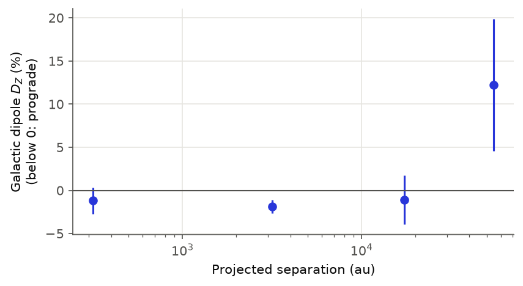
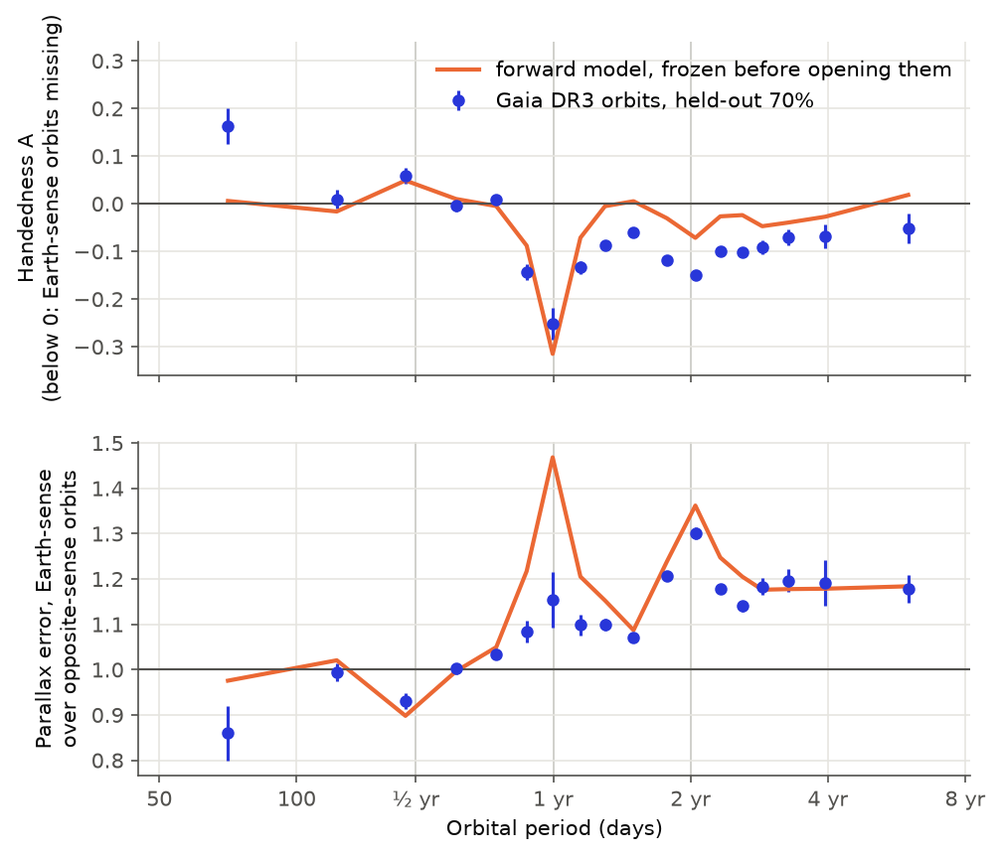
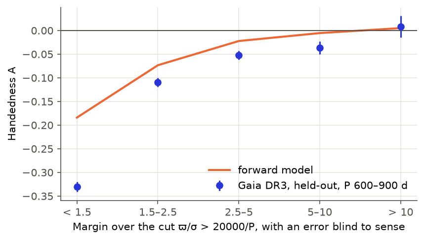
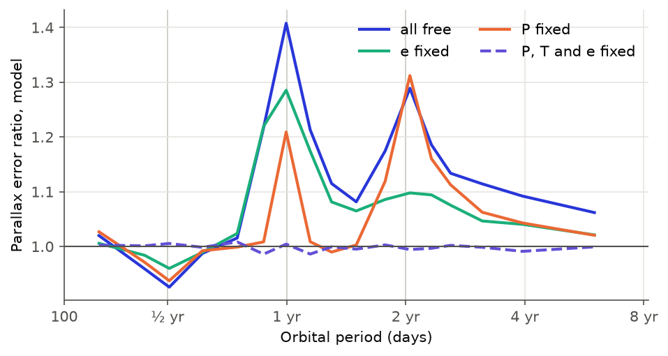

# H-0018: which way do binary stars turn? A discovery dossier

Opened 2026-11-06 from a clean-slate brief: ignore Oddsky's agenda, find a question worth testing, run the experiment.

**Status.** Three results, none of them a discovery of new astrophysics. Refereed and independently reproduced the same day.

1. **Tightest test found of Galactic handedness in binaries:** no detection. Wide pairs give D_Z = −1.56 ± 0.69% (−2.3σ) on
   sealed data, below the 4σ threshold. 95% limit: |⟨L̂_Z⟩| < 1.9%. D = 0 is not rejected (p = 0.115), and dev gives −0.41 ± 1.05%.
2. **Gaia DR3's astrometric orbits have a handedness, and it comes from Gaia, not from the sky.** Orbits turning the way the
   Earth does are missing: 77,470 against 90,595 of the opposite sense (A = −0.0781). At 340–390 d, A = −0.25 on held-out data.
3. **Largely explained below about 1100 d; not above.** Letting P, T and e float in the orbit fit makes parallax errors depend on
   orbital sense, and the parallax cut `ϖ/σ_ϖ > 20000/P` turns that into missing orbits. A model with no fit to orbit data, built
   while dev was in view, matches the pattern on held-out data. Gaia's own solutions with e and T held fixed show the effect
   vanish (post hoc). Applied to the observed margins, the model reproduces 70–77% of the deficit above 300 d (exploratory, by the
   referee), but about 10% above 1100 d, where the cut does not bind and A is still about −0.08.

Butkevich 2018 published the sense dependence of orbit-parallax correlation near one year, for a parallax-only fit. The error
inflation through free P, T and e reported here is a different route. Neither the referee's search nor mine found an earlier
measurement of the sense asymmetry in Gaia data. That is a search result, not proof that nobody has done it.

Files: `PREREGISTRATION.md` (hashes and times in `~/oddsky-runs/h0018/prereg.sha256`), `scripts/`, `work/`, `figures/`,
`predictions/dr4_handedness.md` (draft, not sealed), `reviews/`.

## The unasked question

If you knew nothing of this project and had Gaia, what follows from the plain fact that the Galaxy has a rotation axis? Stars
form from gas shearing about that axis, so ask: *does a binary star know which way the Galaxy turns?*

Five directions were screened, briefly, and only the chosen one was run:

| kind | candidate | why not first |
|---|---|---|
| contradiction | Gaia RVS velocity differences across wide pairs against gravitational redshift | dominated by template mismatch |
| untested consequence | Shklovskii period drift in high-proper-motion eclipsing binaries | swamped by other period changes |
| meaningful absence | periods missing from the orbit catalogue | known, and selection-dominated |
| **new relationship** | **binary orbital angular momentum against the Galactic axis** | **chosen** |
| new measurement | wide pairs as a test of Gaia's magnitude-dependent spin | a calibration, already done with clusters |

These reasons are judgements from the screening; none of the four was tested. The question may have stayed open because it needed
Gaia's numbers and has a simple form that is easy to overlook. Prior tests have 252 and 51 systems (Glebocki 2000; Agati+ 2015). LISA
forecasts carry the dipole around the Galactic axis as an unknown (Seto 2024; Seto & Liu 2026). Makarov 2026 uses projected orbital
momenta of Gaia pairs, assuming isotropy.

## Existing understanding

Molecular clouds show both senses of rotation. Wide binaries near the Jacobi radius should feel tides that remove prograde orbits
faster than retrograde ones. No measurement found constrains a mean angular momentum of binaries at the percent level.

## The new insight

For a Kepler orbit, (r × v)·n = L·n at every phase. So one bit, the sign of rotation on the sky, is a clean measure of the sign of
L along the line of sight, whatever the eccentricity and phase. It is available from both wide-pair proper motions and Thiele-
Innes constants, and any selection even under L → −L cannot fake it. Across the sky, E[y | n] = m + D·n; D is the handedness and
m must be zero.

## The experiment

Unless marked exploratory, tests were fixed in the preregistration or its addendum; departures are listed in its Addendum B. Pairs
and orbits were split 30% dev, 70% held-out by a hash of the Gaia id. The held-out split was opened once, by a frozen script
(`scripts/final.py`, output in `work/final_heldout.txt`), after the second hash at 2026-11-06T06:40:41Z.

Data: El-Badry+ 2021 wide binaries (Zenodo 4435257; 1,817,594 pairs); `gaiadr3.nss_two_body_orbit` joined to `gaia_source`, all
169,227 astrometric orbits, of which 168,065 are `Orbital` or `AstroSpectroSB1`; Gaia commanded scan law (2014-07 to 2017-05).

Reproduce (data paths in `scripts/handedness.py`; downloads are not scripted, see the preregistration for sources):

```
uv run python -I hunts/H-0018/scripts/scanlaw_prep.py
uv run python -I hunts/H-0018/scripts/chiral_sim.py --stars 3000 --draws 100 --out ~/oddsky-runs/h0018/sim_nss.parquet
uv run python -I hunts/H-0018/scripts/chiral_sim.py --parent field --stars 6000 --draws 60 --out ~/oddsky-runs/h0018/sim_field.parquet
uv run python -I hunts/H-0018/scripts/freeze_prediction.py
uv run python -I hunts/H-0018/scripts/controls.py
uv run python -I hunts/H-0018/scripts/final.py --heldout
uv run python -I hunts/H-0018/scripts/post_referee.py
```

### Does the method work? Controls

| control | result |
|---|---|
| Oort test on dev: unrelated field stars must share the Galaxy's vorticity | D_Z = −5.90 ± 0.23% at 220–320 pc, growing with separation. From the slope, after the solar-reflex constant term, **B = −11.2 ± 1.6 km/s/kpc** (referee), against −11.9 (Bovy 2017) and −13.4 (Li+ 2019) |
| Injection on dev | 5% along +Z returned +5.29%, along the ecliptic pole +5.09% (se 1.05%): a linearity check. The registered 0.5% is below dev noise |
| Kepler mock | Referee's, with real pairs, real errors and thermal e: gain D/⟨L̂_Z⟩ of 1.87–1.90, effectively about 1.5–1.75 allowing for pairs that are not Kepler. So the registered (2/3)D is about right. My first mock was not a Kepler mock |
| Shift catalogue | **no power:** only 435 held-out pairs survive the cut, D_Z = +1 ± 15%. Not counted as a pass |
| Sign convention | Sixth Orbit Catalog visual orbits with periods differing from Gaia's by over 1%: **61 of 63 agree** (referee). Gaia BH1 and BH2 also agree (reproducer) |

## The result

### Galactic handedness: an upper limit (registered decision)



Held-out wide pairs, N = 85,663: m = +0.20 ± 0.34%, D_Z = −1.56 ± 0.69% (bootstrap se 0.71%).

| rule | outcome |
|---|---|
| 1. \|D_Z\| > 4σ overall, or p < 0.05/15 in a bin | **fails:** −2.3σ overall; best bin 10³–10⁴ au, −1.87 ± 0.81%, p = 0.021 |
| 2. monopole under 3σ | passes |

Rule 1 failing makes this an upper limit. The other registered conditions no longer decide anything.

| projected separation | N | D_Z (%) | 95% limit on \|⟨L̂_Z⟩\| |
|---|---|---|---|
| all | 85,663 | −1.56 ± 0.69 | 1.9% |
| 10²–10³ au | 14,530 | −1.19 ± 1.50 | 2.8% |
| 10³–10⁴ au | 64,764 | −1.87 ± 0.81 | 2.3% |
| 10⁴–3×10⁴ au | 5,616 | −1.12 ± 2.82 | 4.4% |
| 3×10⁴–10⁵ au | 689 | +12.2 ± 7.6 | 18% |

Pairs wider than 10⁵ au: only 23 survive, so the tidal prediction, which applies near the Jacobi radius, **was not tested**.

*Exploratory.* With dev included: D_Z = −1.22 ± 0.58% (−2.1σ), limit 1.6%. The negative sign would be prograde. The sign of mean y
fits that in five of six latitude bands, but the pattern looks more like a step than sin b, and D_Z does not grow with `|z|/σ`. Plain
shear is far too small (B·s is about 6×10⁻⁴ km/s at 10⁴ au, against pair velocities of order 0.5 km/s). Nothing here is evidence of a signal.

Orbits (T4): D_Z = −0.11 ± 0.83% with a step-function ecliptic term removed, but that term does not remove the pattern: the same fit
leaves D_Y = −5.97 ± 1.03%. With period × |sin β| terms the referee gets −1.2 ± 3.4%, and with period, margin, |sin β| and |b| terms −0.5
± 0.65%. So orbits show no Galactic signal, but they set no clean limit. `AstroSpectroSB1`, whose full 3D L̂ is known, with C and H in
the right units (exploratory; the frozen script had them wrong): held-out ⟨L̂⟩ = (+0.11 ± 0.38, −1.50 ± 0.37, −0.51 ± 0.38)% in
Galactic X, Y, Z. A mean L̂ along the south ecliptic pole with that Y predicts Z ≈ −0.87%, so Z is no evidence for the Galaxy.

### Orbit handedness: found on dev, replicated on held-out



Raw, an alignment study would read this as a 24σ anomaly along the ecliptic pole: D = (−0.25, −11.16, −2.20)% in Galactic coordinates,
20° from the south ecliptic pole and about 79° from the south Galactic pole. A = −0.0730 ± 0.0044 on dev and −0.0803 ± 0.0029 on
held-out. The two ecliptic hemispheres mirror each other. The 20° offset comes from A varying with |b| (19.7° when A(P, |b|) is imposed,
referee), mostly through parallax margin. A residual in Galactic X of −1.9 ± 0.5% remains.

Registered tests on held-out:

| test | requirement | result |
|---|---|---|
| T1 parallax-error ratio by period, against the model | r ≥ 0.8, median \|diff\| ≤ 0.05 | **pass, but weak:** r = 0.809, 0.032. Dev gave 0.792. A plain step at 300 d scores 0.822, so this test cannot discriminate |
| T2 A(P) against the model | ρ ≥ 0.7; A > 0 at 2σ at 150–200 d | **pass:** ρ = 0.864; +0.059 ± 0.016 |
| T3 is the excess fake? P 600–900 d, K_pred > 5 km/s | −NEP over 3σ above fake prediction | **pass:** RV-variable 69.0 ± 1.0% vs 69.2 ± 0.9%; fake prediction 58.8%; +7.6σ. Reaches only 8.8% of the excess, at G up to about 13 |
| T5 fades with margin over the parallax cut | \|A\| at margin ≥ 5 under half of that at < 1.5 | **pass:** 0.025 vs 0.331 |



T1 used either-sense selection in the model, while the data select each sense on its own. Corrected (exploratory, referee), r = 0.934
and the model's one-year ratio is 1.226 against 1.154 ± 0.060 observed; the "1.47" in the figure's frozen curve is mostly that artefact.

In T3 the amplitudes behave alike: RV amplitude / 2K_pred is 1.361 and 1.355 for the two senses. At these bright magnitudes the stars
are RV-variable at the same rate in both senses. This does not confirm individual orbits.

*Exploratory, after opening.* Four further tests of the mechanism (`work/post_referee.txt`, `work/knockout.txt`):

**Gaia's own knockout, found by the referee, is the strongest evidence.** Halbwachs+ 2023 §5.2 fix e and T for solutions with
e < 0.0005 and recompute the covariance. So their published errors contain the experiment. It is post hoc and selected on a fit
outcome, but neither the model nor I used it. `Orbital`, parallax-error ratio:

| period (d) | e < 5×10⁻⁴ (e, T fixed) | 0.006 ≤ e < 0.05 (free) |
|---|---|---|
| 450–600 (control) | 1.079 ± 0.048 | 1.072 ± 0.035 |
| 600–700 | 1.034 ± 0.037 | 1.336 ± 0.053 |
| 700–800 | **1.008 ± 0.041** | **1.652 ± 0.100** |
| 800–900 | 1.020 ± 0.077 | 1.397 ± 0.074 |
| 900–1100 | 0.917 ± 0.072 | 1.256 ± 0.043 |

A follows at 600–900 d: −0.020 ± 0.036 (N = 782) against −0.308 ± 0.026 (N = 1309). The model's knockout predicted the control row.



**The model, element by element.** With all three fixed the ratio is 1, but that is an identity: the linear columns do not contain the
sign. At the **one-year** peak P, T and e all contribute, and P carries the shoulders. The **two-year** peak needs e and T: a second
harmonic of a two-year orbit has a one-year period, with the orbit's sense. This replaces my earlier reading of it as a sidelobe of the
observing window. The **half-year** reversal needs all three in part, and I have no simple account of it. The ratio at 700–800 d falls
with e in the data: 1.518, 1.372, 1.158, 1.106 from e < 0.2 up to e ≥ 0.6; the model gives the same shape with a higher first bin (1.92).

**A real non-linear fit** on simulated epochs (a₀ = 0.8 mas, e = 0.15, G about 14, started at the truth): the *scatter* of fitted parallax
differs by sense, not only the formal error. +NEP over −NEP: 0.92 ± 0.09 at 250 d, 4.2 ± 0.4 at 365 d, 1.27 ± 0.12 at 550 d, 2.26 ± 0.22 at
730 d, 1.01 ± 0.10 at 1500 d (formal-error ratio 1.13). No period search or acceleration step.

**Independent parallaxes.** For 2,713 orbit stars with a clean wide companion, the orbit star's parallax minus the companion's, at 600–900
d: scatter ratio +NEP/−NEP = 1.18 ± 0.14. Consistent with the 1.2–1.3 expected, but also with 1. Underpowered.

**Positive findings.** Sense-dependent parallax errors (ratio 1.30 ± 0.01 at 700–800 d, 1.00 at 200–250 d); a sense deficit tied to Earth's
orbit; the parallax cut as the main channel below about 1000 d; radial velocities showing the excess is not fake for bright stars.

**Negative.** No Galactic handedness above the wide-pair limits. No sign in any proxy that the excess orbits are spurious.

**Inconclusive.** Whether faint orbits (G > 13) near the cut are real. The tide prediction.

**Unexplained.**
- **P > 1100 d:** A ≈ −0.08 where the parallax cut does not bind and A does not fade with margin. Likely a pipeline step the model lacks,
  such as the acceleration-orbit cascade. Untested.
- **450–600 d:** the channel reproduces about half the deficit.
- **The model's own amplitude** is about half at 600–900 d: −0.068 against −0.122 after re-weighting to the data's margins. Residual A −
  A_model for P ≥ 450 d is −0.072.
- **50–100 d:** A = +0.164 ± 0.037 against a model +0.006 ± 0.08. Post hoc zoom: +0.21 at 72–100 d, N = 707. `AstroSpectroSB1` shows it too.
- **Small residuals** at margin 5–10 (−0.037 ± 0.014), and at 600–900 d, e 0.7–0.8, where A is +0.11 ± 0.03.

## Adversarial review

An independent referee (`reviews/claude-referee-2026-11-06.md`) put P(materially wrong) at 10% for the limit, 3% for the handedness being
real and instrumental, and 20% for the explanation. A separate agent with no access to this hunt rewrote the analysis, got the same
numbers and reached the same selection mechanism (`reviews/independent_reproduction/REPORT.md`). It knew the statistic's definitions, and
both agents are the same kind of model as me, so that is a check on arithmetic and reasoning, not independent observational confirmation.

| objection | status |
|---|---|
| A sign convention error | Excluded by outside orbits (61 of 63), the algebra, and the scan-angle convention measured from the scan track |
| A numerical artefact in the model | Derivatives match finite differences to 10⁻⁹, QR agrees, a real fit agrees (referee, me) |
| Fake orbits locked to the scan | No evidence. RV: T3 at low margin 80.3 ± 2.3% vs 80.2 ± 1.8%, full-fake 49%. `AstroSpectroSB1`, RV-confirmed, shows the same deficit (median G 11.6). Proxies don't concentrate A. **Nothing direct above G 13**, and Halbwachs introduced the parallax cut to remove false solutions, so near-cut faint orbits are where fakes would be |
| RV variability only shows a binary, not this orbit | Not resolved. Needs epoch RVs folded on the Gaia orbit |
| Margin is itself sense-dependent | Yes, which is why T5 uses a sense-blind error. With the raw margin the trend reverses. A at low margin vanishes at 200–300 d (−0.001 ± 0.014), so it is not low parallax as such |
| Tuned model | No fit to orbit data, but the linear version failed on dev, and that prompted the non-linear one. Dev and held-out are splits of one catalogue, so replication shows the pattern is not noise, not that the model is predictive in a strong sense |
| Parent population | q uniform, M₁ = 1 M☉. The model has 9.5% of orbits at margin < 1.5 and the data 20.8%. This accounts for its low amplitude, and the observed-margin estimate avoids it, though that estimator cannot exclude a false pile-up at the cut |
| Fisher matrix, not the pipeline | A real fit backs the Fisher errors at five periods. The real cascade has not been run |
| Wide pairs: frame spin | Detected at about 13σ, up to (16.7, 31.2)% for pairs straddling G = 13 (referee). It leaves D_Z unchanged (−1.56 to −1.55): it dilutes the statistic but does not fake a dipole |
| Preregistration has no git commit | True. The hash file is local and the times are this machine's. No commit was made because none was asked for |

## Novelty

ADS title, abstract and full-text searches and citation trees, by me and separately by the referee (about 45 queries), with web searches
and full-text reads of eight Gaia papers (`reviews/prior_art_note.md`).

- **Closest:** Butkevich 2018 (MNRAS 476, 5658): "the host star and Earth revolve in the same direction, if iE < π/2"; "for iE > 90° the
  correlation decreases since the star and Earth revolve in opposite directions." Its statistic is a parallax-only fit, closer to this
  model's RUWE channel than to the free-element route. Its abstract finds no effect on detectability for e ≳ 0.5, whereas the data at
  340–390 d give A = −0.15 at e ≥ 0.6 (referee). Penoyre+ 2022 mention orbits that mimic the parallax ellipse. Halbwachs+ 2023, Arenou+ 2023 and
  El-Badry+ 2024 note the one-year degeneracy, without sense. Signed cos i appears all-sky only.
- **Not found:** a measurement of A in Gaia data; sense-dependent published parallax errors; the two-year feature's link to e and T; the
  pseudo-circular step; the parallax cut as the channel; a direct percent-level Galactic dipole.
- **Not read:** Perryman 2026 (Phys. Rep. 1150) and Lammers+ 2026 matched queries and should be read. Hipparcos papers. Yahalomi+ 2026:
  abstract only.
- `gaiamock` (El-Badry+ 2024) keeps the sense and should reproduce this if split by hemisphere; nobody is known to have done that.

So the new contribution, if it stands, is a measurement and a diagnosis. A specialist may recognise much of it at once.

## Scientific implication

If it survives:

- Any Galaxy-alignment study using Gaia orbits must remove this: the raw dipole is about 10% and would read as a huge signal. That includes
  the Galaxy-binary dipole for which the LISA papers need a prior.
- DR3 completeness depends on orbital sense, by a measured amount. Analyses of |cos i| alone are unaffected; anything using the sign, or
  counting orbits near one or two years at low parallax margin, inherits it.
- At 600–900 d, orbits with margin ≥ 5 are nearly free of it (A = −0.025 on held-out). That does not hold at 300–450 d (about −0.1) or above
  1100 d (−0.09).
- Parallax errors of orbit solutions at these periods depend on sense, by up to about 30% overall and more at low e or high |β| (up to 65%).
- Companion searches in DR4 near one and two years, which include many planet candidates, should expect sense-dependent reach.

## Next decisive experiment

1. **Gaia DR4, 2026-12-02 (26 days away).** The draft forecast predicts the shoulders and long-period ratio collapse with the longer baseline,
   while the two-year peak stays and still vanishes with e and T fixed. It needs a final read, then a merge to seal.
   DR4's `epoch_astrometry` then gives the real scan law including reversed precession, so the model can be rerun on it.
2. **Faint RV.** LAMOST, APOGEE or GALAH epochs for G > 13, P 600–900 d, margin < 1.5, by sense, folded on the Gaia orbit. The one direct test left
   of the spurious reading.
3. **`gaiamock` by sense, with the cascade.** For the amplitude, the pseudo-circular step and the P > 1100 d residual.
4. **DR4 wide pairs,** with a spin term in the fit. Proper-motion errors should shrink by about 2.7 (T^1.5, my scaling, not a published figure).
   The Galactic limit should tighten to well under 1%.

## Reusable method

- `scripts/handedness.py`: the sense statistic, the dipole fit, and the split.
- `scripts/chiral_sim.py`: mirror-pair forward model using the real scan law, for any cut on any astrometric-orbit catalogue.
- A systematics meter for any catalogue of astrometric orbits: real orbits have no reason to prefer Earth's sense, so A should be 0.
- The pseudo-circular comparison, as a built-in control for sense effects in future Gaia releases.
- The Oort recovery, as a test that a pair statistic can detect a known 1–5% rotation.

## Limits of this session

No commit, push, site change or ledger entry. `oddsky paper-check` has not been run on this text; it is owed before anything here leaves the
repo, and this dossier is not ready to leave. The referee reviewed an earlier version; the corrections above follow its report but it has not
re-read them. Downloaded data and simulation outputs are in `~/oddsky-runs/h0018`, not the repo. The referee's scripts are in
`reviews/referee_scripts/` as run; they expect a copy of the hunt's scripts at `/tmp/ref_h18/repl/`.
