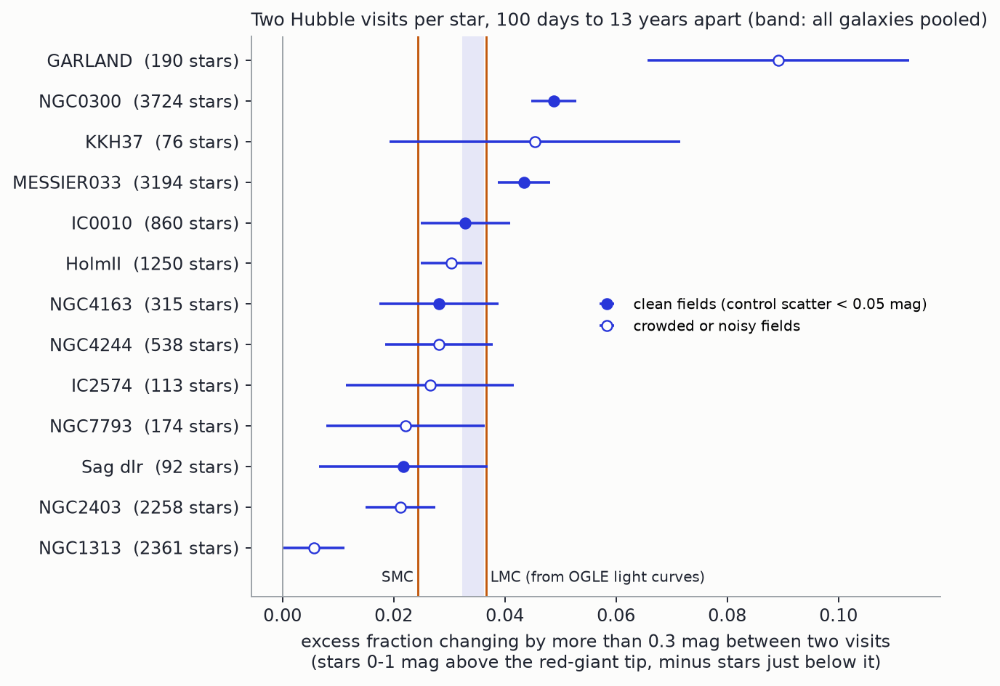
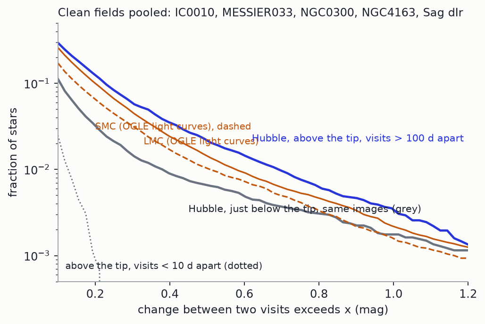
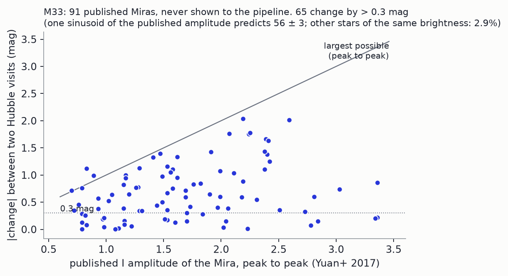

# H-0019: two points per star

Opened 2026-11-09, the day the advisor said two things on a call: that Hubble's automatic multi-visit photometry
catalogues are "tragically underused", and that most AGB stars in other galaxies have "two data points for each of them, and
that's not enough to say much about them". This hunt takes the second sentence as a question about populations instead of
stars, and uses the first as the data.

**Status.** A measurement and a tool, not a discovery. Preregistered (`PREREGISTRATION.md`, committed as `3cc2f73` before any
long-lag pair above the tip was computed). An independent referee (`reviews/claude-referee-2026-11-09.md`) reproduced the
pooled measurement exactly, found the first M33 test invalid (a 0.48" offset between catalogues; fixed below), and showed
that the comparisons between galaxies and with the Magellanic Clouds do not yet support any statement about galaxies. This
page is the version after that report and after the experiment it asked for (the reference rebuilt from real OGLE light
curves, 2026-11-09, section 3), which has not itself been refereed. Nothing here has been sent anywhere.

## Abstract

Stars Hubble visited only a few times are left out of the Hubble Catalog of Variables, which needs five visits. For 13
galaxies within 4.5 Mpc I take the red stars with a measured colour, 0 to 1 mag above the red-giant tip, that have two
clean ACS/WFC F814W visits at least 100 days apart in the Hubble Source Catalog (15,145 stars; 72% have exactly two clean
visits), and count how many changed by more than 0.3 mag, minus the same count for stars just below the tip in the same
images. The excess is 3.4 ± 0.2% (17.5σ). Published Miras in M33, never shown to the pipeline, are recovered: 65 of 91
change by more than 0.3 mag, against 2.9% of other stars of the same brightness. The same statistic computed from real
OGLE-III light curves of the LMC is 3.6 ± 0.2%, and of the SMC 2.4%: the Hubble galaxies pooled look like the LMC. (My
first reference, sums of sinusoids, gave 2.7% and 1.4% and was too low; an apparent excess in M33 and NGC 300 came from
it.) The preregistered prediction that luminous galaxies would score higher than faint ones failed (3.41 ± 0.22% against
3.38 ± 0.40%). Its premise, the SMC scoring below the LMC, is mostly where a fixed colour cut falls on a bluer giant
branch: at matched colour the two Clouds agree. Galaxies differ (χ² = 55.9 for 12 degrees of freedom), with crowded discs
reading low. No dependence on metallicity is shown, and none is excluded.

## Figures

**Figure 1.** The preregistered statistic for each galaxy. Filled points are fields where stars just below the tip repeat
to better than 0.05 mag between the two visits (a cut chosen after seeing the data). The LMC and SMC lines are the
statistic computed from real OGLE light curves; the SMC line is depressed by its colour mix (section 4).

**Figure 2.** Fraction of stars whose two visits differ by more than x, in the five clean fields. Dotted: the same stars
above the tip when the two visits are under 10 days apart, which is the noise. Orange: stars above the tip in the Clouds,
from pairs of real OGLE observations 1,000 days apart.

**Figure 3.** The rediscovery test. Each point is a Mira from Yuan et al. 2017 with two Hubble visits, matched within 0.15"
after removing the 0.48" offset between the two catalogues.

## 1. Introduction

**The question.** Among stars brighter than the red-giant tip, is the fraction that changes by more than 0.3 mag between
two visits the same in every galaxy?

Stars on the asymptotic giant branch pulsate, and the pulsation lifts the gas from which they make dust. Whether pulsation
depends on a galaxy's metallicity matters for how much dust metal-poor galaxies make and for using Miras as distance
indicators. The usual way to find out is to monitor a galaxy for years. Hubble has not done that for most galaxies, but it
has come back to many of them once or twice.

**Why it may not have been asked this way.** The catalogue that should hold the answer (HCV, Bonanos+2019) needs five
visits. Two visits are too few to classify a star, so they are dropped. A population does not need each star classified.

**What was known.** An independent literature read is in `reviews/literature-2026-11-09.md`. The two-visit Hubble idea is
Caldwell et al. 1998 (two M81 dwarfs). DUSTiNGS did it in the infrared for 50 dwarfs (Boyer+2015), and Goldman et al. 2019
found no discernible difference in pulsation from the Magellanic Clouds down to [Fe/H] = −1.85. Schultheis, Glass & Cioni
2004 state that the proportion of variables falls at lower metallicity, without numbers. The read found no uniform fraction
above the tip across many galaxies, no use of the stars below HCV's five-visit cut, and no OGLE-based forward model as the
reference. That is a search result, not proof that nobody has done it.

**Directions screened first** (judgements, none of the others was run):

| kind | candidate | why not first |
|---|---|---|
| contradiction | HSC aperture magnitudes against published PSF photometry of the same stars | a calibration; Whitmore+2016 did it |
| untested consequence | nebulae and light echoes that move between Hubble visits (the advisor's suggestion) | needs image differencing on drizzled frames; a separate tool |
| meaningful absence | stars present in a first visit and gone in the last | Oddsky's H-0011 and H-0012 covered this ground |
| **new relationship** | **two-visit variability of AGB populations against the host galaxy** | **chosen** |
| new measurement | empirical completeness from constant stars in place of artificial-star tests | became the control used here |

## 2. Data

- **Galaxies.** All 262 in Karachentsev et al. 2013 within 4.5 Mpc were probed (`scripts/01_probe.py`). 46 had at least 300
  stars with repeat ACS/WFC F814W measurements in a single cone; 10 large ones were fetched as 0.05° tiles out to 0.2°
  (`03b_fetch_tiled.py`, added after the preregistration and after the first ten galaxies' results, before the tiled
  galaxies' own). M33, NGC 300 and NGC 7793 entered this way: 46% of the stars. M31 was skipped and M81 not finished (its
  core is too slow to download and too crowded for aperture photometry).
- **Photometry.** Hubble Source Catalog v3, `MagAper2` (AB, 0.15" aperture), through `oddsky.data.hsc`. The catalogue stops
  around 2017. Detections kept: `Flags = 0`, concentration index 0.85 to 1.30, one detection of the star per image.
- **Tip.** Each galaxy's own: the Sobel edge of the red-star luminosity function when significant, else the prediction from
  the catalogue distance. They agree within 0.1 mag in 9 of 13 galaxies; M33 is off by 0.23 and IC 10 by 0.48, at the
  edge of the search window. Stars with no second filter have no colour and are dropped (29% of the stars above the tip
  in NGC 300, 39% in NGC 1313, 2% in M33).
- **Pairs.** One long pair per star (first and last detection, at least 100 d apart) and, where it exists, one short pair
  (under 10 d). The median difference of each image pair is removed.
- **Reference.** OGLE-III long-period variables in central boxes of the LMC and SMC (Soszyński+2009, 2011), with Gaia DR3
  proper-motion members as the denominator, sampled at two random times as sums of up to three sinusoids, with the same
  boxes and the same control subtracted (`02_lmc_model.py`, `05_compare.py`). This is the preregistered reference. It
  turned out a third too low, and section 3 replaces it with pairs of real OGLE observations. The Gaia boxes: RA 76 to 84, Dec −70.2 to
  −69.2, RP < 15.3, BP−RP > 1.4 (LMC); RA 9 to 17, Dec −73.5 to −72.2, RP < 15.8, BP−RP > 1.3 (SMC).

13 galaxies have at least 50 long pairs above the tip and 50 in the control. Per-galaxy numbers: `work/galaxies.csv`.

## 3. Results

Preregistered tests (`work/tests.json`):

| test | result | verdict |
|---|---|---|
| T1 the tool works | E₀.₃ = 0.0343 ± 0.0020, 17.5σ | pass |
| T2 noise | short pairs above the tip: 0.36% exceed 0.3 mag (limit 0.5%); blue stars at long lag: 1.49%, 75 of 5,037 (limit 1.5%) | pass, the second by one star |
| T3 lag control | E₀.₃ from short pairs = 0.0017 ± 0.0007, 2.3σ from zero | **fail** |
| T4 universality | pooled value inside 0.007 to 0.042 | pass |
| T5 luminous half scores higher | 0.0341 ± 0.0022 against 0.0338 ± 0.0040; Spearman ρ = −0.50, p = 0.08 | **fail** |

T2 and T3 changed sides as galaxies were added (with the first ten, T2 failed at 0.56% and T3 passed; no file records
that run). The sample grew while the tests were being watched, and where to stop was not preregistered. Both tests hinge
on three crowded discs: of the 33 short-pair outliers, 22 are in NGC 4449, 7 in NGC 253, 3 in NGC 2403. In M33, 0 of 3,195
stars above the tip change by 0.3 mag between visits under 10 days apart; in 21 uncrowded dwarfs, 0 of 625.

**Rediscovery (exploratory, `09_rediscover.py`, corrected after the referee).** Hubble positions are offset from Yuan et
al. 2017 by (−0.45", −0.14"). With that removed and a 0.15" radius, 91 Miras have a clean long pair; shifted positions
give 2.6 chance matches. 65 change by more than 0.3 mag, 51 by more than 0.5, 22 by more than 1.0; other stars of the same
brightness: 2.9%, 1.0%, 0.3%. 49 dimmed, 42 brightened. One sinusoid of the published amplitude at random phase predicts
55 ± 3, 41 ± 3 and 19 ± 3: real Miras change more often than the sinusoid says, by 2.4 to 2.9σ. (My first version matched at
0.5" without the offset and was about 30% chance matches; its numbers are withdrawn.)

**Exploratory, all labelled so** (`work/explore.json`, `work/lag_within.csv`, `work/hcv_check.csv`, `work/cloud_colour.csv`,
and the referee's report):

- Galaxies are not all alike: χ² = 55.9 for 12 degrees of freedom. The five fields with control scatter under 0.05 mag (a
  cut chosen after the data: M33 at 0.048 is in, KKH 37 at 0.052 is out) are consistent with one value (χ² = 7.5 for 4;
  mean 0.043).
- **The reference from real light curves** (`13_ogle_real.py`, `14_reference_real.py`, run after the referee, not yet
  refereed). Pairs of actual OGLE-III I-band observations 150 to 2,500 days apart, for all 22,564 LMC and 9,092 SMC
  variables in the boxes, constants as before, noise matched to the clean Hubble fields (0.043 mag): LMC 0.0366, SMC
  0.0244, the same at every lag to 0.002. The sinusoid version gave 0.0272 and 0.0138. With V−I > 1.6 the LMC gives 0.042.
- Against that reference (error 0.002 from the referee's bootstrap): all galaxies pooled, 0.0343 ± 0.0020, is 0.8σ below
  the LMC. M33 (4.4 ± 0.5%) is 1.3σ above and NGC 300 (4.9 ± 0.4%) 2.6σ above; NGC 300's excess is in its centre (7.4 ±
  0.9% inside 1.37', 4.0 ± 0.4% outside, referee D3). The five clean fields average 0.043 ± 0.003, between the LMC's
  value for all red stars and for its redder ones.
- With lag: inside NGC 300 the excess is 0.049, 0.050, 0.053 from 400 to 6,000 days, and 0.108 ± 0.024 in one image pair
  at 10 to 100 days. Pooled over galaxies it rises from 0.017 (100 to 300 d) to 0.048 (1,000 to 2,000 d), but different
  galaxies fill different bins.
- Three dwarfs (IC 10, NGC 4163, Sagittarius dIrr) pooled: 0.032 ± 0.006. IC 10 is 68% of that pool and its value runs
  from 0.005 to 0.033 depending on where its tip is put. Without IC 10: 0.026 ± 0.009.
- Moving the tip by ±0.1 mag changes the pooled value by less than 0.002; dropping the bluest third of the red stars raises
  it to 0.039. Boxing on one visit's magnitude instead of the mean changes the five clean fields from 0.044 to 0.041.
- The Hubble Catalog of Variables mostly misses this sampling. IC 10 has one visit in 2002 and four in five days in 2005.
  Of 33 stars that changed by more than 0.3 mag across the gap and that HCV examined, HCV flags 4 (none of the 19 in the
  0-to-1-mag box): a median absolute deviation over five points ignores one that differs.
- 282 individual stars above the tip changed by more than 0.5 mag and more than five times the local scatter
  (`work/candidates.csv`; 138 dimmed, 144 brightened). They are candidates. None has been checked with the Librarian.

## 4. Analysis: why none of this is yet about galaxies

- **The SMC's lower value is mostly colour mix.** From real light curves the raw fraction above the tip changing by
  more than 0.3 mag is 4.4% (LMC) and 3.0% (SMC) for V−I > 1.2, and 5.1% in both for V−I > 1.6. Stars with V−I between
  1.2 and 1.6 rarely vary that much; they are 13% of the LMC box and 40% of the SMC box. The T5 prediction was built on
  this.
- **The first reference was wrong by a third.** Sinusoids of the catalogued amplitudes understate real stars: 0.027
  against 0.036 from the light curves themselves. The M33 Miras showed the same thing. Any forecast for a few-visit
  survey should draw from real light curves.
- **Colour mix inside the Hubble box.** The bluest third of the red stars scores 0.016 in M33 and 0.010 in NGC 300; the
  reddest third changes 8% of the time. The statistic follows the colour mix as strongly as it differs between galaxies,
  and the colour mix follows age and metallicity both.
- **The control is partly signal.** Stars just below the tip change by more than 0.3 mag 1.5% of the time at long lag in
  the clean fields (0.19% at short lag over all fields). In M33 the reddest third of the control box scores 5.0%: red
  variables below the placed tip. The subtraction removes real signal, by an amount that depends on the galaxy.
- **Crowding.** Aperture photometry blends neighbours, which shrinks changes. The noisy fields read low. Luminous
  galaxies are the crowded, distant ones, so T5 cannot say "no metallicity effect" either.
- **Tips.** IC 10's is not well placed, and it carries the dwarf pool.
- **No metallicities.** None is in the analysis; luminosity stood in for it, and Garland is tidal debris of NGC 3077.
- **Errors are binomial only.** NGC 300's nine image pairs scatter more than that (χ² = 16.7 for 8).

What the referee tried and could not break: mismatched stars between visits, close neighbours, and selection on the
two-visit mean. The referee put about 80% on the differences between galaxies and Clouds being mundane.

## 5. Conclusions

1. Two archival Hubble visits detect the variability of a galaxy's AGB population, at 17.5σ pooled, and recover published
   Miras blind. In clean fields no star above the tip changes by 0.3 mag in under 10 days, so the changes are not
   photometric noise.
2. Among red stars up to 1 mag above the tip, 2 to 5% change by more than 0.3 mag between two visits, after subtracting
   the stars just below it. Pooled, the 13 galaxies give 3.4 ± 0.2%; the LMC, measured the same way from OGLE light
   curves, gives 3.6 ± 0.2%.
3. The preregistered trend with luminosity is not seen. The SMC-to-LMC difference that motivated it is mostly a
   colour-cut effect. Nothing here confirms or contradicts Goldman et al. 2019.
4. The apparent excess of M33 and NGC 300 over the LMC came from a reference that was too low. With the real one, M33 is
   consistent and NGC 300 is 2.6σ high, driven by its central field.

**The next decisive experiment.** The one the referee asked for is done (section 3) and removed the anomaly. What would
now turn this into a measurement of how pulsation depends on the galaxy: box the Clouds and each Hubble field by the same
intrinsic colour (which needs a transformation between V−I and each Hubble colour, and measured metallicities), and use
PSF photometry (DOLPHOT catalogues exist for most of these fields) so that crowded discs can be compared with dwarfs.

**What is reusable.** `oddsky.data.hsc` (the Hubble Source Catalog, visit by visit), `oddsky.analysis.twopoint` (pairs,
zero points, the excess statistic, the two-visit simulator; `tests/test_twopoint.py`), the Cloud reference populations, and
a forecast method for any telescope that will visit nearby galaxies a few times, which is what Roman will do. Owed to the
tools (referee): positional matches should fit and remove a bulk offset and report a shifted-position chance rate;
`tip_edge` should flag an edge in the outermost bin of its window; the reference builder needs a bootstrap error and a
colour-matched option.

## What the advisor said, and what was done with it

| on the call | here |
|---|---|
| Hubble's automatic photometric catalogues on MAST: "no one does anything with that data" | the data source; a client for it is now in the package |
| "there's like, you know, 2 data points for each of them" | the question |
| artificial-star tests "every time manually" | not replaced. For variability, the same stars seen days apart give the noise directly (0 of 3,195 in M33) |
| abstract, introduction, data, results, analysis, conclusion; "I look at the figures first" | this page's order |
| VizieR for more data | OGLE, Yuan+2017 and the galaxy catalogue all came through its CfA mirror |
| moving nebulae; asteroids in mixed data; all AGB data in one place with its quality | not done; first two are in the screening table |

## Files

`PREREGISTRATION.md` (with an addendum of departures); `scripts/01`–`14` in run order; `work/` (probe, measure, tests, reference, pairs per galaxy,
candidates); `figures/`; `reviews/`. Raw catalogue downloads are in `~/oddsky-runs/h0019` (394 MB), not in the repo.
